<p align="center">
  
</p>

<h1 align="center">GdAHome</h1>

<p align="center">
  <b>La tua casa Home Assistant in una plancia sola: sul telefono, sul tablet, al polso e in auto.</b><br>
  Luci, clima, tapparelle, antifurto, telecamere, energia e persone, stanza per stanza.<br>
  Anche da fuori casa, senza aprire porte sul router.
</p>

<p align="center">
  
  
  
  
</p>

<p align="center">
  <a href="#installazione-in-home-assistant"><b>Installa</b></a>
  &nbsp;·&nbsp;
  <a href="docs/MANUALE.md"><b>Manuale d'uso</b></a>
  &nbsp;·&nbsp;
  <a href="https://gdahome.org"><b>Il sito</b></a>
  &nbsp;·&nbsp;
  <a href="#domande-frequenti"><b>Domande</b></a>
  &nbsp;·&nbsp;
  <a href="#in-english"><b>English</b></a>
</p>

<p align="center">
  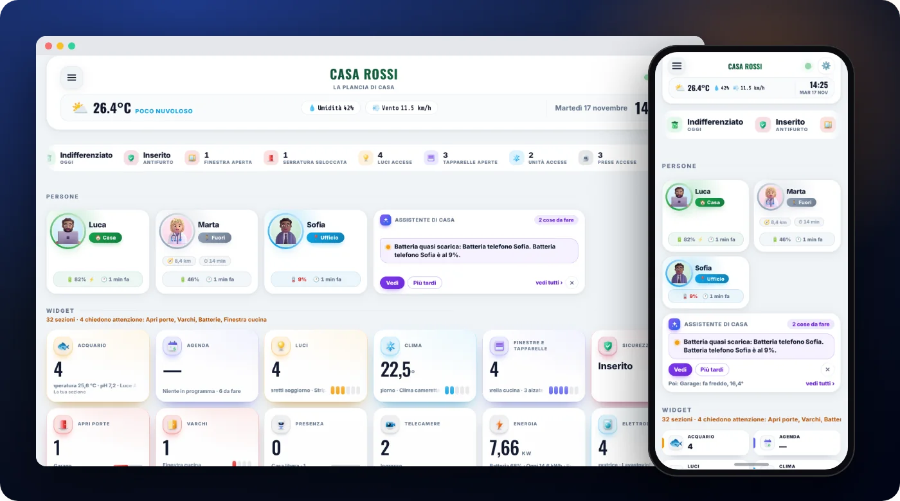
</p>
<p align="center"><sub>La plancia vera, con una casa d'esempio («Casa Rossi»): sul computer e sul telefono è la stessa.</sub></p>

---

## Cosa fa

<table>
<tr>
<td width="50%" valign="top">

🏠 **Una plancia per tutta la casa**<br>
Quello che in Home Assistant sta in dieci pagine, qui sta in una: una trentina di sezioni, divise per stanza.

</td>
<td width="50%" valign="top">

📱 **Un'app per telefono e tablet**<br>
Android, iPhone e iPad, e anche dal browser. Si collega **inquadrando un QR code**: nessuna password da scrivere.

</td>
</tr>
<tr>
<td width="50%" valign="top">

🚗 **Un navigatore con la casa dentro**<br>
GdANav, con **Android Auto** e **CarPlay**: il cancello, la musica e gli avvisi di casa sullo schermo dell'auto.

</td>
<td width="50%" valign="top">

⚡ **Energia a colpo d'occhio**<br>
Sole, rete, batteria, auto e carichi in un unico flusso, con quello che non è misurato.

</td>
</tr>
<tr>
<td width="50%" valign="top">

🧊 **Casa 3D**<br>
La tua casa in tre dimensioni, dalla planimetria: tocchi una luce nel modello e si accende.

</td>
<td width="50%" valign="top">

🔔 **Notifiche e assistente di casa**<br>
La casa ti scrive quando serve e ti propone cosa fare: «C'è sole: avvio la lavatrice?».

</td>
</tr>
<tr>
<td width="50%" valign="top">

🌍 **Da fuori casa**<br>
Senza VPN, senza porte aperte sul router, cifrato da un capo all'altro.

</td>
<td width="50%" valign="top">

🖼️ **Il tablet a muro**<br>
Un tablet in corridoio o un NSPanel diventano un pannello con comandi grandi.

</td>
</tr>
<tr>
<td width="50%" valign="top">

⌚ **Al polso**<br>
Apple Watch e Wear OS: i comandi rapidi, com'è la casa, la prossima svolta del navigatore.

</td>
<td width="50%" valign="top">

🔒 **I dati restano in casa**<br>
Nessun account, nessuna pubblicità: il segreto di Home Assistant non lascia mai l'add-on.

</td>
</tr>
</table>

GdAHome sono **due pezzi che lavorano insieme**: l'**add-on**, che si installa
in Home Assistant come ogni altro add-on, e l'**app**. L'add-on porta la
plancia, abbina i telefoni e tiene il segreto di Home Assistant: quello non
esce mai di casa e sul telefono non ci finisce.

## La plancia

In alto il meteo, l'ora, l'antifurto e chi è in casa; sotto le sezioni —
**luci, clima, tapparelle, telecamere, energia, persone** e tutte le altre — e
ogni sezione divisa per stanza. Si tocca una luce e si accende, si trascina il
cursore e cambia la luminosità. La plancia si apre anche **dentro Home
Assistant**, dalla barra laterale, da qualunque browser di casa.

<p align="center">
  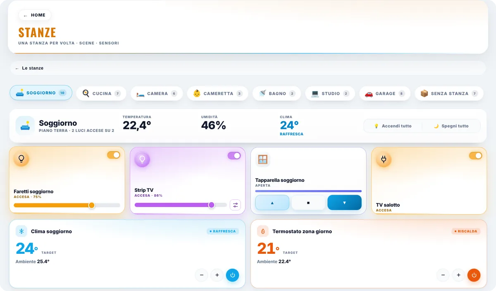
</p>
<p align="center"><sub>Una stanza: tutto quello che c'è nel soggiorno, con i suoi comandi.</sub></p>

<table>
<tr>
<td width="33%" align="center" valign="top">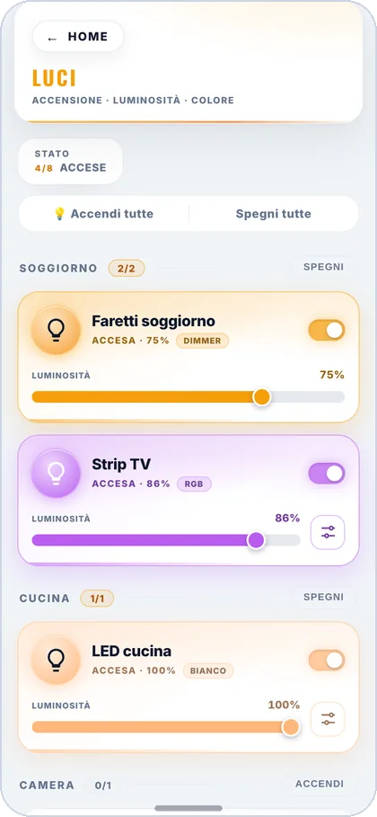<br><sub>Le luci, stanza per stanza</sub></td>
<td width="33%" align="center" valign="top">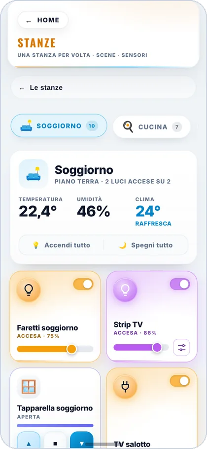<br><sub>Una stanza, sul telefono</sub></td>
<td width="33%" align="center" valign="top">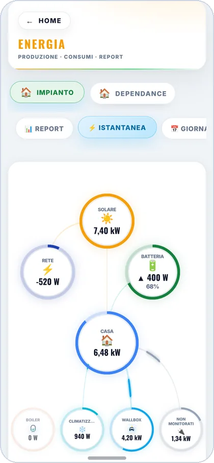<br><sub>L'energia, dal vivo</sub></td>
</tr>
</table>

<p align="center">
  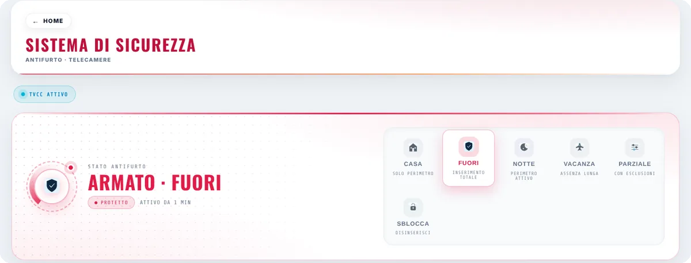
</p>
<p align="center"><sub>L'antifurto: i modi (Casa, Fuori, Notte, Vacanza…) a un tocco, con le telecamere e i sensori di fumo e gas sotto.</sub></p>

<details>
<summary><b>Tutte le sezioni della plancia</b></summary>

<br>

| Sezione | Cosa contiene |
| --- | --- |
| 🏠 Home | Il riepilogo della casa, le persone, l'assistente e i riquadri |
| ⚡ Energia | Fotovoltaico, rete, accumulo, consumi, tariffe, report |
| 🚗 Auto | Auto elettrica, colonnina, ricarica di notte |
| 🧭 GdANav | I viaggi pianificati, che ritrovi nel navigatore |
| 🛡️ Sicurezza | Antifurto, telecamere, sensori di fumo e gas |
| ❄️ Clima · 🌡️ Temperatura · 🌞 Gestione termica | Termostati, condizionatori, VMC, solare termico, caldaia |
| 🪟 Finestre | Tapparelle e finestre |
| 💡 Luci · 🔌 Prese · 🛋️ Stanze | |
| 🧺 Elettrodomestici | Lavatrice, lavastoviglie e gli altri, con cicli e costi |
| 🎵 Musica | Lettori, radio, Alexa |
| ❤️ Salute | Le misure dell'orologio |
| 🌦️ Meteo · ⛈️ Allerte · 📅 Agenda · 🗑️ Rifiuti | |
| 🚪 Varchi · 🏃 Presenza · 🔓 Apri porte · 📮 Citofono | Porte e finestre aperte, movimento, cancelli con PIN, campanello |
| 🏊 Piscina · 💧 Irrigazione · 🪴 Piante · 🐾 Animali · 🤖 Robot | |
| 🔋 Batterie · 🔌 UPS · 🖨️ Stampanti · 💧 Acqua e gas · 🖥️ Server e rete | |
| ⚽ Sport | Squadra del cuore, Formula 1, MotoGP |
| ⭐ Le tue sezioni | Quelle che crei tu |

Le sezioni si accendono e si spengono dalla configurazione, anche dal
telefono; una sezione senza niente dentro non compare.

</details>

### Il tablet a muro

Un tablet fisso in corridoio o un **Sonoff NSPanel** diventano un pannello con
**comandi grandi** e poche pagine scelte da te: una stanza, le scene, l'ingresso
con il cancello e la telecamera, l'energia, la musica, il meteo. Quando nessuno
lo tocca resta l'orologio; di notte lo schermo si spegne.

<p align="center">
  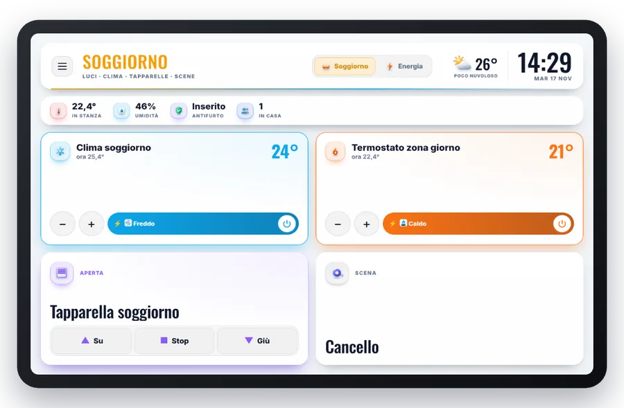
</p>

## L'app sul telefono e sugli orologi

L'app è per **Android**, **iPhone** e **iPad**, e c'è anche
[nel browser](https://webapp.gdahome.org). Dentro c'è la plancia, e intorno
quello che serve per tenere la casa: le notifiche, la pagina «La tua
giornata», i dispositivi, le automazioni, Zigbee, gli aggiornamenti di Home
Assistant e le segnalazioni. Si apre con l'impronta o col volto.

<table>
<tr>
<td width="25%" align="center" valign="top"><br><sub>L'avvio</sub></td>
<td width="25%" align="center" valign="top">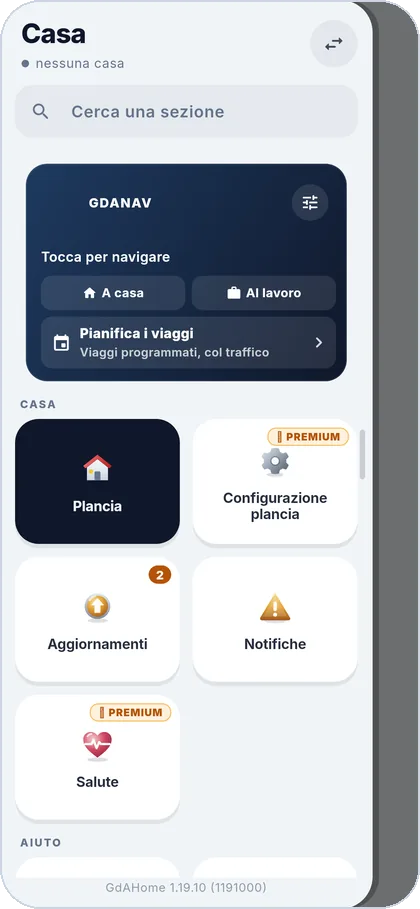<br><sub>Il menu</sub></td>
<td width="25%" align="center" valign="top">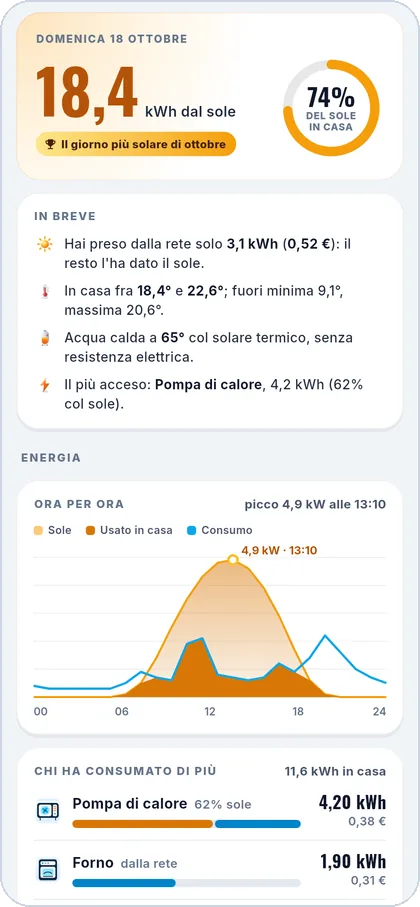<br><sub>«La tua giornata»</sub></td>
<td width="25%" align="center" valign="top">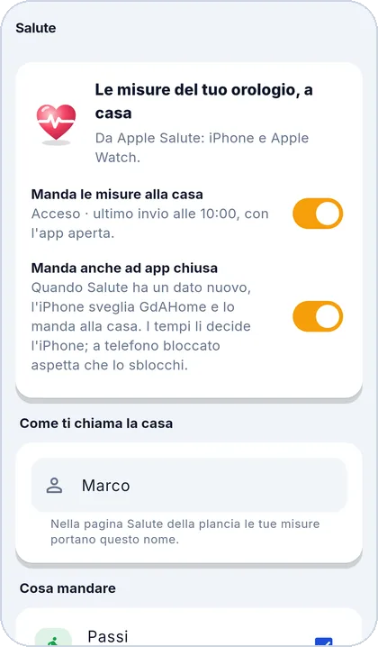<br><sub>La Salute dall'orologio</sub></td>
</tr>
</table>

**⌚ Al polso.** Su **Apple Watch** e **Wear OS** ci sono i comandi rapidi, i
dispositivi, le azioni della plancia, «Come sta la casa» e il navigatore:
«Portami a casa» e, durante la guida, la freccia con la distanza.
L'orologio non ha impostazioni sue: usa gli stessi tasti scelti per l'auto.

**❤️ La Salute.** Le misure dell'orologio — da Apple Salute o da Health
Connect (Galaxy Watch, Pixel Watch, Fitbit, Amazfit…) — arrivano alla casa e
si vedono nella sezione Salute della plancia, per tutta la famiglia.

## Il navigatore: GdANav, con Android Auto e CarPlay

Nell'app c'è **GdANav**, un navigatore pensato per l'auto elettrica che va
bene anche a benzina o a gasolio:

- percorso con **guida vocale** e lo svincolo ingrandito agli incroci;
- **distributori** con i prezzi del giorno;
- **traffico, autovelox e meteo** lungo la strada, e le segnalazioni di chi
  guida;
- con l'auto elettrica, **la batteria letta dall'auto** e **le soste alle
  colonnine**, col loro stato in tempo reale;
- i **viaggi pianificati** dal telefono o dal computer, con l'avviso prima di
  partire.

Mentre guidi **la casa ti avvisa** — la lavatrice che ha finito, l'auto
carica — e ti chiede conferma prima di fare cose importanti, come
disinserire l'antifurto.

<p align="center">
  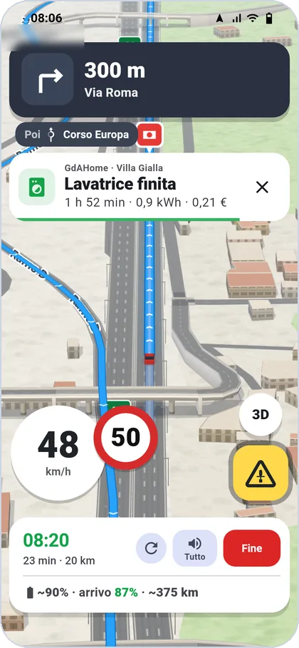
  &nbsp;
  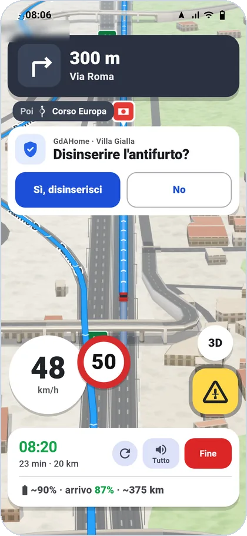
  &nbsp;
  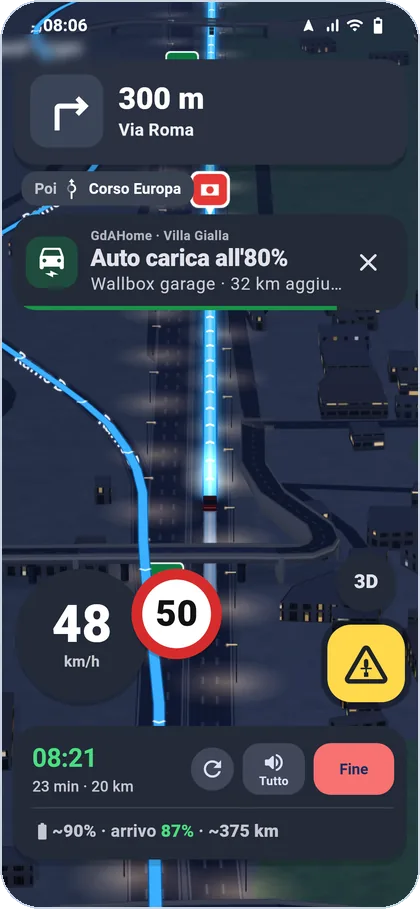
</p>

GdANav si usa **dentro l'app GdAHome**: è in alto nel menu, e non va
scaricato a parte.

Sullo schermo dell'auto, con **Android Auto** e **CarPlay**, la casa è a un
tasto: il cancello e il portone, «Quasi a casa» quando arrivi, gli avvisi di
casa con il loro tasto, e la musica di casa.

<p align="center">
  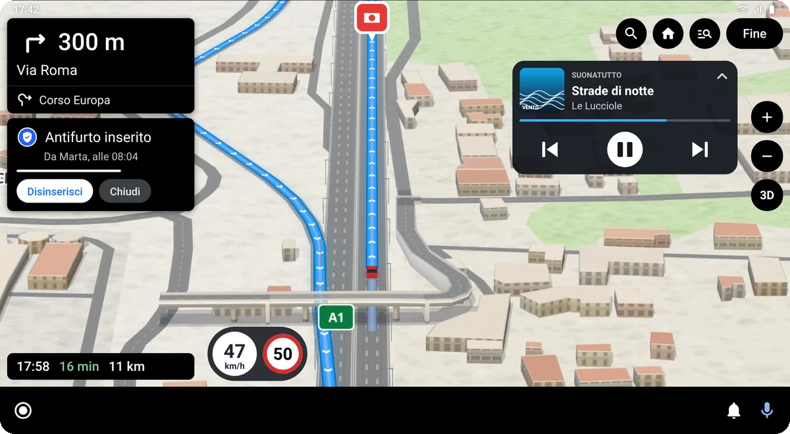
</p>
<p align="center">
  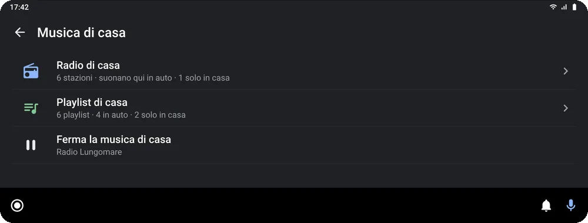
</p>
<p align="center"><sub>Android Auto: un avviso di casa durante la guida, e la musica di casa.</sub></p>

## Casa 3D

La tua casa **in tre dimensioni**, creata dalla planimetria con una procedura
guidata e poi arredata. Dentro ci sono i dispositivi veri: le luci accese si
illuminano, le finestre aperte si vedono, il movimento si accende dove
succede, e un tocco comanda la casa. Di sera la casa si fa buia e restano
accese le luci che sono accese davvero.

<p align="center">
  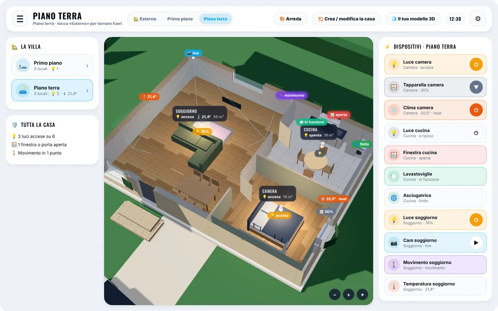
</p>

<table>
<tr>
<td width="50%" align="center" valign="top">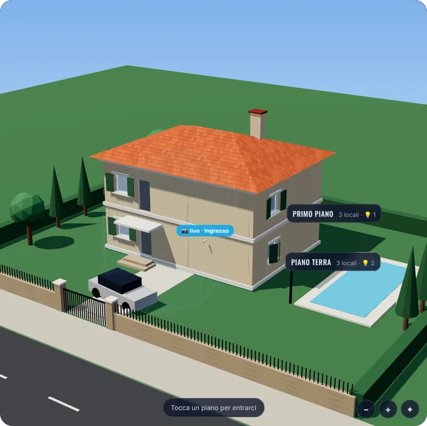<br><sub>Fuori, di giorno</sub></td>
<td width="50%" align="center" valign="top">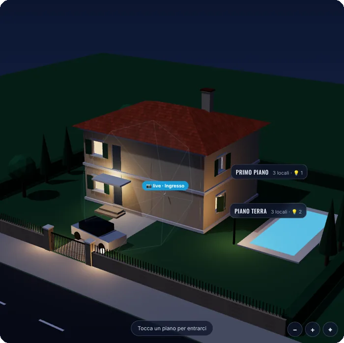<br><sub>La stessa casa, di sera</sub></td>
</tr>
</table>

## Energia

Il **flusso dal vivo**: quanto produce il sole, quanto prende o cede la rete,
la batteria che si carica o si scarica, la casa e i carichi più grandi — e il
cerchio **«Non monitorati»**, quello che la casa consuma e che nessun sensore
misura. Poi i report del giorno e del mese, le tariffe, l'auto elettrica e
la ricarica di notte.

<p align="center">
  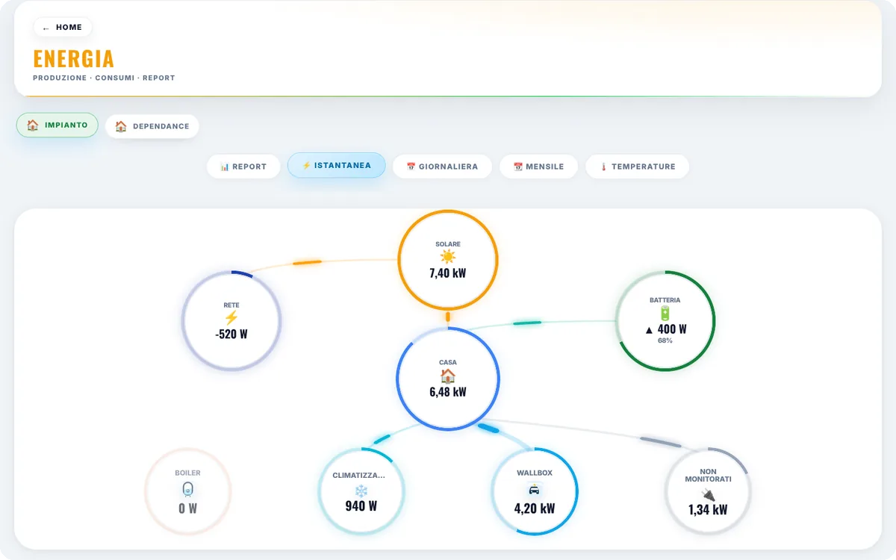
</p>

## Notifiche e assistente di casa

**La casa ti avvisa anche ad app chiusa**: l'antifurto che scatta, il fumo,
l'acqua per terra, il campanello, la lavatrice che ha finito, il movimento
quando non c'è nessuno, con la foto del momento. Le regole stanno nell'add-on,
e le notifiche partono **già cifrate** con la chiave del tuo telefono.

L'**assistente di casa** guarda quello che succede e propone cosa fare, con un
tasto: avviare la lavatrice quando c'è sole, inserire l'antifurto se siete
usciti tutti, aprire una finestra quando l'aria è pesante. La sera arriva il
**riepilogo della giornata**.

<table>
<tr>
<td width="25%" align="center" valign="top">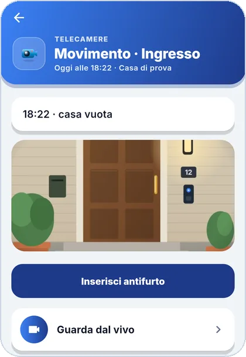<br><sub>Movimento, con la foto</sub></td>
<td width="25%" align="center" valign="top">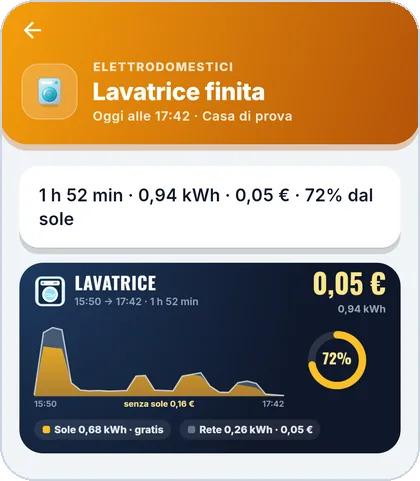<br><sub>Lavatrice finita</sub></td>
<td width="25%" align="center" valign="top">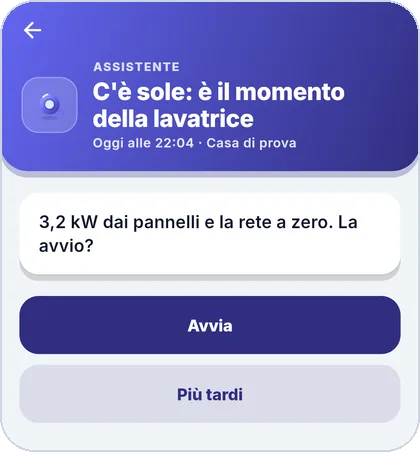<br><sub>«C'è sole»</sub></td>
<td width="25%" align="center" valign="top"><br><sub>«Siete usciti»</sub></td>
</tr>
</table>

## Da fuori casa

Sulla rete di casa il telefono parla direttamente con l'add-on. **Con
Premium** la casa si raggiunge anche da fuori — dall'ufficio, in vacanza, coi
dati del telefono — e senza fare niente:

- **nessuna porta da aprire sul router**, nessun indirizzo pubblico, nessuna
  VPN: è la casa a tenere aperto il collegamento verso l'esterno;
- **cifrato da un capo all'altro**, fra il telefono e l'add-on: chi sta in
  mezzo fa passare i messaggi ma non li può leggere;
- **si sceglie da solo**: in casa l'app usa la strada diretta, appena esci dal
  portone passa a quella da fuori.

Ogni telefono abbinato ha **un accesso suo**, che si toglie con un tasto dalla
pagina dell'add-on — per esempio il giorno che un telefono si perde.

## Base e Premium

**GdAHome Base è gratis, per sempre**: l'add-on, la plancia in Home Assistant
e l'app sul telefono e sul tablet, sulla rete di casa.

**GdAHome Premium** aggiunge:

| Con Premium | In pratica |
| --- | --- |
| 🌍 **Da fuori casa** | la casa ovunque, cifrata, senza aprire porte |
| 📋 **Più plance e più case** | una plancia per la famiglia, una per l'ufficio; casa e casa al mare nella stessa app |
| ⚙️ **La configurazione dal telefono** | sezioni, stanze, dispositivi, automazioni, aiutanti, Zigbee con «Dove lo metto?» |
| 🔔 **Le notifiche elaborate** | con grafici e foto, il riepilogo della sera, i mini video del movimento |
| 🧊 **Casa 3D** | la casa in tre dimensioni, dalla tua planimetria |
| 🖼️ **La plancia a muro** | un tablet o un NSPanel come pannello con comandi grandi |
| ❤️ **La Salute dall'orologio** | per tutta la famiglia |
| ⌚ **Al polso** e 🚗 **in auto** | Apple Watch, Wear OS, Android Auto, CarPlay |
| 🧭 **GdANav Premium compreso** | batteria letta dall'auto e soste alle colonnine |
| 🌐 **L'app dal browser** | la stessa app, senza installare niente |

Premium **è della casa, non del telefono**: si attiva una volta, e tutti i
telefoni abbinati a quella casa sono Premium insieme a lei. Si prende
dall'app, con Google Play o l'App Store (**4,99 € al mese** o **49,99 €
all'anno**), e **i primi 14 giorni sono gratis**. Se finisce non si perde
niente: la configurazione resta salvata e torna appena Premium torna.

**GdANav è compreso nell'app.** Con Base ci sono il percorso con la voce, il
traffico, gli autovelox, il meteo e i distributori con i prezzi; con
l'elettrica la batteria si scrive a mano. Con **Premium** la batteria si
legge dall'auto, il percorso sceglie le soste alle colonnine in tempo reale,
e ci sono Android Auto e CarPlay. Non c'è un secondo abbonamento.

## Installazione in Home Assistant

**Cosa serve:** Home Assistant con il **Supervisor**, cioè **Home Assistant
OS** (su Raspberry, mini PC o macchina virtuale) oppure **Home Assistant
Supervised**. GdAHome è un **add-on**, non un'integrazione: **da HACS non si
installa**.

**1. Aggiungi l'archivio.** In Home Assistant apri **Impostazioni → Add-on →
Negozio degli add-on**, tocca i **tre puntini** in alto a destra →
**Archivi**, incolla questo indirizzo e premi **Aggiungi**:

```
https://github.com/danigio15/gdahomeapp
```

**2. Installa e avvia.** Nell'elenco compare la sezione **GdAHome**: apri
l'add-on, premi **Installa** e poi **Avvia**, e accendi **Mostra nella barra
laterale**. La prima volta ci vuole qualche minuto. Gli aggiornamenti poi
arrivano come per ogni altro add-on.

**3. Collega l'app.** Apri la voce di **GdAHome** nella barra laterale, premi **Collega
l'app**, scegli la persona che userà il telefono e premi **Genera il QR
code**. Il codice vale cinque minuti e una volta sola.

<p align="center">
  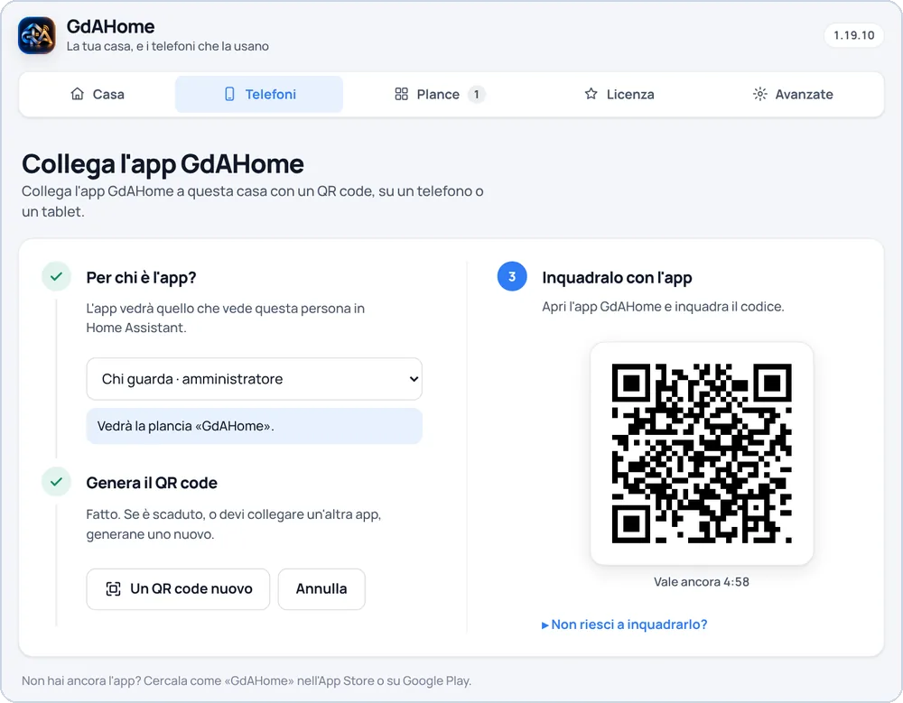
</p>

**4. Inquadralo con l'app.** Scarica GdAHome dal
**[Play Store](https://play.google.com/store/apps/details?id=com.gdahome.gdahome)**
o dall'**[App Store](https://apps.apple.com/app/id6816421418)** e inquadra il
codice. Senza fotocamera lo si scrive a mano: sedici caratteri, in quattro
gruppi. Fatto: **nessuna password di Home Assistant**, nessun indirizzo,
nessun token da copiare.

Il resto — le sezioni, le stanze, le notifiche, l'auto — è spiegato passo
passo, con le schermate, nel **[manuale d'uso](docs/MANUALE.md)**.

<details>
<summary><b>Avevo l'integrazione DashboardModern: cosa faccio?</b></summary>

<br>

Non serve più: la plancia è già dentro l'add-on, e **alla prima apertura
GdAHome prende la configurazione che avevi**. Disinstalla l'integrazione da
HACS e togli la sua voce da **Impostazioni → Dashboard**: se la lasci, quella
voce mostra «Errore di configurazione».

</details>

## Domande frequenti

<details>
<summary><b>Si installa su Home Assistant in Docker?</b></summary>

<br>

No, e non dipende da GdAHome: su **Home Assistant Container** e su **Home
Assistant Core** il negozio degli add-on non esiste, e nessun add-on si
installa.

| Home Assistant | GdAHome |
| --- | :-: |
| **OS** — il sistema completo, su Raspberry, mini PC o macchina virtuale | ✅ |
| **Supervised** — Debian con l'installatore ufficiale | ✅ |
| **Container** — l'immagine Docker da sola | ❌ nessun add-on, di nessuno |
| **Core** — in un ambiente Python | ❌ idem |

Chi ha Container può passare a Supervised sulla stessa macchina: Docker ce
l'ha già.

</details>

<details>
<summary><b>Serve l'app per usare la plancia?</b></summary>

<br>

No. La plancia compare anche in Home Assistant, nella barra laterale, e si
guarda e si configura da qualunque browser di casa. Con l'app diventa una casa
in tasca.

</details>

<details>
<summary><b>Siamo in quattro in casa: paghiamo quattro volte?</b></summary>

<br>

No. Premium è della casa: tutti i telefoni abbinati, e l'app dal browser,
sono Premium insieme.

</details>

<details>
<summary><b>Ho perso il telefono.</b></summary>

<br>

Apri GdAHome in Home Assistant e, fra i **telefoni abbinati**, togli quello
perso: da quel momento non entra più.

</details>

<details>
<summary><b>Che fine fanno i dati della casa?</b></summary>

<br>

**Restano in casa.** Nessun account, nessuna pubblicità, nessun
tracciamento. Da fuori casa i messaggi viaggiano cifrati fra il telefono e
l'add-on, e il segreto di Home Assistant non esce mai dall'add-on. Il
pagamento lo gestiscono Google e Apple. Tutto per intero:
**[l'informativa sulla privacy](https://gdahome.org/privacy.html)**
([`docs/PRIVACY.md`](docs/PRIVACY.md)).

</details>

## Lingue

L'app, la plancia e l'add-on parlano **italiano** e **inglese**, e scelgono da
soli la lingua del telefono o di Home Assistant. Il manuale d'uso è in
italiano.

## Assistenza e segnalazioni

- **Dall'app:** **Segnalazioni** nel menu, con foto e video, senza bisogno di
  un account GitHub; per una domanda c'è **Assistenza**, una conversazione
  privata.
- **Da GitHub:** apri una
  **[segnalazione](https://github.com/danigio15/gdahomeapp/issues)**. Non
  mettere nelle segnalazioni indirizzi, token o foto di casa tua.
- **Le novità** di ogni versione dell'add-on sono in
  [`ponte/CHANGELOG.md`](ponte/CHANGELOG.md).

GdAHome la fa **CRV Immobiliare S.r.l.**, impresa di impianti elettrici e
tecnologici: **[www.crvgroup.it](https://www.crvgroup.it/)** · per scrivere,
**domotica@crvgroup.it** oppure il modulo su
[gdahome.org/#contatti](https://gdahome.org/#contatti).

## Licenza

Il codice di GdAHome è pubblico, ma non è open source: vale la **Licenza d'uso
di GdAHome** ([`LICENSE`](LICENSE)), in italiano con la traduzione inglese. In
breve: si legge e si controlla cosa fa, si installa e si usa a casa propria o
nella propria attività; non si ripubblica, non si rivende e non si aggira
Premium. Le condizioni d'uso dell'app sono in [`docs/TERMINI.md`](docs/TERMINI.md).

---

## In English

<details>
<summary><b>GdAHome in short</b></summary>

<br>

**GdAHome turns your Home Assistant into a single dashboard** — on your phone,
tablet, watch and car. Lights, climate, blinds, alarm, cameras, energy and
people, room by room.

- **Two pieces:** a Home Assistant **add-on** (it serves the dashboard, pairs
  phones and keeps the Home Assistant secret at home) and an **app** for
  Android, iPhone and iPad, also in the browser. Pairing is a **QR code**: no
  passwords, no addresses, no tokens.
- **Energy flow** with solar, grid, battery, car and the "not monitored" share;
  **3D home** built from your floor plan; **wall tablet** mode; **notifications**
  and a **home assistant** that suggests what to do.
- **GdANav**, a navigator built for EVs, with **Android Auto** and **CarPlay**:
  gate, music and home alerts on the car screen.
- **Away from home** with Premium: no open router ports, no VPN, end-to-end
  encrypted.
- **Base is free forever**; **Premium** (14 days free) belongs to the whole
  house, not to a single phone.

**Install:** Home Assistant OS or Supervised → *Settings → Add-ons → Add-on
store → ⋮ → Repositories* → add `https://github.com/danigio15/gdahomeapp` →
install **GdAHome** → open it from the sidebar → **Connect the app** → scan the
QR code with the app.

The app and the dashboard speak Italian and English. Issues:
[github.com/danigio15/gdahomeapp/issues](https://github.com/danigio15/gdahomeapp/issues).
License: [`LICENSE`](LICENSE) (source-available, not open source).

</details>
