# Manuale d'uso di GdAHome

<p align="center"></p>

Questo manuale spiega **passo per passo, con le schermate vere**, come si
installa e come si usa GdAHome: l'add-on in Home Assistant, l'app sul
telefono, la plancia e tutte le sue funzioni.

**Come leggere le schermate.** Su molte immagini ci sono dei **cerchi rossi
numerati** con un riquadro attorno a un elemento. Sotto ogni immagine la
**legenda** spiega cosa sono: ① corrisponde al cerchio 1, ② al 2 e così via.

**Altre convenzioni**
- I nomi tra «virgolette basse» sono le parole scritte sullo schermo.
- La freccia → indica il percorso da seguire, un tocco dopo l'altro.
- **(Premium)** segna le funzioni che richiedono GdAHome Premium
  ([capitolo 16](#16-gdahome-premium-e-licenze)). Tutto il resto è compreso
  nella versione gratuita, **Base**.

> Le schermate vengono da una **casa di prova** con nomi d'esempio («Casa del
> collaudo», «Persona 1», «Faretti soggiorno»…). Nella tua app vedrai i nomi
> della tua casa.

---

## Indice

1. [Cos'è GdAHome](#1-cosè-gdahome)
2. [Cosa serve](#2-cosa-serve)
3. [Installare l'add-on in Home Assistant](#3-installare-ladd-on-in-home-assistant)
4. [Abbinare il telefono alla casa](#4-abbinare-il-telefono-alla-casa)
5. [Il menu dell'app](#5-il-menu-dellapp)
6. [La plancia: usarla tutti i giorni](#6-la-plancia-usarla-tutti-i-giorni)
7. [Configurare la plancia](#7-configurare-la-plancia)
8. [Più plance: a muro, Colpo d'occhio, Casa 3D](#8-più-plance-a-muro-colpo-docchio-casa-3d)
9. [Più case e il collegamento da fuori casa](#9-più-case-e-il-collegamento-da-fuori-casa)
10. [Le notifiche](#10-le-notifiche)
11. [Il riepilogo della sera e «La tua giornata»](#11-il-riepilogo-della-sera-e-la-tua-giornata)
12. [La Salute dall'orologio](#12-la-salute-dallorologio)
13. [Dispositivi, integrazioni, aiutanti e Zigbee](#13-dispositivi-integrazioni-aiutanti-e-zigbee)
14. [Automazioni e Pianificatore](#14-automazioni-e-pianificatore)
15. [In auto e al polso: GdANav, Android Auto, CarPlay, orologi](#15-in-auto-e-al-polso-gdanav-android-auto-carplay-orologi)
16. [GdAHome Premium e licenze](#16-gdahome-premium-e-licenze)
17. [Impostazioni dell'app, lucchetto e diagnostica](#17-impostazioni-dellapp-lucchetto-e-diagnostica)
18. [Aggiornamenti e riavvio della casa](#18-aggiornamenti-e-riavvio-della-casa)
19. [Segnalazioni e assistenza](#19-segnalazioni-e-assistenza)
20. [La pagina «Configura GdAHome» in Home Assistant](#20-la-pagina-configura-gdahome-in-home-assistant)
21. [Le opzioni dell'add-on](#21-le-opzioni-delladd-on)
22. [Se la casa te l'ha montata un installatore](#22-se-la-casa-te-lha-montata-un-installatore)
23. [Per chi installa: il cruscotto](#23-per-chi-installa-il-cruscotto)
24. [Se qualcosa non va](#24-se-qualcosa-non-va)
25. [Domande frequenti](#25-domande-frequenti)
26. [Privacy, contatti e chi c'è dietro](#26-privacy-contatti-e-chi-cè-dietro)
27. [Configurare la plancia, scheda per scheda](#27-configurare-la-plancia-scheda-per-scheda)

---

## 1. Cos'è GdAHome

GdAHome porta Home Assistant sul telefono in **una pagina sola fatta per essere
guardata**: la **plancia**. In alto ci sono il meteo, l'antifurto e chi è in
casa; sotto ci sono le sezioni (luci, clima, tapparelle, telecamere, consumi,
persone e una trentina di altre), divise per stanza.

GdAHome è fatta di **due pezzi che lavorano insieme**:

| | Pezzo | Cosa fa |
| :-: | --- | --- |
| 🏠 | **L'add-on**, dentro Home Assistant | Contiene la plancia, abbina i telefoni e custodisce il segreto di Home Assistant, che non esce mai da lì. Nella barra laterale di Home Assistant compare come **«Configura GdAHome»**. |
| 📱 | **L'app**, sul telefono | Per Android e iPhone/iPad, e anche dal browser su [webapp.gdahome.org](https://webapp.gdahome.org). Si abbina **inquadrando un QR code**: niente indirizzi, password o token da copiare. |

<p align="center">
  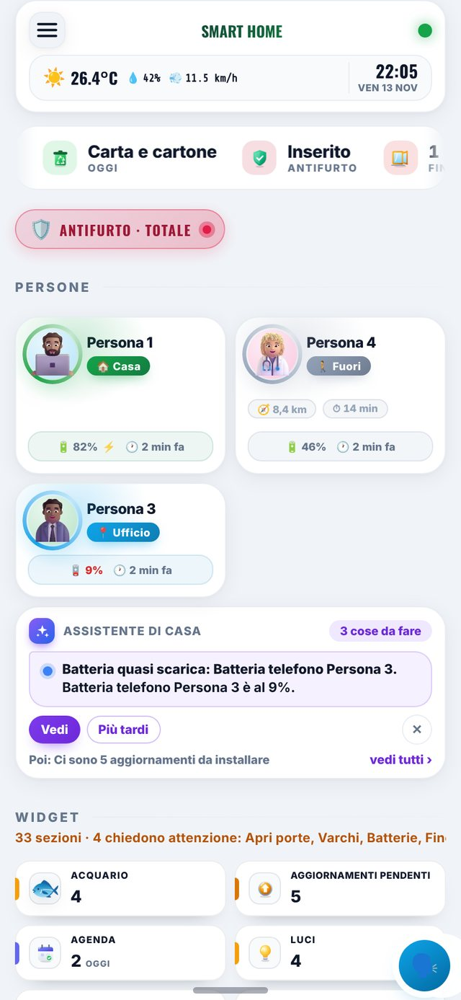
  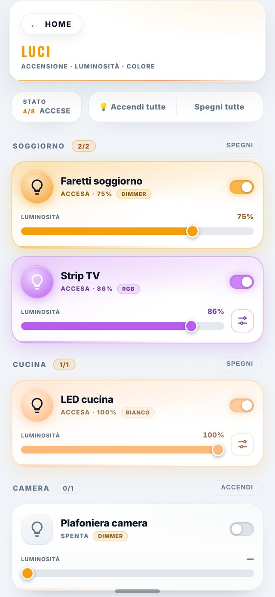
  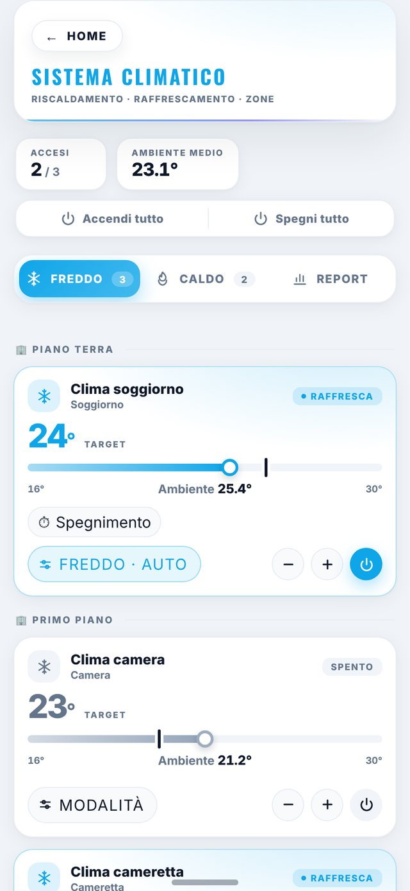
</p>
<p align="center"><sub>L'app aperta sulla plancia, la sezione Luci e la sezione Clima.</sub></p>

---

## 2. Cosa serve

**Un Home Assistant con il Supervisor**:

| Home Assistant | GdAHome |
| --- | :-: |
| **OS**: il sistema completo, su Raspberry, mini PC o macchina virtuale | ✅ |
| **Supervised**: Debian con l'installatore ufficiale | ✅ |
| **Container**: solo l'immagine Docker | ❌ nessun add-on, di nessuno |
| **Core**: in un ambiente Python | ❌ idem |

Su Container e Core il negozio degli add-on non esiste: non dipende da
GdAHome. Chi ha Container può passare a Supervised sulla stessa macchina,
perché Docker c'è già.

Servono anche:
- **un telefono o un tablet**, Android o iPhone/iPad, oppure un browser (l'app
  nel browser è compresa in Premium);
- **nessun account**: GdAHome non ne chiede.

> GdAHome è un **add-on**, non un'integrazione: **HACS non lo accetta**. Si
> installa dal negozio degli add-on.

---

## 3. Installare l'add-on in Home Assistant

### 3.1 Aggiungere l'archivio

1. In Home Assistant apri **Impostazioni → Add-on → Negozio degli add-on**.
2. Tocca i **tre puntini** in alto a destra → **Archivi**.
3. Incolla questo indirizzo e premi **Aggiungi**:
   ```
   https://github.com/danigio15/gdahomeapp
   ```
4. Chiudi la finestra.

### 3.2 Installare e avviare

1. Nell'elenco compare la sezione **GdAHome**: apri l'add-on.
2. Premi **Installa**. La prima volta ci vogliono alcuni minuti, **anche dieci
   su un Raspberry**.
3. Premi **Avvia**.
4. Accendi **Mostra nella barra laterale**: comparirà la voce **«Configura
   GdAHome»**.

### 3.3 Il primo controllo

Apri **«Configura GdAHome»** dalla barra laterale. Si apre la sezione
**Casa**:

<p align="center">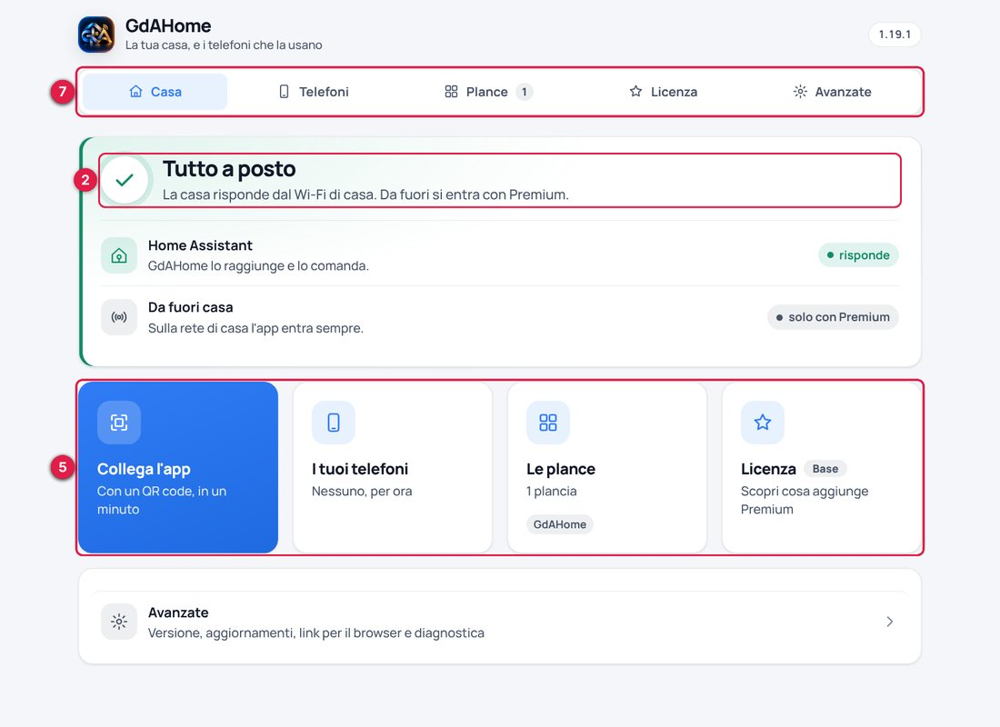</p>

**Legenda**
- ① **Le schede**: Casa, Telefoni, Plance, Licenza, Avanzate. Su un telefono
  diventano un elenco, e si torna indietro con «‹».
- ② **Lo stato della casa**: «Tutto a posto» quando funziona tutto, «C'è una
  cosa da sistemare» quando c'è un problema. Sotto ci sono le righe dei
  controlli (Home Assistant, Da fuori casa…).
- ③ **«Collega l'app»**: abbina un telefono nuovo (capitolo 4).
- ④ **«I tuoi telefoni»**: i telefoni abbinati.
- ⑤ **«Le plance»**: le plance della casa.
- ⑥ **«Licenza»**: Base o Premium.
- ⑦ **«Avanzate»**: versione, link per il browser, diagnostica.

**Se c'è scritto «Serve riavviare Home Assistant una volta»** (succede la
prima volta):
1. Vai in **Impostazioni → Sistema**.
2. In alto a destra tocca **⏻ → Riavvia Home Assistant**.
3. Entro un minuto dal riavvio la plancia compare da sola fra le Dashboard.

### 3.4 Se avevi l'integrazione DashboardModern

Non serve più: la plancia è già nell'add-on, e **alla prima apertura GdAHome
prende la configurazione che avevi**. Disinstalla l'integrazione da HACS e
togli la sua voce da **Impostazioni → Dashboard**. Se la lasci, quella voce
mostra «Errore di configurazione».

### 3.5 Aggiornare l'add-on

Si aggiorna come ogni altro add-on: **Impostazioni → Add-on → GdAHome →
Aggiorna**. Puoi farlo anche dall'app, dalla pagina
[Aggiornamenti](#18-aggiornamenti-e-riavvio-della-casa).

---

## 4. Abbinare il telefono alla casa

### 4.1 Scaricare l'app

- **Android**: [Google Play](https://play.google.com/store/apps/details?id=com.gdahome.gdahome), cerca «GdAHome».
- **iPhone e iPad**: [App Store](https://apps.apple.com/app/id6816421418).
- **Browser**: [webapp.gdahome.org](https://webapp.gdahome.org) (si abbina scrivendo il codice).

### 4.2 Generare il QR code (in Home Assistant)

1. Apri **«Configura GdAHome»** e premi la tessera blu **«Collega l'app»**.
   Si apre la pagina **«Collega l'app GdAHome»**, con tre passi.

<p align="center">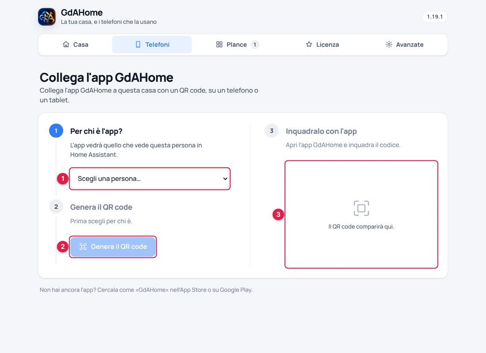</p>

**Legenda**
- ① **«Per chi è l'app?»**: scegli dall'elenco l'utente di Home Assistant che
  userà il telefono. L'app vedrà **quello che vede quella persona**.
- ② **«Genera il QR code»**: resta grigio finché non hai scelto la persona.
- ③ Qui comparirà il QR code.

2. Scegli la persona in ①.
3. Premi ②, **«Genera il QR code»**.

<p align="center">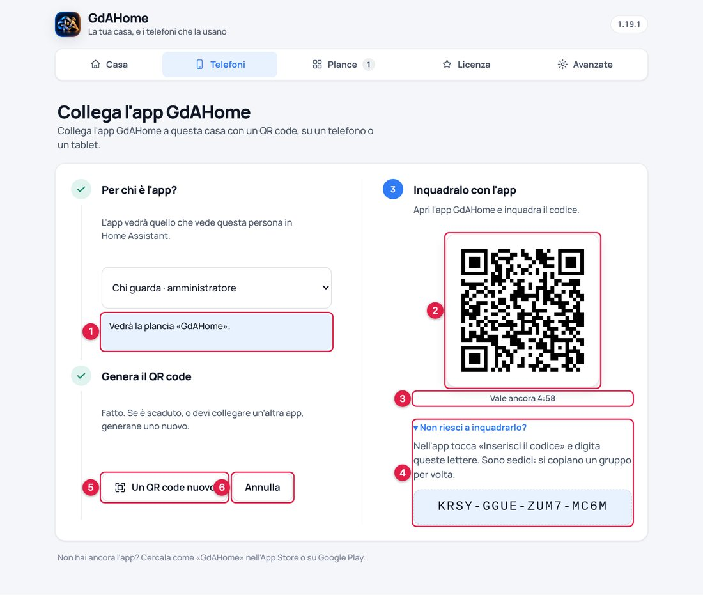</p>

**Legenda**
- ① **L'anteprima**: dice quali plance vedrà il telefono, per esempio «Vedrà
  la plancia «GdAHome».».
- ② **Il QR code** da inquadrare con l'app.
- ③ **Il conto alla rovescia**: «Vale ancora 4:58». Il codice vale **5
  minuti e una volta sola**.
- ④ **«Non riesci a inquadrarlo?»**: mostra i **sedici caratteri** da
  scrivere a mano, in quattro gruppi.
- ⑤ **«Un QR code nuovo»**: se è scaduto, ne crea un altro.
- ⑥ **«Annulla»**: cancella subito il codice.

### 4.3 Inquadrarlo con l'app

<p align="center">
  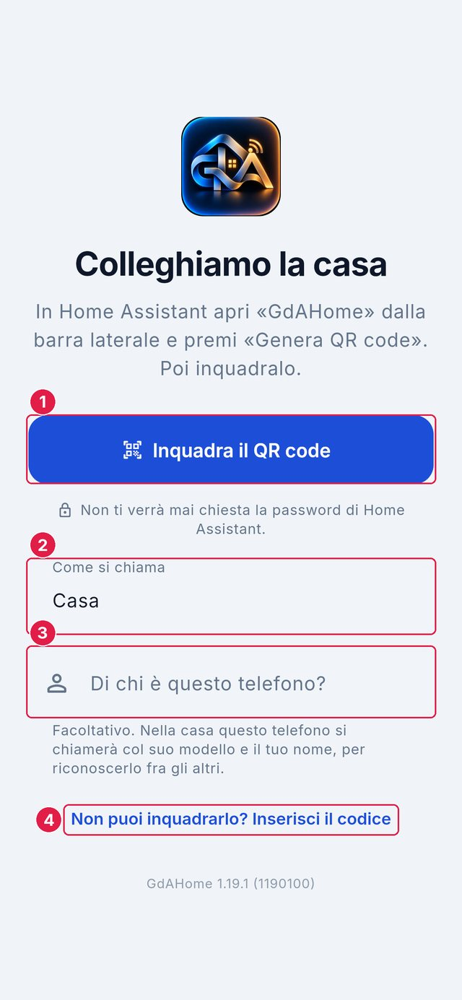
  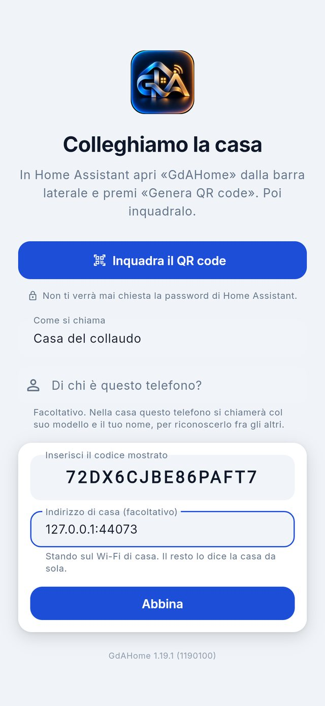
</p>

**Legenda** (schermata a sinistra)
- ① **«Inquadra il QR code»**: apre la fotocamera.
- ② **«Come si chiama»**: il nome della casa nell'app, per esempio «Casa» o
  «Casa al mare».
- ③ **«Di chi è questo telefono?»**: il tuo nome (facoltativo). Serve a
  riconoscere il telefono fra quelli abbinati.
- ④ **«Non puoi inquadrarlo? Inserisci il codice»**: per scrivere il codice a
  mano.

**Con il QR code**
1. Apri l'app: compare **«Colleghiamo la casa»**.
2. Se vuoi, cambia il nome ② e scrivi il tuo nome ③.
3. Premi ① e consenti l'uso della fotocamera. Al buio c'è il tasto
   **«Torcia»**.
4. Inquadra il QR code sullo schermo di Home Assistant.

Fatto: la plancia si apre. 🔒 **Non ti verrà mai chiesta la password di Home
Assistant.**

**Con il codice a mano** (schermata a destra)
1. Premi ④.
2. In **«Inserisci il codice mostrato»** scrivi i sedici caratteri, un gruppo
   alla volta.
3. Lascia vuoto **«Indirizzo di casa (facoltativo)»**. Scrivilo solo se l'app
   lo chiede: è l'indirizzo di Home Assistant sulla rete di casa, per esempio
   `192.168.1.50`.
4. Premi **«Abbina»**.

### 4.4 Errori possibili

| Messaggio | Cosa fare |
| --- | --- |
| «Non trovo la casa. Controlla che l'add-on sia acceso, e che il codice non sia scaduto…» | Controlla che l'add-on sia avviato e genera un QR nuovo. |
| «Non trovo GdAHome a quell'indirizzo…» | Collegati al Wi-Fi di casa e controlla l'indirizzo. |
| «GdAHome non ha il permesso di usare la fotocamera…» | Consenti la fotocamera nelle impostazioni del telefono, oppure usa il codice a mano. |
| «L'accesso remoto di Home Assistant non arriva agli add-on…» | Collegati al Wi-Fi di casa e scrivi l'indirizzo locale. |

### 4.5 Da sapere

- Ogni telefono ha **il suo abbinamento** e si toglie con un tasto (capitolo
  20).
- Un telefono vede **le plance della persona** per cui è stato abbinato.
- Con **Base** si abbinano **fino a 2 telefoni**; con **Premium**, quanti ne
  vuoi.
- Se avevi abbinato il telefono prima che esistesse il nome del proprietario,
  l'app te lo chiede una volta, con il foglio **«Di chi è questo
  telefono?»**: scrivi il nome e premi **«Salva»**, oppure **«Più tardi»**.

---

## 5. Il menu dell'app

### 5.1 Aprire e chiudere il menu

Il menu si apre in tre modi:
- toccando i **tre trattini** in alto a sinistra della plancia;
- toccando **☰** in alto a sinistra nelle altre pagine;
- premendo **Indietro** su Android. Con il menu aperto, un altro Indietro
  esce dall'app.

Il menu si chiude toccando una voce, trascinandolo verso sinistra, oppure da
solo dopo qualche secondo.

<p align="center">
  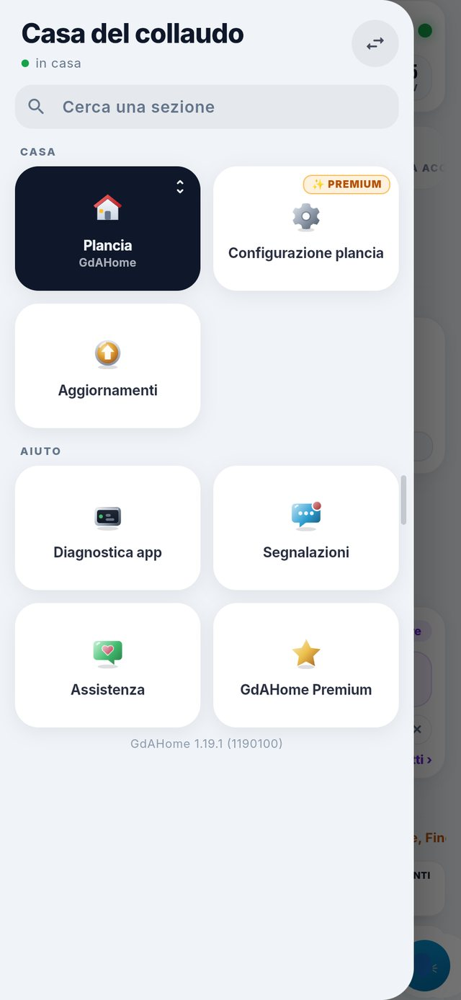
  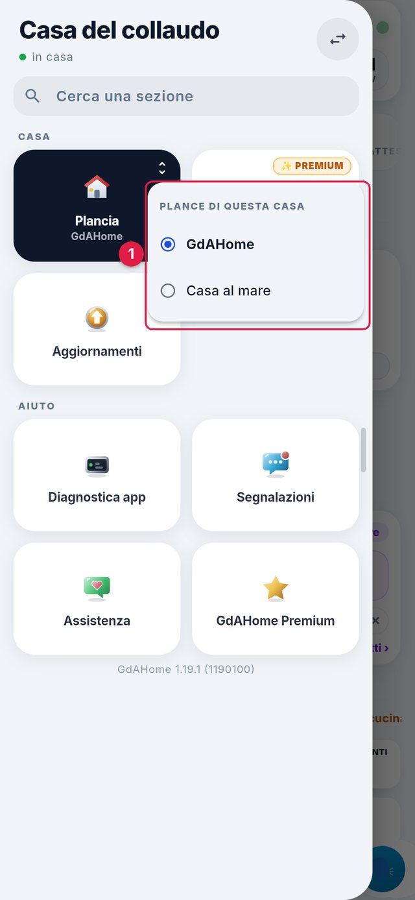
  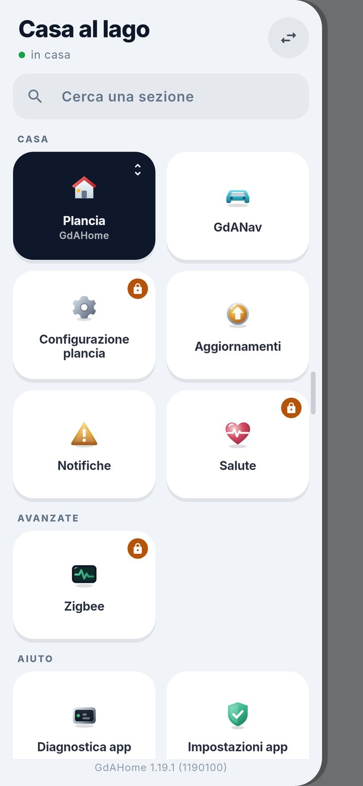
</p>

**Legenda** (prima schermata)
- ① **Il nome della casa**, e sotto come sei collegato: «in casa» (verde) o
  «da fuori».
- ② **⇄ Le tue case**: per passare a un'altra casa o aggiungerne una
  (capitolo 9).
- ③ **«Cerca una sezione»**: scrivi un nome per trovare subito la voce.
- ④ **«Plancia»**: torna alla plancia.
- ⑤ **⇕ Quale plancia**: tocca qui per cambiare plancia. L'elenco «PLANCE
  DI QUESTA CASA» è nella seconda schermata; le plance con il lucchetto
  richiedono Premium.
- ⑥ **Una voce Premium**: con Premium ha il bollino «✨ PREMIUM», con Base un
  lucchetto.

La terza schermata è il menu completo **sul telefono**. Alcune voci ci sono
solo nell'app e non nel browser: GdANav, Notifiche, Salute, Zigbee e
Impostazioni app.

### 5.2 Tutte le voci

**Gruppo «Casa»**

| Voce | A cosa serve | Note |
| --- | --- | --- |
| Plancia | Torna alla plancia | |
| Dispositivi | Dispositivi stanza per stanza e integrazioni | Premium, solo amministratori |
| GdANav | Il navigatore | Solo app |
| Configurazione plancia | Cambia la plancia dal telefono | Premium |
| Aggiornamenti | Aggiornamenti di Home Assistant, degli add-on e dei firmware; riavvio | Il numero indica quanti sono in attesa |
| Notifiche | Cosa ricevere su questo telefono | Solo app |
| Salute | Le misure dell'orologio inviate alla casa | Solo app, Premium |

**Gruppo «Avanzate»**

| Voce | A cosa serve | Note |
| --- | --- | --- |
| Automazioni | Automazioni e Pianificatore | Premium, solo amministratori |
| Aiutanti | Interruttori, numeri, timer, sensori calcolati | Premium, solo amministratori |
| Zigbee | Abbinare dispositivi Zigbee | Solo app, Premium, solo con ZHA o Zigbee2MQTT |
| Gestione installatore | Il cruscotto di chi installa | Solo sugli impianti degli installatori |

**Gruppo «Aiuto»**

| Voce | A cosa serve |
| --- | --- |
| Impostazioni app | Plancia leggera e lucchetto con volto o impronta |
| Diagnostica app | Come sta andando l'app |
| Segnalazioni | Un problema, un'idea o una domanda |
| Assistenza | Chat privata con chi fa l'app |
| GdAHome Premium | Abbonamento, prova gratuita, codice regalo |

---

## 6. La plancia: usarla tutti i giorni

### 6.1 Com'è fatta

<p align="center">
  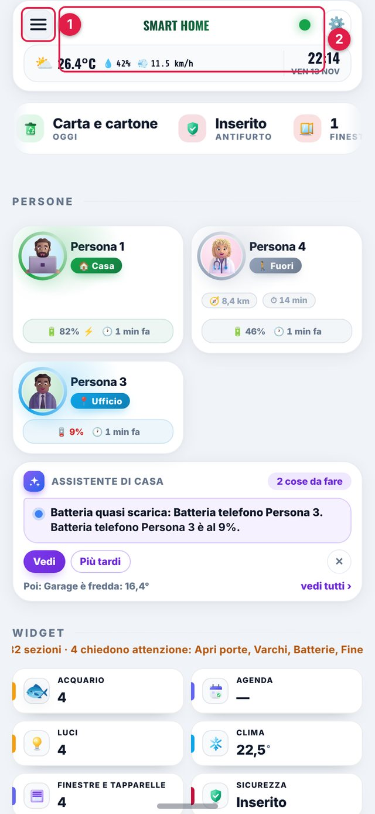
  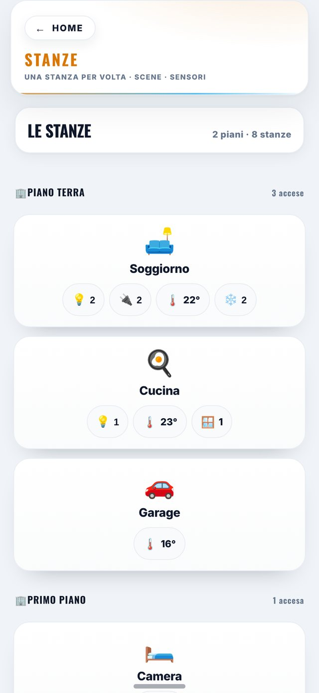
</p>

**Legenda**
- ① **Il menu della plancia** (tre trattini). Nell'app apre il menu
  dell'app.
- ② **La testata**: nome della casa, meteo, ora, stato del collegamento.

In fondo allo schermo c'è la **barra delle sezioni**: scorrila e tocca una
sezione per aprirla. In ogni sezione, **«← HOME»** in alto riporta alla Home.

Nella Home trovi, dall'alto in basso:
- i blocchi di riepilogo: rifiuti di domani, antifurto, avvisi;
- **Persone**: chi è in casa e chi è fuori, con batteria e posizione;
- **Assistente di casa**: le cose da fare, per esempio una batteria scarica;
- **Widget**: i riquadri con i numeri della casa (luci accese, clima,
  aggiornamenti…).

La seconda schermata è la sezione **Stanze**: ogni stanza mostra quante luci
sono accese, la temperatura e cosa c'è dentro. Toccala per aprirla.

### 6.2 Come si comanda

- **Un tocco** su una luce la accende o la spegne. **Trascinando la barra**
  sotto la luce ne cambi la luminosità.
- **Un tocco** su una tapparella, un termostato o una telecamera apre i suoi
  comandi o il video dal vivo.
- I tasti come **«Accendi tutte» / «Spegni tutte»** agiscono su tutta la
  sezione.
- **Porte e cancelli** si aprono dalla sezione «Apri porte» e, se l'hai
  impostato, chiedono il **PIN**.

<p align="center">
  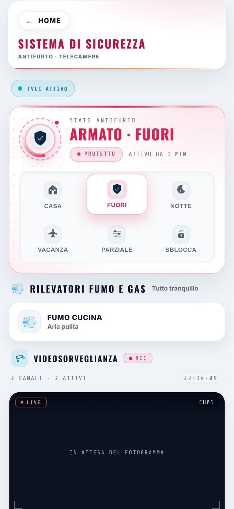
  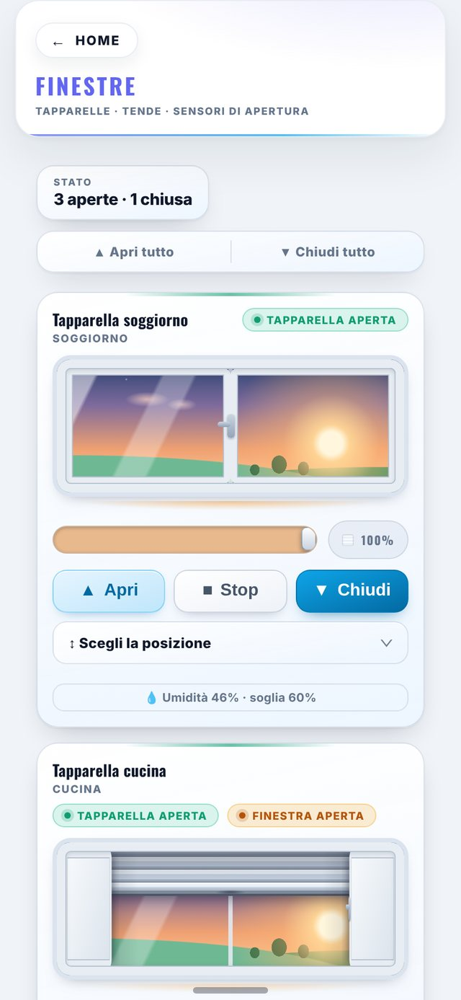
  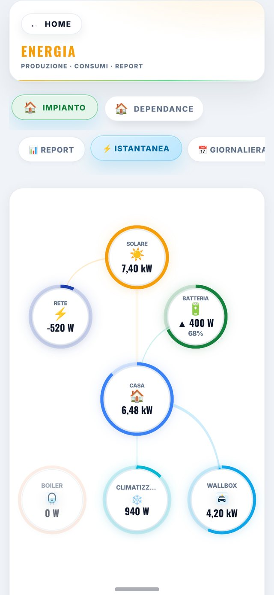
</p>
<p align="center"><sub>Sicurezza (antifurto con i modi Casa, Fuori, Notte…), Finestre (tapparelle con Apri, Stop, Chiudi) ed Energia (il flusso fra sole, rete, batteria e casa).</sub></p>

<p align="center">
  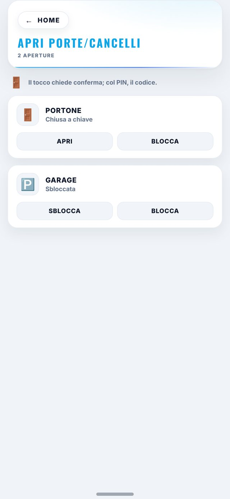
  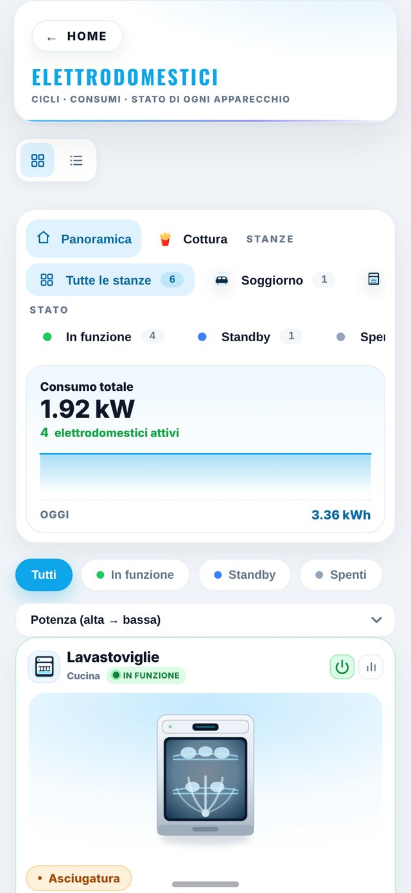
  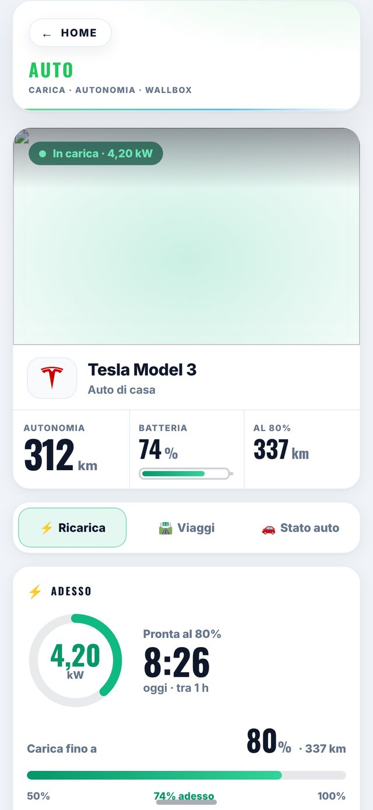
</p>
<p align="center"><sub>Apri porte e cancelli («Apri», «Blocca», «Sblocca»), Elettrodomestici (cicli e consumi) e Auto (batteria, autonomia, ricarica).</sub></p>

<p align="center">
  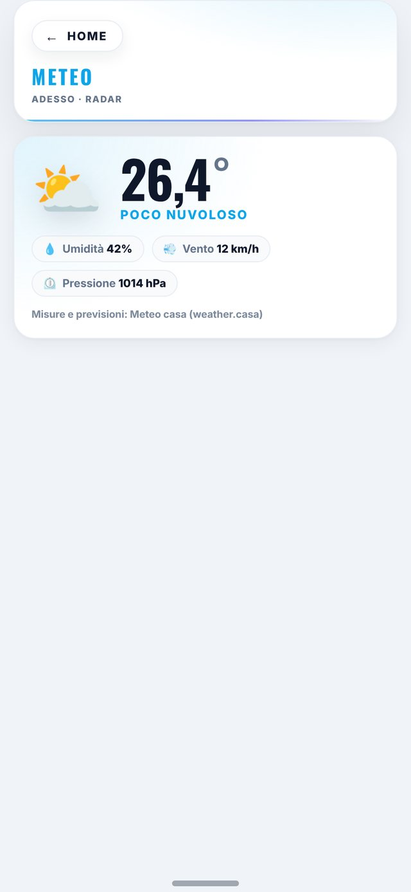
  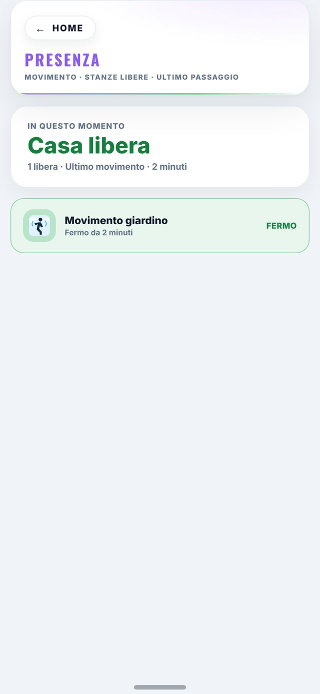
  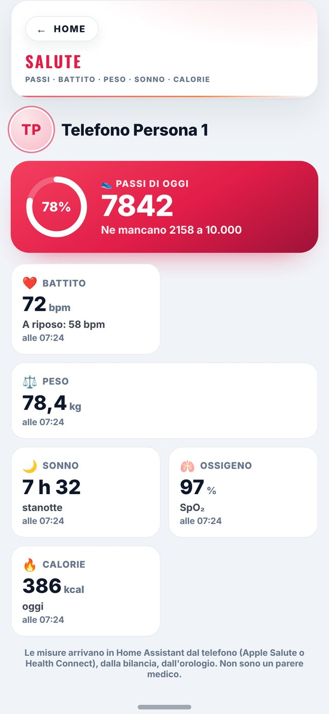
</p>
<p align="center"><sub>Meteo, Presenza (stanze libere e ultimi passaggi) e Salute (le misure dell'orologio, capitolo 12).</sub></p>

### 6.3 Le sezioni della plancia

Le sezioni si accendono e si spengono dalla Configurazione (capitolo 7). Una
sezione senza contenuto non compare nella barra.

| Sezione | Cosa contiene |
| --- | --- |
| 🏠 Home | Il riepilogo della casa e i widget |
| ⚡ Energia | Fotovoltaico, rete, accumulo, consumi, tariffe, report |
| 🚗 Auto | Auto elettrica, colonnina, evcc, ricarica di notte |
| 🧭 GdANav | Viaggi pianificati, che ritrovi nel navigatore |
| 🌞 Gestione termica | Solare termico, scaldabagno, caldaia, pellet |
| 🛡️ Sicurezza | Antifurto, telecamere, sensori di fumo e gas |
| 🖥️ MiniPC (Server e rete) | Server, container, rete |
| 🌡️ Temperatura | Le temperature delle stanze |
| 🌦️ Meteo | Condizioni, previsioni, radar |
| ⚽ Sport | Squadra del cuore, Formula 1, MotoGP |
| ❤️ Salute | Le misure dall'orologio |
| ❄️ Clima | Termostati, condizionatori, VMC |
| 🪟 Finestre | Tapparelle e finestre |
| 🏊 Piscina · 💧 Irrigazione · 🪴 Piante | |
| 🧺 Elettrodomestici | Lavatrice, lavastoviglie e altri, con cicli e costi |
| 🤖 Robot | Aspirapolvere robot |
| 🐾 Animali | Anche acquari e terrari |
| 💡 Luci · 🔌 Prese · 🛋️ Stanze | |
| 📅 Agenda · 🗑️ Rifiuti · ⛈️ Allerte | |
| 🔌 UPS | Gruppi di continuità |
| 🚪 Varchi · 🏃 Presenza | Porte e finestre aperte, movimento |
| 🔓 Apri porte | Porte e cancelli, con PIN |
| 📮 Citofono | Campanello e posta |
| 🎵 Musica | Lettori, radio, Alexa |
| 🔋 Batterie | Le batterie dei dispositivi |
| 🖨️ Stampanti · 💧 Acqua e gas | |
| ⭐ Le tue sezioni | Sezioni create da te |

---

## 7. Configurare la plancia

> Qui trovi le basi. **Ogni scheda dell'editor, una per una**, è spiegata nel
> [capitolo 27](#27-configurare-la-plancia-scheda-per-scheda); la stessa guida
> si apre anche dentro la plancia, con **«📖 Come si configura questa scheda»**.

**(Premium dall'app; dal browser è sempre disponibile all'amministratore.)**

### 7.1 Aprire la Configurazione

- Dall'app: menu → **«Configurazione plancia»**.
- Dalla plancia: la voce **CONFIG** in fondo alla barra delle sezioni.

La Configurazione si apre solo all'utente indicato come «Utente admin».

<p align="center">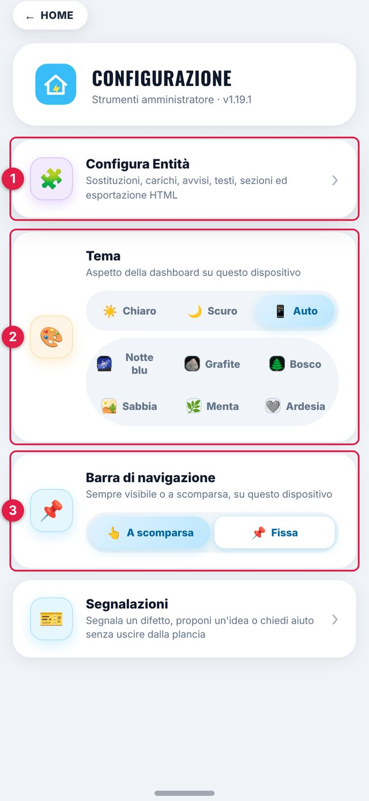</p>

**Legenda**
- ① **«Configura Entità»**: l'editor completo della plancia. Qui si sceglie
  cosa va in ogni sezione.
- ② **«Tema»**: Chiaro, Scuro, Auto e le tavolozze (Notte blu, Grafite,
  Bosco…). Vale solo per questo dispositivo.
- ③ **«Barra di navigazione»**: «A scomparsa» o «Fissa». Vale solo per questo
  dispositivo.
- ④ **«Segnalazioni»**: per segnalare un problema senza uscire dalla plancia.

### 7.2 L'editor: come è organizzato

Tocca ① **«Configura Entità»**: si apre l'**EDITOR DASHBOARD**.

<p align="center">
  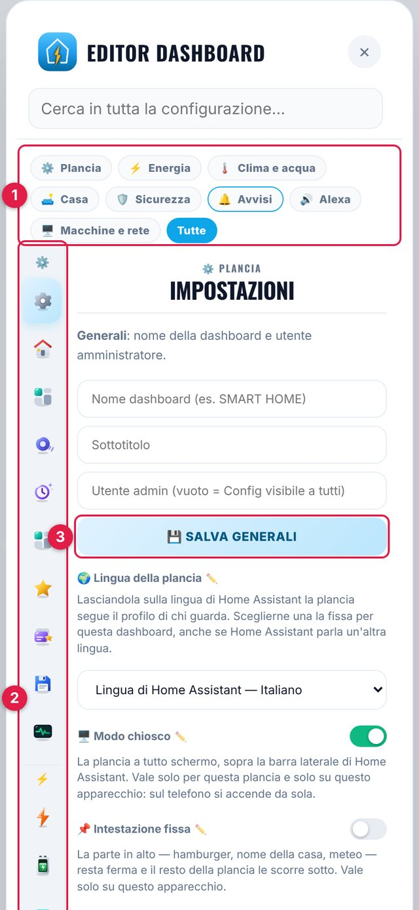
  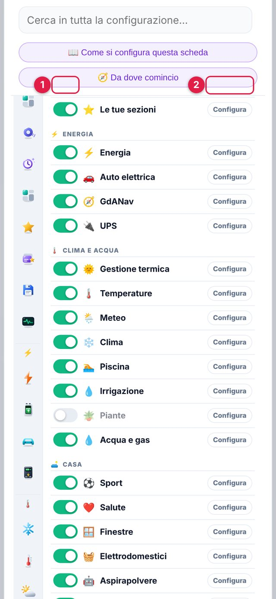
</p>

**Legenda** (schermata a sinistra)
- ① **Le famiglie**: Plancia, Energia, Clima e acqua, Casa, Sicurezza, Avvisi,
  Alexa, Macchine e rete, oppure «Tutte». Toccane una per vedere solo le sue
  schede.
- ② **Le schede**: la colonna di icone a sinistra. Ogni icona è una scheda
  (Impostazioni, Home, Luci, Clima…). In cima c'è la casella «Cerca in tutta
  la configurazione».
- ③ **«💾 Salva generali»**: salva il nome della plancia e l'utente
  amministratore.

**Legenda** (schermata a destra: «Le sezioni della plancia», più in basso
nella scheda Impostazioni)
- ① **L'interruttore** verde: accende o spegne la sezione nella plancia.
- ② **«Configura»**: apre la scheda di quella sezione.

### 7.3 Mettere un dispositivo in una sezione (esempio: una luce)

<p align="center">
  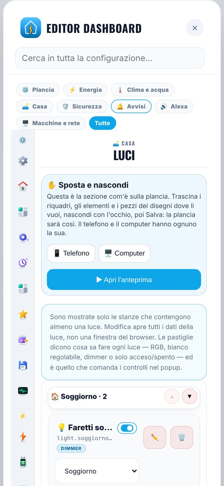
  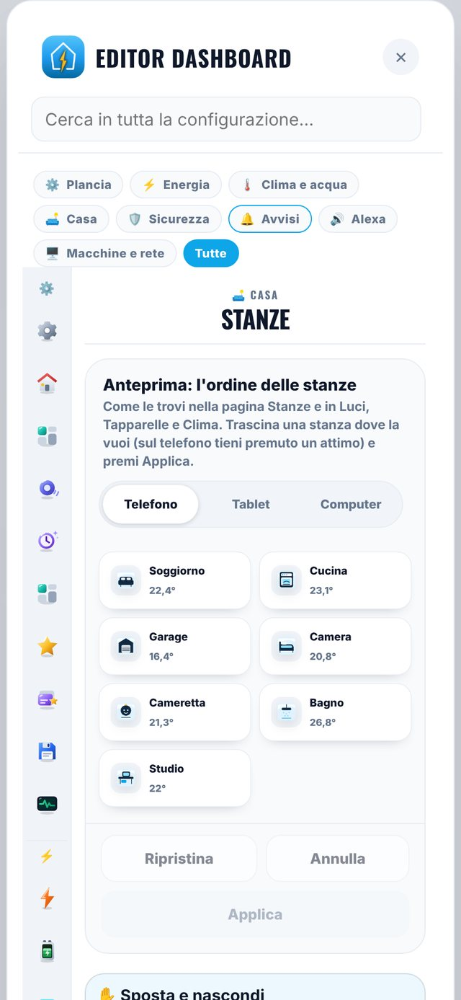
  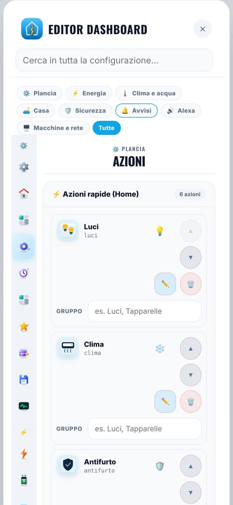
</p>

1. Nell'editor apri la scheda **Luci** (famiglia Casa).
2. Nella riga di una luce scegli quale entità di Home Assistant mostrare.
3. Dalla tendina della riga scegli la **stanza** (per esempio «Soggiorno»).
4. Per aggiungere un'altra luce usa il tasto **+**; per toglierla, il
   cestino.
5. Premi **Salva** in fondo alla scheda.

Se lasci la scheda senza salvare, compare **«Ricordati di salvare»** con tre
scelte: salvare, uscire senza salvare, restare.

**Le altre schede che si usano di più:**
- **Stanze** (al centro): l'anteprima e l'ordine delle stanze. Le stanze
  vengono dalle aree di Home Assistant e si riordinano trascinandole.
- **Azioni** (a destra): i tasti rapidi della Home, per esempio «Esco», che
  spegne tutto. Sono anche i comandi proposti in auto e sull'orologio.

### 7.4 Le tue sezioni, le persone, gli annunci

<p align="center">
  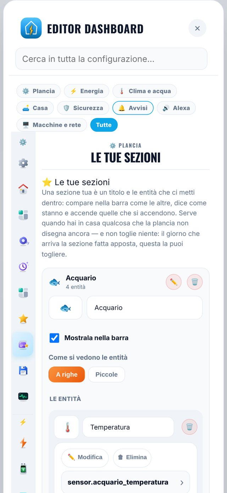
  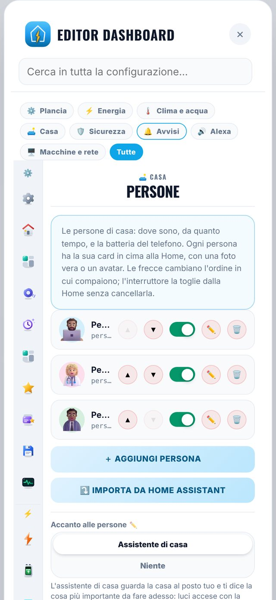
  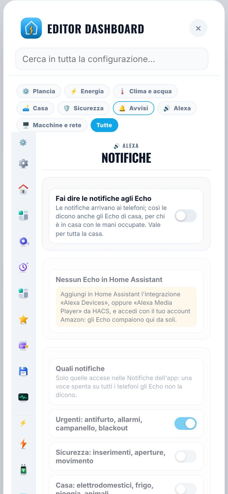
</p>

- **Le tue sezioni** (a sinistra): crea una sezione nuova con titolo e icona e
  mettici le entità che vuoi (nell'esempio, «Acquario»). La sezione compare
  nella barra.
- **Le tue entità**: aggiunge entità in fondo a una sezione esistente.
- **Persone** (al centro): le persone della Home. Usa **«+ Aggiungi
  persona»** oppure **«Importa da Home Assistant»**.
- **Notifiche** (a destra, famiglia Alexa): fa dire le notifiche dagli
  altoparlanti Echo, se in Home Assistant c'è l'integrazione Alexa.

### 7.5 Backup e ripristino della plancia

<p align="center">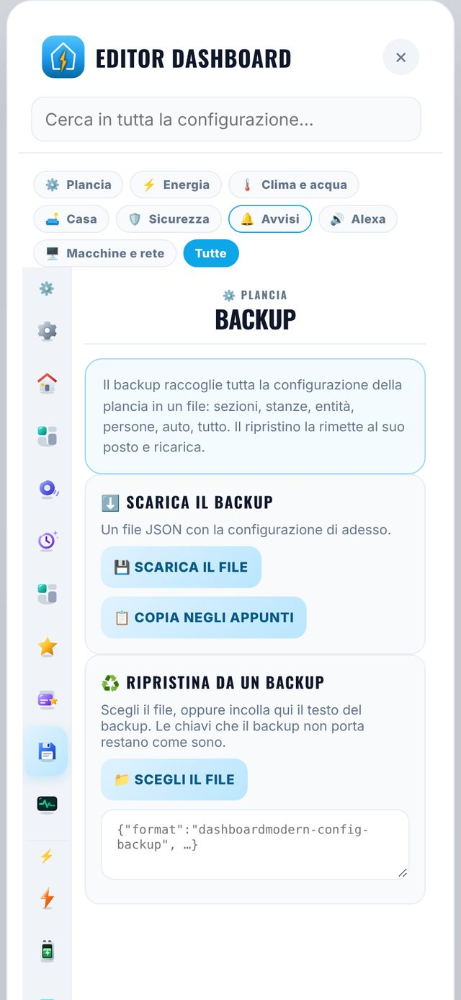</p>

1. Apri la scheda **Backup**.
2. **«Scarica il file»** salva tutta la configurazione in un file JSON;
   **«Copia negli appunti»** la copia come testo.
3. Per ripristinare: **«Scegli il file»** (oppure incolla il testo) e
   conferma. Il ripristino **non cancella** quello che nel file non c'è.

---

## 8. Più plance: a muro, Colpo d'occhio, Casa 3D

Con **Base** c'è una plancia, la principale. Con **Premium** puoi averne
**fino a 30 per casa**, per esempio una per la famiglia, una per il tablet in
cucina e una per l'ufficio.

### 8.1 Creare una plancia

Le plance si creano dalla pagina dell'add-on in Home Assistant:
**«Configura GdAHome» → Plance**.

<p align="center">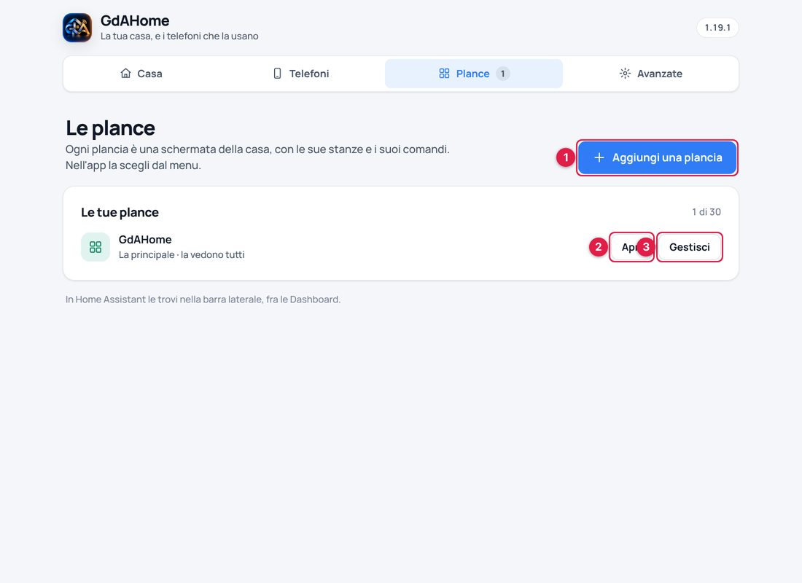</p>

**Legenda**
- ① **«Aggiungi una plancia»**: apre il modulo per una plancia nuova.
- ② **«Apri»**: apre la plancia in Home Assistant.
- ③ **«Gestisci»**: chi la vede, rinomina, togli.

<p align="center">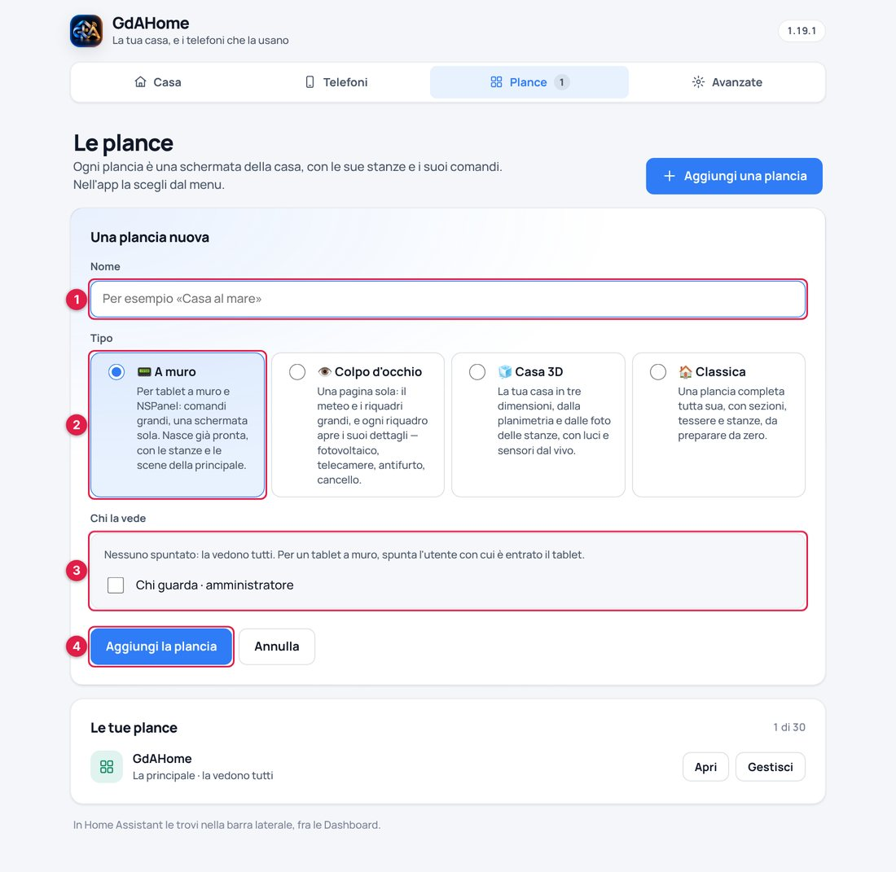</p>

**Legenda**
- ① **«Nome»**: fino a 40 caratteri, per esempio «Casa al mare».
- ② **«Tipo»**:
  - **📟 A muro**: per tablet a muro e NSPanel. Comandi grandi, una
    schermata sola. Nasce già pronta, con le stanze e le scene della
    principale.
  - **👁️ Colpo d'occhio**: una pagina sola con il meteo e riquadri grandi.
  - **🧊 Casa 3D**: la casa in tre dimensioni.
  - **🏠 Classica**: una plancia completa, da preparare da zero.
- ③ **«Chi la vede»**: spunta gli utenti che possono vederla. **Nessuna
  spunta = la vedono tutti.** Per un tablet a muro, spunta l'utente con cui è
  entrato il tablet.
- ④ **«Aggiungi la plancia»**: crea la plancia.

Nell'app la nuova plancia compare nel **selettore delle plance** del menu (⇕,
capitolo 5).

### 8.2 Chi vede una plancia

Premi **Gestisci** accanto alla plancia:

<p align="center">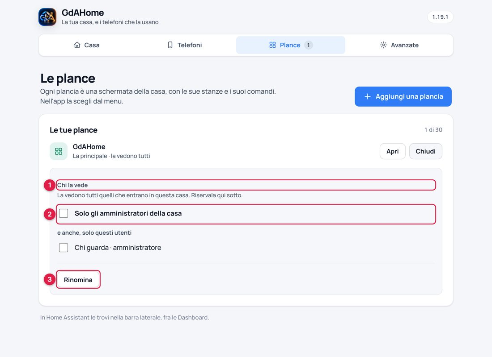</p>

**Legenda**
- ① **«Chi la vede»**: la frase dice chi la vede adesso.
- ② **«Solo gli amministratori della casa»**: la riserva agli amministratori.
  Sotto, **«e anche, solo questi utenti»** permette di spuntare singole
  persone. Le scelte si salvano subito.
- ③ **«Rinomina»**. Per le plance aggiunte c'è anche **«Togli la
  plancia»**, che cancella anche sezioni e stanze e non si può annullare.

Chi non vede nessuna plancia legge nell'app «Non hai plance associate alla
tua utenza».

### 8.3 La plancia a muro (Premium)

Trasforma un tablet fisso o un **Sonoff NSPanel** in un pannello con comandi
grandi, **fino a 8 pagine**.

<p align="center">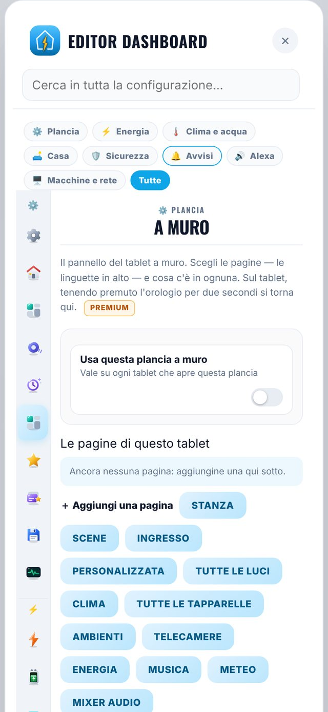</p>

1. Apri la plancia del tablet e vai in **Configurazione → Configura Entità →
   scheda «A muro»**.
2. Accendi **«Usa questa plancia a muro»**.
3. In **«Prende le cose da»** scegli se usare stanze, luci, clima e antifurto
   di questa plancia o della **principale**.
4. In **«Le pagine di questo tablet»** premi **«+ Aggiungi una pagina»** e
   scegli il tipo: Stanza, Scene, Ingresso, Personalizzata, Tutte le luci,
   Clima, Tutte le tapparelle, Ambienti, Telecamere, Energia, Musica, Meteo,
   Mixer audio…
5. Per ogni pagina scegli quanti riquadri: da 4 a 24 (di serie 6).
6. In **«Altre impostazioni»** regola orientamento, tema, riposo, notte
   (schermo nero), luminosità, chi c'è vicino (sensore di presenza) e il **PIN
   per uscire** dal pannello.
7. Premi **«Salva»**. Finché non salvi, il tablet non vede le modifiche.

Sul tablet si passa da una pagina all'altra con le linguette o facendo
scorrere il dito. Dopo qualche minuto senza tocchi resta l'orologio.

### 8.4 Colpo d'occhio (Premium)

Una pagina sola: nome della casa e ora, meteo, e i riquadri grandi
**Fotovoltaico**, **Telecamere**, **Antifurto** e **Cancello**. Si accende
in Configurazione → scheda **«Colpo d'occhio»** → **«Accesa: questa plancia
si apre a colpo d'occhio»**.

### 8.5 Casa 3D (Premium)

1. Crea una plancia di tipo **🧊 Casa 3D** e aprila.
2. Premi **«Crea la tua casa»** e segui gli **8 passi**:
   1. **Planimetria**: una foto anche storta, un PDF, un DWG, le misure a mano
      o le foto delle stanze.
   2. **Scala**: segna due punti di cui conosci la distanza.
   3. **Muri**: riconosciuti da soli; li ritocchi con muro, gomma, porta,
      finestra.
   4. **Stanze**: i nomi dalle aree di Home Assistant o scritti da te.
   5. **Foto delle stanze**: arredi e dispositivi riconosciuti.
   6. **Dispositivi**: collega ogni oggetto alla sua entità.
   7. **Esterno**: villa o palazzo, tetto, colori.
   8. **Casa 3D**: salva e apri, oppure aggiungi un piano.

Nella casa 3D un tocco accende le luci, muove le tapparelle o apre le
telecamere. Le foto restano sul dispositivo da cui le carichi.

> Con Base la plancia a muro resta una plancia normale, e Colpo d'occhio e
> Casa 3D mostrano un avviso. **La configurazione resta salvata.**

---

## 9. Più case e il collegamento da fuori casa

### 9.1 Le tue case (Premium: fino a 10)

Apri il menu e tocca **⇄** (② nella prima schermata del capitolo 5).

<p align="center">
  
  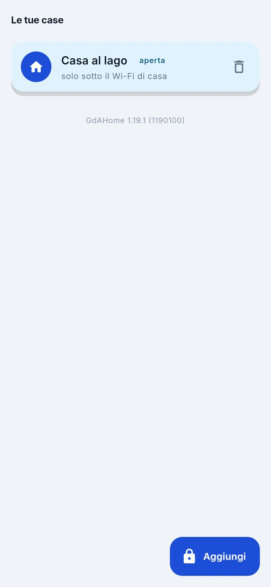
</p>

- **Passare a un'altra casa**: tocca il suo nome. Sotto il nome c'è da dove
  la raggiungi: «in casa adesso», «da fuori adesso», «solo sotto il Wi-Fi di
  casa».
- **Aggiungere una casa**: premi **«Aggiungi»** e ripeti l'abbinamento
  (capitolo 4) sull'Home Assistant dell'altra casa. Con Base il tasto ha il
  lucchetto (schermata a destra).
- **Togliere una casa dal telefono**: tocca il **cestino** e conferma con
  **«Elimina»**. Per toglierla anche dalla parte della casa: «Configura
  GdAHome» → Telefoni → ⋯ → «Togli da questa casa».

### 9.2 Da fuori casa (Premium)

Sul Wi-Fi di casa l'app parla direttamente con l'add-on. **Con Premium** la
casa si raggiunge da qualunque posto:
- **senza aprire porte sul router**, senza VPN e senza indirizzo pubblico;
- **cifrato da un capo all'altro**;
- **in automatico**: appena esci di casa l'app cambia strada da sola.

L'opzione dell'add-on **«Da fuori casa»** deve essere accesa (lo è di serie).

<p align="center">
  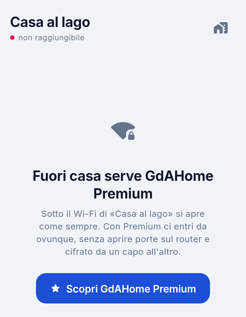
  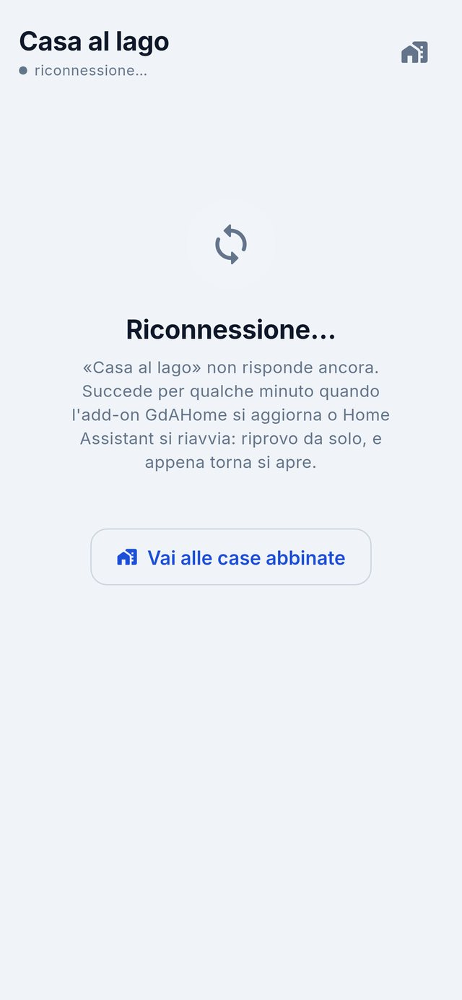
</p>
<p align="center"><sub>A sinistra: con Base, fuori dal Wi-Fi di casa. A destra: mentre l'add-on si aggiorna o Home Assistant si riavvia, l'app riprova da sola.</sub></p>

### 9.3 L'app dal browser (Premium)

Apri [webapp.gdahome.org](https://webapp.gdahome.org) e abbinala con il
**codice a mano** (paragrafo 4.3). L'indirizzo esatto lo trovi anche in
«Configura GdAHome» → Avanzate → «GdAHome nel browser».

---

## 10. Le notifiche

La casa ti avvisa **anche ad app chiusa**: l'antifurto che scatta, il
campanello, la lavatrice che ha finito.
- **Le regole stanno nell'add-on**: è la casa a guardare i sensori e a
  decidere quando scriverti.
- **Sul telefono scegli quali** notifiche ricevere.
- Le notifiche partono **già cifrate** con la chiave del tuo telefono: né il
  centralino, né Google, né Apple le possono leggere.

> **Con Base** arrivano solo gli **avvisi di sicurezza**: fumo, gas,
> allagamento, antifurto scattato e campanello. **Tutto il resto è
> Premium**, e nella pagina è segnato con un lucchetto.

### 10.1 Attivarle

1. La prima volta che entri in una casa compare **«Le notifiche di casa»**:
   premi **«Attiva»** e consenti le notifiche al telefono. Se avevi scelto
   «Non ora», le attivi dalla pagina Notifiche.
2. Apri menu → **«Notifiche»**.

<p align="center">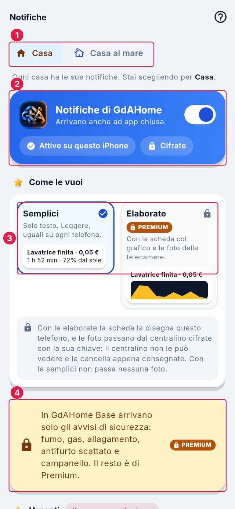</p>

**Legenda**
- ① **Per quale casa**: ogni casa ha le sue notifiche. Tocca il nome della
  casa per cui stai scegliendo.
- ② **«Notifiche di GdAHome»**: l'interruttore principale. Sotto devono
  comparire **«Attive su questo iPhone»** (o telefono) e **«Cifrate»**.
- ③ **«Come le vuoi»**:
  - **«Semplici»**: solo testo (di serie);
  - **«Elaborate»** (Premium): con il grafico e le foto delle telecamere.
- ④ **L'avviso di Base**: con Base arrivano solo gli avvisi di sicurezza.

3. Accendi ②.
4. In fondo alla pagina premi **«Manda una notifica di prova»**. Se leggi
   «Partita: arriva fra qualche secondo», funziona.

**Requisiti:**
- l'opzione dell'add-on **«Da fuori casa»** deve essere accesa, perché le
  notifiche passano dal centralino;
- il telefono deve essere abbinato a un utente di Home Assistant.

Se manca qualcosa, la pagina lo dice con una scheda gialla e spiega cosa
fare.

### 10.2 Cosa puoi ricevere

Scorri la pagina: ogni voce ha un interruttore, e di serie sono tutte
accese.

<p align="center">
  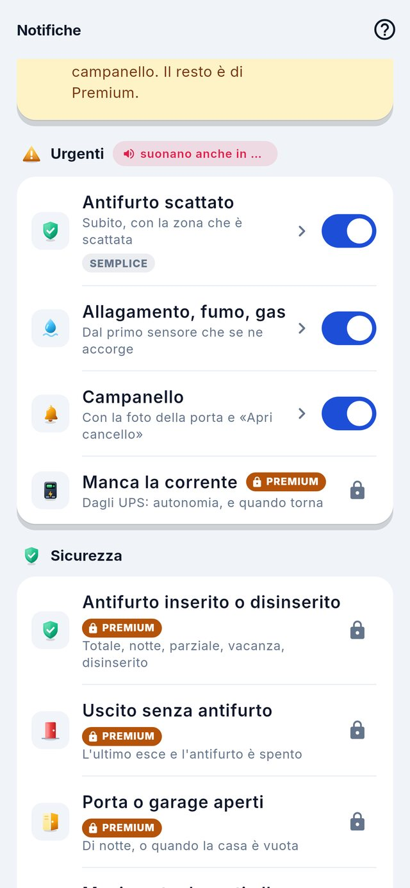
  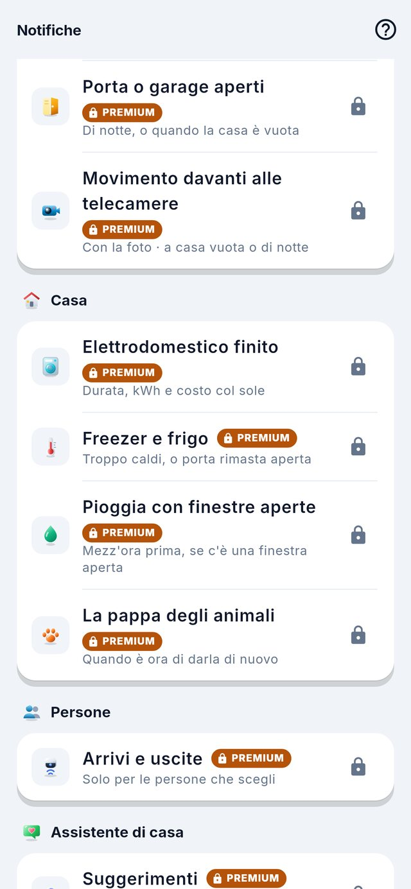
  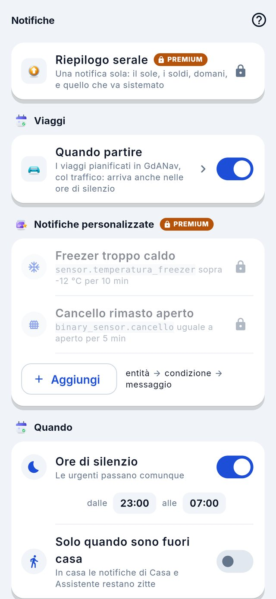
</p>

| Categoria | Voce | Quando arriva |
| --- | --- | --- |
| **Urgenti** (suonano anche in silenzioso) | Antifurto scattato | Subito, con la zona |
| | Allagamento, fumo, gas | Dal primo sensore che se ne accorge |
| | Campanello | Con la foto della porta e «Apri cancello» |
| | Manca la corrente | Dagli UPS: autonomia, e quando torna |
| **Sicurezza** | Antifurto inserito o disinserito | Totale, notte, parziale, vacanza |
| | Uscito senza antifurto | L'ultimo esce e l'antifurto è spento |
| | Porta o garage aperti | Di notte, o con la casa vuota |
| | Movimento davanti alle telecamere | Con la foto, a casa vuota o di notte |
| **Casa** | Elettrodomestico finito | Durata, kWh e costo |
| | Freezer e frigo | Troppo caldi, o porta aperta |
| | Pioggia con finestre aperte | Mezz'ora prima |
| | La pappa degli animali | Quando è ora |
| **Persone** | Arrivi e uscite | Solo per le persone che scegli |
| **Assistente di casa** | Suggerimenti | Luci o clima accesi con la casa vuota, ecc. |
| **Manutenzione** | Riepilogo serale | Ogni sera all'ora scelta |
| **Viaggi** | Quando partire | I viaggi pianificati in GdANav |

In fondo alla pagina (terza schermata) trovi:
- le **«Notifiche personalizzate»** (paragrafo 10.5);
- la scheda **«Quando»**, con:
  - **«Ore di silenzio»**: accese di serie, dalle 23:00 alle 07:00. Tocca gli
    orari per cambiarli. **Le urgenti passano comunque.**
  - **«Solo quando sono fuori casa»**: quando sei in casa, le notifiche di
    «Casa» e «Assistente» restano zitte.

### 10.3 Regolare una singola notifica

**Tocca il nome di una voce** (non l'interruttore): si apre il suo foglio.
Le scelte valgono **solo per quella notifica, su questo telefono**, e si
salvano subito.

<p align="center">
  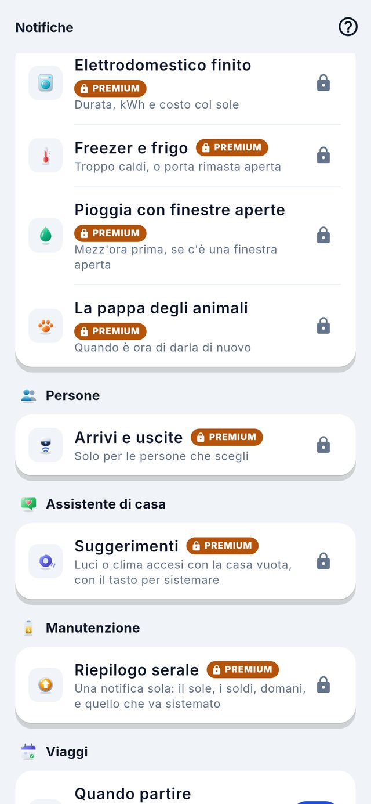
  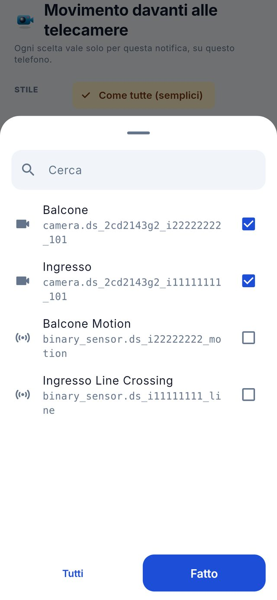
  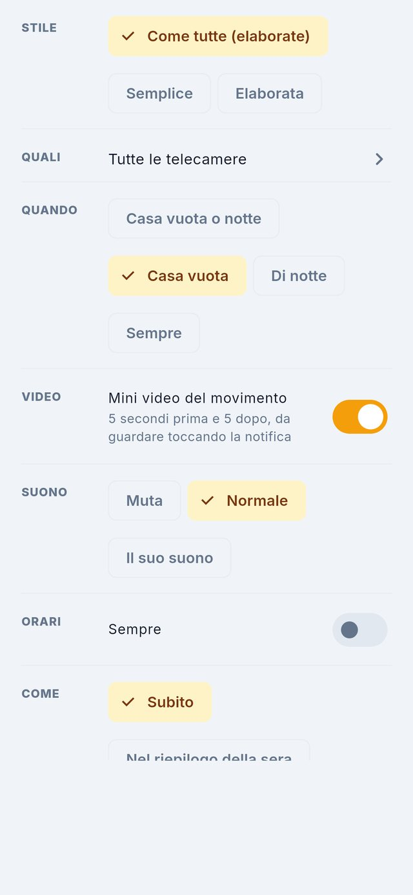
</p>

| Scelta | Cosa fa |
| --- | --- |
| **Stile** | Come tutte, Semplice oppure Elaborata |
| **Quali** | Quali elettrodomestici, UPS o telecamere seguire. Si apre un elenco con «Cerca», le spunte e «Fatto» (seconda schermata) |
| **Quando** (Movimento) | «Casa vuota o notte» (di serie), «Casa vuota», «Di notte», «Sempre» |
| **Video** (Movimento, Premium) | «Mini video del movimento»: 5 secondi prima e 5 dopo (terza schermata) |
| **Solo se** | Per esempio «Solo se il ciclo costa più di … €» |
| **Suono** | «Muta», «Normale», «Il suo suono» |
| **Orari** | «Sempre» oppure «Solo in queste ore» |
| **Come** | «Subito» oppure «Nel riepilogo della sera» (Premium) |

**«Prova: mandamela adesso»** ti manda subito un esempio.

> Le notifiche **urgenti** non si possono silenziare: arrivano sempre e
> subito.

### 10.4 Com'è una notifica, e cosa fare quando arriva

<p align="center">
  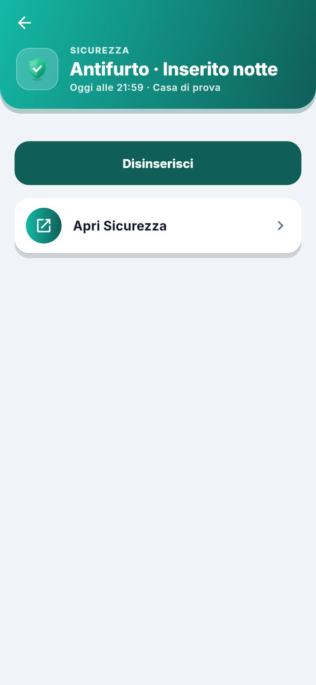
  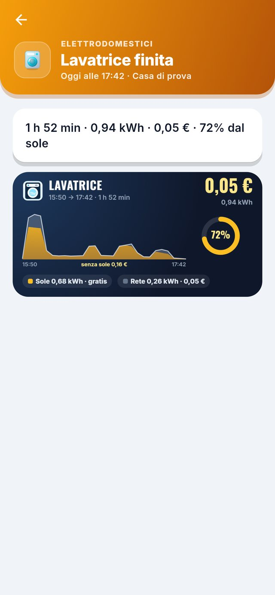
  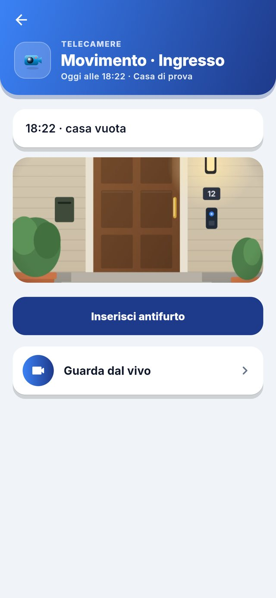
  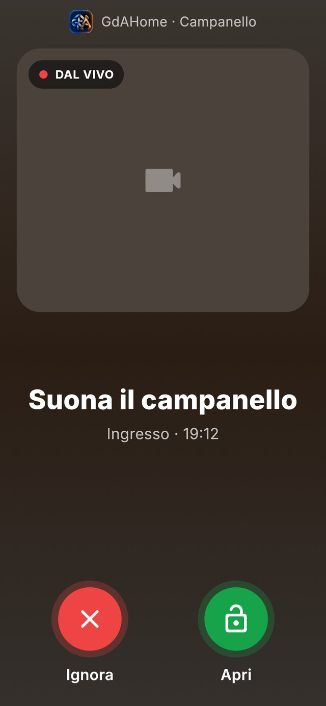
</p>
<p align="center"><sub>Quattro notifiche aperte nell'app: antifurto inserito, lavatrice finita (con il costo e la parte presa dal sole), movimento davanti a una telecamera, campanello a tutto schermo.</sub></p>

**Toccando la notifica** si apre la pagina giusta: Sicurezza, la telecamera,
Elettrodomestici, Energia, Persone, Meteo, «La tua giornata» o GdANav.

**I tasti nelle notifiche** (valgono 2 ore):

| Notifica | Tasti |
| --- | --- |
| Antifurto scattato | «Spegni sirena», «Disinserisci», «Guarda» |
| Campanello | «Apri cancello» / «Apri», «Ignora» |
| Uscito senza antifurto | «Inserisci», «Più tardi» |
| Porta o garage aperti | «Chiudi», «Va bene così», «Più tardi» |
| Movimento | «Guarda», «Inserisci antifurto» |
| Luci con casa vuota | «Spegni», «Restano così», «Più tardi» |
| Riepilogo serale | «Apri la giornata», «OK» |

- **«Va bene così»** zittisce quel suggerimento per 12 ore.
- **«Più tardi»** lo rimanda di un'ora.
- Con il lucchetto dell'app acceso, i tasti chiedono prima volto o impronta.

**Il campanello** si presenta a tutto schermo, come una telefonata, con la
foto dal vivo della porta e i tasti **«Ignora»** e **«Apri»**. «Apri» chiede
prima di sbloccare il telefono. Resta valido per 60 secondi.

<p align="center">
  
  
  
  
</p>
<p align="center"><sub>Da una notifica di movimento: la foto del momento, «Guarda dal vivo» e il mini video. A destra due suggerimenti dell'assistente («Nessuno in casa da 1 h» con «Spegni le 2 luci», e il garage aperto con «Chiudi»).</sub></p>

### 10.5 Notifiche personalizzate (Premium)

Sono regole tue, per esempio «quando il freezer va sopra i -12 °C per 10
minuti, avvisami».

1. Notifiche → **«Notifiche personalizzate»** → **«Aggiungi»**.

<p align="center">
  
  
</p>

**Legenda** (schermata a sinistra)
- ① **I tre passi**: Entità → Condizione → Messaggio.
- ② **L'entità** da controllare: toccala e cerca il sensore.
- ③ **La condizione e il valore**: «sopra», «sotto», «uguale a» o «diverso
  da», e il valore (per esempio -12 °C).
- ④ **Per quanto tempo**: subito, 1, 5, 10, 15, 30 minuti o 1 ora.
- ⑤ **Il valore di adesso** («tutto a posto» o «scatterebbe») e il
  **grafico delle ultime 24 ore**, con la soglia tratteggiata.
- ⑥ **«Titolo»** del messaggio (obbligatorio).
- ⑦ **«Prova adesso»**: la ricevi subito, solo tu.
- ⑧ **«Salva»**.

2. Compila ②, ③ e ④.
3. Scrivi il **Titolo** ⑥ e, se vuoi, il testo «Sotto il titolo».
4. Nella seconda parte (a destra) scegli:
   - **«Urgenza»**: «Bassa», «Normale» oppure «Urgente» (passa anche in
     silenzioso);
   - **«Chi la riceve»**: di serie solo tu; un amministratore può scegliere
     altre persone;
   - **«Non ripetere per»**: al massimo una volta ogni 15 min, 30 min, 1 h,
     3 h, 12 h o 24 h.
5. Premi **⑦ «Prova adesso»** per vedere com'è, poi **⑧ «Salva»**.

Ogni casa può avere fino a 40 notifiche personalizzate. Per toglierne una:
aprila → **«Togli questa notifica»**.

### 10.6 Le notifiche che già mandi con Home Assistant (Premium)

Se hai automazioni di Home Assistant che mandano notifiche alla sua app,
GdAHome le trova e le elenca nella scheda **«Da Home Assistant»**.

<p align="center">
  
  
</p>

1. Premi **«Accendi quelle di questo telefono»**, oppure tocca una singola
   automazione (seconda schermata).
2. Scegli **«Chi la riceve»** e se deve **«Rispetta le ore di silenzio»**.
3. Premi **«Ricevila anche in GdAHome»**.

Arrivano nello stesso momento e con lo stesso testo, ma cifrate. L'app di
Home Assistant continua a riceverle: se non le vuoi doppie, spegnile lì.

---

## 11. Il riepilogo della sera e «La tua giornata»

### 11.1 Il riepilogo serale (Premium)

Ogni sera, all'ora che scegli (di serie **20:30**), arriva **una notifica
sola** con la giornata della casa: energia dal sole, soldi spesi e
risparmiati, chi ha consumato di più, un consiglio per domani e le cose da
sistemare.

<p align="center"></p>

**Per cambiare l'ora:** Notifiche → Manutenzione → **«Riepilogo serale»** →
tocca l'orario **«Ogni sera alle»**.

### 11.2 La pagina «La tua giornata» (Premium)

Si apre toccando il riepilogo serale (o **«Apri la giornata»**), oppure da
Notifiche → Manutenzione → **«La tua giornata»**. Per aggiornarla, tira la
pagina verso il basso.

<p align="center">
  
  
  
  
</p>
<p align="center"><sub>La pagina intera, dall'alto in basso.</sub></p>

| Sezione | Cosa racconta |
| --- | --- |
| In breve | Tre o quattro fatti della giornata |
| Energia | Ora per ora, chi ha consumato di più, i soldi, la batteria di casa |
| Clima di casa | Temperature per stanza, quanto è stato acceso il riscaldamento |
| Acqua calda | Il solare termico e quanto ha fatto risparmiare |
| Auto e consumi | Ricariche, chilometri, acqua e gas |
| La casa | Porte aperte, automazioni eseguite, avvisi |
| Rispetto a | Ieri, la settimana, il mese |
| Domani | Il meteo e le ore di sole |
| Da sistemare | Le cose che chiedono attenzione |

---

## 12. La Salute dall'orologio

**(Premium, solo nell'app sul telefono.)** Passi, battito, pressione, peso,
sonno e le altre misure dell'orologio arrivano a casa e diventano sensori di
Home Assistant. Funziona con:
- **Apple Salute**: iPhone e Apple Watch;
- **Health Connect** su Android: Galaxy Watch, Pixel Watch, Fitbit, Amazfit e
  gli altri. Serve Android 8 o successivo.

<p align="center">
  
  
  
</p>

### 12.1 Attivarla

1. Menu → **«Salute»**.
2. Su Android, se manca Health Connect, premi **«Installa Health Connect»**.
3. Accendi **«Manda le misure alla casa»** e concedi il permesso di lettura
   della salute.
4. Lascia acceso **«Manda anche ad app chiusa»**.
5. In **«Come ti chiama la casa»** scrivi il tuo nome: con questo nome le tue
   misure compaiono nella plancia.
6. In **«Cosa mandare»** spunta le misure: Passi, Distanza, Piani saliti,
   Battito, Battito a riposo, Peso, Massa grassa, Pressione, Ossigeno, Sonno,
   Calorie…
7. Premi **«Manda adesso»** per il primo invio.

Ogni persona di famiglia fa lo stesso **sul proprio telefono**. Nella sezione
Salute della plancia (terza schermata) compare una persona per telefono.
Toccando una scheda apri lo storico a 7, 30 o 90 giorni.

### 12.2 Se una misura non arriva

- **Android**: premi **«Dai i permessi che mancano»**. Se la richiesta non
  compare, vai in **Impostazioni → Health Connect → Autorizzazioni app →
  GdAHome**.
- **iPhone**: vai in **Impostazioni → Salute → Accesso ai dati e dispositivi →
  GdAHome**.

**Privacy.** Le misure vanno **solo alla tua casa**, cifrate. GdAHome non
scrive mai in Salute. Spegnendo l'interruttore, la casa cancella le tue
misure.

> Chiunque possa aprire la plancia con la sezione Salute vede le misure. Se
> vuoi tenerle riservate, metti la sezione in una plancia visibile solo a te
> («Chi la vede», capitolo 8).

---

## 13. Dispositivi, integrazioni, aiutanti e Zigbee

Queste pagine **cambiano Home Assistant**: sono **Premium** e solo per **chi
amministra Home Assistant**. Gli altri utenti non le vedono nel menu.

### 13.1 Dispositivi

Menu → **«Dispositivi»**.

<p align="center">
  
  
</p>

**Legenda** (schermata a sinistra)
- In cima, i tre riquadri: quanti **dispositivi**, quante **entità**, quanti
  **non rispondono**.
- ⑤ **Un dispositivo**: nome, marca e modello, e a destra il suo comando o
  il suo stato. «Non risponde» in rosso vuol dire scollegato.
- Sopra l'elenco ci sono le schede **«Dispositivi»** e **«Integrazioni»**,
  il raggruppamento **«Per stanza» / «Per integrazione»** e la casella
  **«Cerca un dispositivo…»**.

**Toccando un dispositivo** si apre il suo foglio (a destra): marca, modello,
integrazione, **tutte le sue entità** con i comandi, e **«↻ Ricarica
l'integrazione»**.

### 13.2 Integrazioni

Tocca la scheda **«Integrazioni»**.

<p align="center">
  
  
</p>

**Legenda**
- ① **I riquadri**: «Installate», «Dispositivi» e «Da sistemare».
- **«Da guardare»** raccoglie le integrazioni con un problema. Per esempio
  «Casa · errore auth» vuol dire che **l'accesso va rifatto**: tocca ↻ o
  «Ripara».
- **«＋ Aggiungi»** aggiunge un'integrazione nuova.

**Aggiungere un'integrazione**
1. Premi **«＋ Aggiungi»**.
2. Cerca il nome (per esempio «Shelly», «Hue», «Sonos»).
3. Rispondi alle domande della procedura guidata di Home Assistant, una alla
   volta.

Toccando un'integrazione trovi **«Ricarica»**, **«⚙️ Opzioni»**,
**«Disattiva»** ed **«Elimina»**.

> **«Elimina»** toglie l'integrazione con tutti i suoi dispositivi, e le
> automazioni che li usano smettono di funzionare. Non si torna indietro.

### 13.3 Aiutanti

Menu → **«Aiutanti»**: interruttori, numeri, elenchi, timer e sensori
«fatti in casa», da usare nelle automazioni.

<p align="center">
  
  
  
</p>

**Legenda** (prima schermata)
- ① **«Per tipo» / «Tutti»**: come raggruppare l'elenco.
- ② **«Cerca un aiutante…»**.
- ③ **Un gruppo** (Interruttori): gli aiutanti di quel tipo. Toccane uno per
  cambiarne subito il valore, modificarlo o eliminarlo.

**Creare un aiutante**
1. Premi **«＋ Nuovo»**.
2. Scegli il tipo (seconda schermata): Interruttori, Numeri, Elenchi, Testi,
   Date e ore, Pulsanti, Timer, Contatori, Programmi.
3. Compila il modulo (terza schermata): **Nome**, **Icona** e i campi del
   tipo scelto.
4. Premi **«Salva in Home Assistant»**.

### 13.4 Zigbee: aggiungere un dispositivo dal telefono

**(Premium, solo app.)** La voce **«Zigbee»** compare se in casa c'è **ZHA**
o **Zigbee2MQTT**.

<p align="center">
  
  
</p>

1. Menu → **«Zigbee»** (prima schermata).
2. Leggi **«Prima di cominciare»**:
   - porta il dispositivo **vicino a una presa o a una lampadina già in
     casa**;
   - **tienilo spento**.
3. Premi **«Apri la rete»**. Parte un conto alla rovescia di circa 4 minuti,
   poi la rete si richiude da sola.
4. **Accendi il dispositivo** e mettilo in abbinamento. Quasi sempre si tiene
   premuto il tasto per cinque secondi, finché la spia non lampeggia.
5. Aspetta. Quando compare **«È entrato»**, scrivi un nome chiaro in **«Come
   lo chiami»** (per esempio «Luce comodino») e premi **«Chiamalo così»**.
6. Premi **«Adesso mettilo nella plancia»**: si apre **«Dove lo metto?»**
   (seconda schermata).
7. La plancia ti propone la sezione giusta e ti dice perché (qui: «è una
   lampadina»).
   - Scegli la **«Stanza»**.
   - Se preferisci, sotto **«Oppure»** scegli un'altra sezione.
8. Premi **«Mettilo in Luci»** (o nella sezione scelta). **«Più tardi»**
   rimanda.

Dalla pagina Zigbee, toccando un dispositivo già presente, puoi rinominarlo
(**«Salva il nome»**), metterlo nella plancia o toglierlo dalla rete
(**«Togli dalla rete»**). **«Guarda la rete»** disegna la mappa della rete.

---

## 14. Automazioni e Pianificatore

**(Premium, solo amministratori.)** Sono **vere automazioni di Home
Assistant**: le esegue la casa anche ad app chiusa. Le ritrovi anche in
Home Assistant, in **Impostazioni → Automazioni**.

### 14.1 L'elenco

Menu → **«Automazioni»**.

<p align="center">
  
  
</p>

**Legenda** (schermata a sinistra)
- ① **«Automazioni»** e ② **«Pianificatore»**: le due schede della pagina.
- I riquadri **«Attive»**, **«Spente»** e **«Prossima»** (la prossima che
  scatta a un orario).
- ③ **«N proposte per la tua casa»**: idee pensate sui tuoi dispositivi.
  Tocca **«Vedi ›»**; per ognuna scegli **«Crea»** o **«No, grazie»**.
- ④ **Come raggruppare**: «Per categoria», «Per tipo», «Per stanza».
- A destra della ricerca c'è **«＋ Nuova»**, per crearne una.

Nell'elenco (a destra), ogni automazione ha il suo **interruttore** per
accenderla o spegnerla. Toccandola trovi **«Esegui ora»**, **«✏️
Modifica»**, **«Duplica»** ed **«Elimina»**.

### 14.2 Creare un'automazione

1. Premi **«＋ Nuova»**.
2. Scegli un modello pronto oppure **«Da zero»** (prima schermata qui
   sotto).

<p align="center">
  
  
  
</p>

I modelli sono: «Luce col movimento», «Tapparelle a orario», «Clima spento
con finestra aperta», «Avvisami quando la lavatrice ha finito», «Tutti
fuori: spegni tutto», «Bentornato a casa», «Cronotermostato», «Routine a
orari», «Calendario a fasce» e «Da zero».

3. Compila i tre blocchi dell'editor (seconda e terza schermata):
   - **QUANDO** (cosa la fa partire): a un orario, una porta che si apre, c'è
     movimento, un valore che sale o scende, qualcuno che arriva o esce,
     l'antifurto, un elettrodomestico che finisce…
   - **SOLO SE** (facoltativo): è notte, fra due orari, certi giorni, chi è
     in casa, un'entità in un certo stato. Aggiungi con **«+ Un'altra
     condizione»**.
   - **ALLORA** (cosa fare): accendi, spegni, tapparella, clima, notifica,
     aspetta… Ogni azione ha il suo numero (1, 2, 3); aggiungi con **«+
     Aggiungi un'azione»**.
4. Controlla la frase **«Si legge così:»**, che racconta l'automazione in
   italiano. Per esempio: «quando c'è movimento in Movimento giardino, solo
   se di notte, accendi Faretti soggiorno al 30%, aspetta 2 min e spegni
   Faretti soggiorno».
5. Premi **«💾 SALVA IN HOME ASSISTANT»**.

### 14.3 Il Pianificatore: routine a orari e calendari a fasce

Tocca la scheda **«Pianificatore»**.

<p align="center">
  
  
  
</p>

1. Premi **«＋ Crea la prima»** (o **«＋ Nuova»**).
2. Scegli il tipo (seconda schermata):
   - **«Routine a orari»**: a ogni orario le sue azioni. Per esempio «alle
     6:30 caldaia, alle 7 tapparelle su».
   - **«Calendario a fasce»**: tiene accesa una cosa nelle fasce che disegni.

**Calendario a fasce** (terza schermata)
1. Scrivi il **«Nome»** e scegli in **«Cosa accende»** l'entità (per esempio
   la caldaia o l'antifurto).
2. In **«Quando vale»** scegli **«Tutto l'anno»** oppure un periodo.
3. In **«Le fasce»** **trascina il dito** sulle barre dei giorni per segnare
   quando è acceso.
4. Per fare prima usa **«Copia lun su mar–ven»** e **«Copia sab su dom»**;
   **«Svuota»** cancella tutto.
5. Salva.

**Routine a orari**
1. Scegli i **giorni**.
2. Premi **«＋ Aggiungi un orario»** e, per ogni orario, scegli le azioni.
3. Scegli **«Quando vale»** e salva.

---

## 15. In auto e al polso: GdANav, Android Auto, CarPlay, orologi

### 15.1 GdANav, il navigatore

Nell'app c'è **GdANav**, un navigatore pensato per l'auto elettrica che va
bene anche a benzina o a gasolio. Offre:
- percorso con guida vocale e lo svincolo ingrandito agli incroci;
- distributori con i prezzi del giorno;
- traffico, autovelox e meteo lungo la strada;
- segnalazioni degli utenti: incidenti, polizia, lavori, strade chiuse.

<p align="center">
  
  
  
  
</p>
<p align="center"><sub>La guida con lo svincolo, il viaggio con le soste alle colonnine, i distributori con i prezzi e le segnalazioni.</sub></p>

**Aprirlo**
- Menu → **«GdANav»**, oppure tocca la tessera GdANav in cima al menu.
- **«A casa»** e **«Al lavoro»** partono subito, se quei luoghi sono
  impostati nel navigatore.
- GdANav si accende da solo quando colleghi il telefono all'auto.

**Segnalare** qualcosa sulla strada: tocca il **triangolo giallo** e scegli
cosa (traffico, polizia, incidente, pericolo, lavori, strada chiusa,
autovelox).

**L'auto elettrica.** GdANav usa l'auto della sezione **Auto** della plancia
e ne legge dal vivo batteria e autonomia.

| | GdANav (gratis) | GdANav Premium (compreso in GdAHome Premium) |
| --- | :-: | :-: |
| Auto a benzina o gasolio | completa | completa |
| Auto elettrica | batteria scritta a mano, percorso senza soste | batteria **letta dall'auto**, **soste alle colonnine** |
| Traffico, autovelox, meteo | ✅ | ✅ |
| Home Assistant, Android Auto, CarPlay | — | ✅ |

### 15.2 Pianificare un viaggio (GdANav Premium)

I viaggi si pianificano dal telefono (tessera GdANav → **«Pianifica i
viaggi»**) oppure dal computer, nella sezione **GdANav** della plancia. Li
ritrovi nel navigatore, su CarPlay e su Android Auto.

<p align="center">
  
  
</p>

1. Premi **«+ Nuovo viaggio»**.
2. Scegli **«Una volta»**, **«Ogni settimana»** oppure **«A tappe»**.
3. Se vuoi, scrivi un nome (per esempio «Giro clienti»).
4. Controlla la **partenza** («Casa», oppure **«Cambia»**) e scrivi **«Dove
   vai?»**. Scegli il suggerimento con 📍.
5. Scegli **«Quando»** e **«Arrivo entro»** oppure **«Parto alle»**, con
   l'orario.
6. Con l'auto elettrica, nella scheda **«L'auto»** scegli la carica alla
   partenza e quella minima all'arrivo. Il piano mostra le **soste di
   ricarica**.
7. In **«Avvisi»** scegli quanti minuti prima di partire vuoi l'avviso.
8. In **«Prepara l'auto e la casa»** puoi:
   - accendere il **clima dell'auto** 10 minuti prima;
   - avere nell'avviso un tasto per aprire il **garage** (non si apre mai da
     solo).
9. Premi **«Salva il viaggio»**.

### 15.3 La casa in Android Auto e CarPlay (Premium)

Sullo schermo dell'auto si apre la mappa di GdANav. Il tasto con la
**casetta** apre i **«Comandi rapidi»**: una griglia di tasti di casa (6 su
ogni auto, fino a 12 sugli schermi grandi). Da lì trovi anche:
- **«Dispositivi»**;
- **«Azioni rapide»**;
- **«Come sta la casa»** (energia e chi è in casa).

**Scegliere i tasti per l'auto (cancello, portone…)**
1. Sul telefono apri **GdANav** → menu ☰ → **«Comandi rapidi in auto»**.
2. La prima volta la pagina è già compilata con le azioni rapide della
   plancia, il cancello e il garage.
3. In **«I TUOI COMANDI»** (fino a 12):
   - **tocca** un comando per cambiare nome, icona e **«Chiedi conferma in
     auto»**, poi **«Salva»**;
   - **tieni premuto** per spostarlo: i primi 6 si vedono su ogni auto;
   - il tasto **meno** lo toglie.
4. Per aggiungerne altri:
   - **«AZIONI RAPIDE DELLA PLANCIA»** → **«Aggiungi»**;
   - **«DALLA CASA»** → cerca e tocca;
   - oppure **«Crea un comando»**:
     1. scegli il dispositivo;
     2. scegli cosa fa (per esempio «Apri»);
     3. scrivi il nome sul tasto;
     4. premi **«Aggiungi in auto»**.

Le modifiche si salvano da sole. Le serrature chiedono sempre conferma.

**«Quasi a casa»**: nella stessa pagina scegli quale comando proporre
arrivando (per esempio «Apri cancello») e **«Quanto prima di arrivare»**
(100 m – 2 km, di serie 500 m). Arrivando, l'auto chiede **«Quasi a casa»**
con **«Fallo»** / **«Non ora»**. Perché funzioni, imposta **«Casa»** nel
navigatore.

Su iPhone puoi usare **Siri**: «Portami a casa con GdAHome», «Portami al
lavoro con GdAHome», «Naviga con GdAHome».

### 15.4 Al polso: Apple Watch e Wear OS (Premium)

L'orologio **non ha impostazioni sue**: i suoi tasti sono gli stessi
**«Comandi rapidi in auto»**.
1. Apri GdAHome sul telefono **una volta** con l'orologio collegato.
2. Sull'orologio trovi:
   - i comandi rapidi;
   - **«Dispositivi»**;
   - **«Azioni rapide»**;
   - **«Come sta la casa»**;
   - il **«Navigatore»**: «Portami a casa» e «Al lavoro», e durante la guida
     la freccia con la distanza.

Se l'orologio dice «Il telefono non risponde», tieni il telefono vicino. Su
Wear OS controlla anche il Bluetooth.

---

## 16. GdAHome Premium e licenze

### 16.1 Base e Premium a confronto

| | **Base**<br>gratis, per sempre | **Premium**<br>4,99 € al mese · 49,99 € all'anno |
| --- | :-: | :-: |
| L'add-on e la plancia in Home Assistant | ✅ | ✅ |
| Plance | una, la principale | fino a **30** per casa |
| Telefoni abbinati alla casa | fino a 2 | **senza limite** |
| Case nell'app | una | fino a **10** |
| Dove funziona | sul Wi-Fi di casa | **anche da fuori**, cifrato |
| L'app dal browser | — | ✅ |
| Configurare la plancia dal telefono | — | ✅ |
| Dispositivi, integrazioni, aiutanti, automazioni | — | ✅ |
| Zigbee dall'app | — | ✅ |
| Notifiche | solo sicurezza | tutte, elaborate, mini video, riepilogo serale |
| La tua giornata | — | ✅ |
| Plancia a muro, Colpo d'occhio, Casa 3D | — | ✅ |
| La Salute dall'orologio | — | ✅ |
| Al polso e in auto | — | ✅ |
| GdANav | gratis | **Premium compreso** |
| Segnalazioni, assistenza, aggiornamenti, lucchetto | ✅ | ✅ |

> **I primi 14 giorni di Premium sono gratis**, la prima volta. Se non ti
> serve, disdici dal Play Store o dall'App Store prima che finiscano.

**Premium è della casa, non del telefono.** Si attiva **una volta per la
casa**: tutti i telefoni abbinati, e anche l'app nel browser, diventano
Premium insieme. Chi abita con te **non paga un'altra volta**.

### 16.2 Attivare Premium dall'app

<p align="center">
  
  
</p>

**Legenda** (schermata a sinistra)
- ① **Cosa comprende Premium.**
- ② **«Annuale»**: 49,99 € all'anno (si risparmia il 17%).
- ③ **«Mensile»**: 4,99 € al mese.
- ④ **«Prova gratis per 14 giorni»**: avvia la prova e poi l'abbonamento.

1. Menu → **«GdAHome Premium»**.
2. Scegli ② o ③.
3. Premi ④ e conferma con Google Play o con l'App Store.
4. Compare **«Fatto: ora la casa è Premium.»**. La pagina diventa come quella
   a destra.

Più in basso nella pagina ci sono altri tre tasti:
- **«Gestisci abbonamento»**: apre l'abbonamento nel negozio, per cambiarlo o
  disdirlo.
- **«Ripristina abbonamento»**: dopo un cambio di telefono. Un abbonamento
  vale per **una casa alla volta**.
- **«Ho un codice regalo»**: vedi qui sotto.

**Dal browser non si compra**: compri dal telefono, e vale anche nel browser.

### 16.3 Con un codice regalo

I codici sono fatti così: `GDA-XXXX-XXXX-XXXX` e **valgono una volta
sola**.

<p align="center"></p>

**Dall'app (anche dal browser)**
1. Menu → **«GdAHome Premium»** → **«Ho un codice regalo»**.
2. Scrivi il codice.
3. Premi **«Riscatta»**.

**Dalla pagina dell'add-on**: «Configura GdAHome» → **Licenza** → casella
③ e tasto ④ (vedi capitolo 20.4).

### 16.4 Dal tuo installatore

Se l'impianto te l'ha fatto un installatore, può:
- **assegnare Premium direttamente alla tua casa**: non devi fare niente;
- **mandarti un codice regalo**, che riscatti come sopra.

### 16.5 Quando Premium finisce

**Non si perde niente.** La casa torna Base:
- la plancia principale resta; le altre **restano salvate** e tornano con
  Premium;
- restano abbinati **i due telefoni usati più di recente**, gli altri si
  staccano;
- una casa senza internet resta Premium per **fino a 8 giorni**.

---

## 17. Impostazioni dell'app, lucchetto e diagnostica

### 17.1 Impostazioni app

Menu → **«Impostazioni app»** (solo nell'app sul telefono).

<p align="center"></p>

**Legenda**
- ① **«Plancia leggera»** (spenta di serie): ferma le animazioni e toglie le
  sfocature. Accendila solo se il telefono va a scatti.
- ② **«Composizione ibrida»** (Android): prova a spegnerla solo se, con lei
  accesa, l'app va peggio.
- ③ **«Chiedilo quando apro l'app»**: il **lucchetto**. L'app si apre solo
  con il volto o l'impronta.
- ④ **«Anche quando ci torno»**: lo chiede di nuovo se hai lasciato l'app per
  più di un minuto.

**Accendere il lucchetto**
1. Accendi ③.
2. Più sotto, in **«Con che cosa»**, scegli **«Volto»** e/o **«Impronta»**.
3. In **«E una seconda volta prima di»** puoi chiederlo anche per:
   - «Aprire le pagine di gestione»;
   - «Comandare dalla scheda Dispositivi»;
   - «Togliere una casa dall'app».

Volto e impronta **non escono dal telefono**: GdAHome riceve solo un «sì».

### 17.2 Diagnostica app

<p align="center"></p>

Menu → **«Diagnostica app»**: una pagina di sola lettura su come va l'app
nell'ultimo minuto. Mostra fotogrammi lenti, il collegamento con la casa e
quanto ci mettono i dati. **Se l'app va a scatti**, fai una foto di questa
pagina e allegala a una segnalazione.

---

## 18. Aggiornamenti e riavvio della casa

Menu → **«Aggiornamenti»**. Il numero sulla voce dice quanti aggiornamenti
sono in attesa.

<p align="center">
  
  
</p>

**Installare un aggiornamento**
1. In **«Da fare»** ci sono gli aggiornamenti di Home Assistant, degli
   add-on, di GdAHome e dei firmware.
2. Tocca **«Cosa cambia»** per leggere le novità (schermata a destra).
3. Premi **«Installa»** e conferma con **«Aggiorna»**.

Quelli segnati **«riavvia la casa»** riavviano Home Assistant: per qualche
minuto l'app resta senza collegamento, poi si ricollega da sola.

**Riavviare Home Assistant** (quando qualcosa non risponde e non si capisce
perché)
1. In fondo, scheda **«Riavvia Home Assistant»** → **«Riavvia»**.
2. Conferma.
3. Per qualche minuto luci, tapparelle e automazioni non rispondono.

**Aggiornare l'app.** L'app si aggiorna dal Play Store o dall'App Store. Se è
troppo vecchia, compare **«C'è una versione nuova di GdAHome»**: premi il tasto
e aggiorna. Case e plance restano come sono.

<p align="center"></p>

---

## 19. Segnalazioni e assistenza

### 19.1 Segnalazioni

Servono per un **problema**, un'**idea** o una **domanda**. Arrivano a chi fa
l'app con le informazioni tecniche già allegate, e la risposta torna nell'app.

> **Le segnalazioni sono pubbliche**: diventano pagine su GitHub che chiunque
> può leggere. Non scriverci password, dati personali o indirizzi.

<p align="center">
  
  
  
</p>

1. Menu → **«Segnalazioni»** → **«Nuova segnalazione»**.
2. Scegli il tipo: **«Problema»**, **«Idea»** oppure **«Domanda»**.
3. Scrivi il titolo **«In due parole»** (per esempio «La luce del salotto non
   risponde»).
4. In **«Racconta»** spiega cosa stavi facendo, cosa ti aspettavi e cosa è
   successo.
5. Se serve, allega **foto e video** con **«Foto»**, **«Scatta»** o
   **«Video»** (massimo 10 MB). La prima volta l'app ricorda che foto e
   video saranno pubblici (terza schermata): premi **«Ho capito»**.
6. Premi **«Manda»**.

In **«Le tue segnalazioni»** (prima schermata) le filtri per **«Da
lavorare»**, **«In lavorazione»**, **«Chiuse»**, **«Tutte»**. Apri una
segnalazione per leggere le risposte e aggiungere messaggi.

### 19.2 Assistenza

<p align="center"></p>

Menu → **«Assistenza»**: una **chat privata** con chi fa l'app, che non
finisce su nessuna pagina pubblica.
1. Scrivi nella casella **«Scrivi a chi fa l'app…»** e invia.
2. La risposta arriva qui sotto.

Con il messaggio partono da sole le versioni di plancia, add-on e app.
**È la strada più veloce per chiedere aiuto.**

---

## 20. La pagina «Configura GdAHome» in Home Assistant

Nella barra laterale di Home Assistant c'è **«Configura GdAHome»**. Qui
gestisci telefoni, plance e licenza. La pagina **Casa** è nel capitolo 3.3,
l'abbinamento nel capitolo 4.2, le plance nel capitolo 8.

<p align="center"></p>
<p align="center"><sub>La pagina con due telefoni abbinati.</sub></p>

### 20.1 Telefoni

Scheda **Telefoni**: i telefoni e i tablet abbinati, con il contatore (per
esempio «2 di 10»). Ogni riga mostra:
- il nome e il proprietario;
- **«Collegato adesso»** oppure quando è stato visto l'ultima volta;
- il modello e la versione dell'app.

Il menu **«⋯»** della riga ha due voci:
- **«Rinomina»**: scrivi il nome e premi **Salva**.
- **«Togli da questa casa»**: il telefono **esce subito**. Per rientrare
  dovrà abbinarsi di nuovo con un QR nuovo.

> **Hai perso il telefono?** Toglilo da qui: da quel momento non entra più.

### 20.2 Licenza

<p align="center"></p>

**Legenda**
- ① **Lo stato**: «Base», oppure «Premium attivo» con la scadenza e la
  provenienza (abbonamento, regalo, installatore).
- ② **«Ricontrolla adesso»**: chiede subito la licenza. Usalo dopo aver
  appena comprato Premium. La casa la ricontrolla comunque da sola ogni 6
  ore.
- ③ **La casella del codice regalo** (`GDA-XXXX-XXXX-XXXX`).
- ④ **«Attiva»**: riscatta il codice.
- ⑤ **«Matricola della casa»**: il codice da mandare a chi ti vuole regalare
  Premium (con il tasto **Copia**).

Al centro, la tabella **«Base e Premium»** segna con «il tuo» il piano della
tua casa.

<p align="center"></p>
<p align="center"><sub>La stessa scheda con Premium attivo.</sub></p>

### 20.3 Avanzate

<p align="center"></p>

**Legenda**
- ① **«Versione e aggiornamenti»**: la versione dell'add-on. Gli
  aggiornamenti arrivano da Home Assistant.
- ② **«GdAHome nel browser»**: l'indirizzo dell'app dal browser, con
  **«Apri nel browser»**. Con Premium funziona da casa e da fuori.

---

## 21. Le opzioni dell'add-on

In Home Assistant: **Impostazioni → Add-on → GdAHome → Configurazione**.
Dopo ogni cambio premi **Salva**: l'add-on si riavvia da solo.

### 21.1 «La casa»: le opzioni che contano

| Opzione | Di serie | Cosa fa |
| --- | --- | --- |
| **Da fuori casa** | acceso | L'app entra anche da fuori passando dal centralino. Serve anche per notifiche e segnalazioni. |
| **Il codice di chi ti ha fatto l'impianto** | vuoto | Lascialo vuoto, a meno che un installatore non ti abbia dato un codice (capitolo 22). |
| **Ogni quanto parte un rapporto** | 1 minuto | Conta solo se il codice sopra è scritto. |
| **Lascia che chi ti ha fatto l'impianto aggiorni da lontano** | spento | Può solo installare aggiornamenti già in attesa e riavviare Home Assistant. |
| **Lascia che chi ti ha fatto l'impianto configuri la plancia da lontano** | spento | Può vedere e cambiare com'è fatta la plancia. |
| **Lascia che la plancia porti il marchio di chi ti ha fatto l'impianto** | acceso | Il nome e il logo dell'installatore sulla plancia. |
| **Quanto vive un QR di abbinamento** | 5 minuti | Da 1 a 60. |
| **Dopo quanto un telefono va riabbinato** | 90 giorni | 0 = mai. |
| **Quanti telefoni insieme** | 10 | Con Base al massimo 2; con Premium senza limite. |

### 21.2 Le altre sezioni

- **«Chi installa»**: solo per chi monta GdAHome nelle case degli altri. In
  casa tua lascia tutto com'è.
- **«Chi gestisce il cruscotto»** e **«L'assistenza»**: servono a una sola
  casa al mondo. **Lasciale vuote.**
- **«Avanzate»**:
  - la porta dell'app (8098): cambiala solo se è già usata da un altro
    programma;
  - **«Quanto scrive il registro»**: lascia «info».

---

## 22. Se la casa te l'ha montata un installatore

Il tuo installatore può tenere d'occhio l'impianto **senza entrare in casa
tua**. Decidi tu, con interruttori che puoi spegnere quando vuoi.

### 22.1 Collegare la casa all'installatore

1. L'installatore ti dà un **codice di abbinamento**: 16 caratteri, valido un
   giorno.
2. In Home Assistant apri **Impostazioni → Add-on → GdAHome →
   Configurazione**.
3. Incolla il codice in **«Il codice di chi ti ha fatto l'impianto»** e premi
   **Salva**.

### 22.2 Cosa vede e cosa non vede

| L'installatore vede | L'installatore **non** vede |
| --- | --- |
| Come sta la macchina: processore, memoria, disco, temperatura | Se le luci sono accese o le porte aperte |
| Rete e internet | Chi è in casa e dove sono le persone |
| Versioni, add-on, aggiornamenti in attesa | Cosa riprendono le telecamere |
| Quanti telefoni e i nomi delle plance | Il nome del tuo Wi-Fi |
| I nomi dei dispositivi che non rispondono, le batterie scariche, l'ultimo backup | |

Il rapporto lo leggi parola per parola in **«Configura GdAHome» →
Installatore → «Leggi l'ultimo rapporto, parola per parola»**.

### 22.3 I permessi in più (spenti di serie)

- **«…aggiorni da lontano»**: può installare gli aggiornamenti già pronti
  (sempre dopo un backup) e riavviare Home Assistant. Nient'altro.
- **«…configuri la plancia da lontano»**: può sistemare la plancia senza
  venire. Vede i nomi di stanze, dispositivi ed entità, **mai** le
  telecamere né gli stati dei sensori.
- **«…porti il marchio»** (acceso di serie): la plancia mostra il suo nome e
  il suo logo.

### 22.4 Smettere

In **«Configura GdAHome» → Installatore** premi **«Smetti di mandarlo»** e
conferma con **Smetti**.

---

## 23. Per chi installa: il cruscotto

Chi monta impianti per i clienti ha il **cruscotto per installatori**
(**«Gestione installatore»**): tutti gli impianti in una pagina e le licenze
Premium da dare ai clienti.

<p align="center"></p>

### 23.1 Come si comincia

1. **Chiedi l'accesso** su [gdahome.org/#contatti](https://gdahome.org/#contatti):
   ricevi il codice del cruscotto e il pacchetto di licenze.
2. Sul **tuo** Home Assistant (mai su quello di un cliente) apri le opzioni
   dell'add-on, sezione **«Chi installa»**.
3. Accendi l'interruttore, scrivi il codice e premi **Salva**.
4. Compare **«Gestione installatore»** nella barra laterale e nel menu
   dell'app.

Il cruscotto ha quattro schede: **Impianti · Aggiornamenti · Abbinamento ·
Licenze**.

### 23.2 Collegare un cliente

1. Scheda **Abbinamento** → **«Genera codice»** e **copialo**. Vale un giorno
   e per un solo impianto.
2. A casa del cliente: **Impostazioni → Add-on → GdAHome → Configurazione** →
   incolla in **«Il codice di chi ti ha fatto l'impianto»** → **Salva**.
3. Entro un minuto l'impianto compare in **«Nuovi impianti»**: dagli un nome
   e premi **Salva**.

### 23.3 Tenere d'occhio gli impianti

- La scheda **Impianti** colora ogni impianto: **in ordine**, **da
  verificare**, **offline**.
- **«Da verificare ora»** mette in cima quelli che chiedono qualcosa.
- Ogni impianto ha **dieci controlli** al giorno: plancia, telefoni,
  collegamento da fuori, dispositivi, aggiornamenti, add-on, rete, macchina,
  backup, batterie.
- Ricevi un avviso quando una casa smette di farsi sentire e quando riprende.

Se il cliente l'ha permesso, dalla scheda dell'impianto puoi **installare gli
aggiornamenti** (uno alla volta, dopo il backup) e **riavviare Home
Assistant**.

### 23.4 Le licenze per i clienti

Nella scheda **Licenze**, scegli **App** e **Durata**, poi una delle due
strade:
- **«Assegna all'impianto»**: la casa è Premium subito;
- **«Genera un codice»**: lo mandi al cliente, che lo scrive in **«Ho un
  codice regalo»**.

Una licenza tolta o un codice annullato **torna nel tuo pacchetto**.

---

## 24. Se qualcosa non va

| Cosa succede | Cosa fare |
| --- | --- |
| Il QR non funziona | Vale 5 minuti e una volta sola: generane uno nuovo, oppure usa il codice a mano (4.3). |
| «Fuori casa serve GdAHome Premium» | Con Base la casa si apre solo dal Wi-Fi di casa. |
| Da fuori non entro, ma ho Premium | In «Configura GdAHome» → Casa leggi il motivo sotto «Da fuori casa». Controlla che l'opzione «Da fuori casa» sia accesa. |
| «Da fuori casa: cade di continuo» | C'è un'altra copia della casa accesa (per esempio un backup ripristinato su un'altra macchina): spegni GdAHome sulla copia. |
| «Riconnessione…» | L'add-on si sta aggiornando o Home Assistant si sta riavviando: l'app riprova da sola. |
| «Questo telefono è stato staccato» | Riabbinalo con un QR nuovo. |
| «Con Base si abbinano al massimo 2 telefoni» | Sono rimasti i due usati più di recente. Con Premium riabbini anche questo. |
| «Non hai plance associate alla tua utenza» | L'amministratore deve abilitarti: «Configura GdAHome» → Plance → Gestisci → «Chi la vede». |
| La plancia dice che Home Assistant va riavviato | Riavvia Home Assistant (3.3). |
| Le notifiche non arrivano | Controlla l'interruttore principale, il permesso del telefono e l'opzione «Da fuori casa», poi premi «Manda una notifica di prova». |
| La Salute non arriva | Paragrafo 12.2. |
| L'app va a scatti | Accendi «Plancia leggera» (17.1); se non basta, manda una segnalazione con la foto di «Diagnostica app». |
| Manca la voce «Zigbee» | Serve ZHA o Zigbee2MQTT, Premium, e l'app sul telefono. |
| Mancano Dispositivi, Automazioni, Aiutanti | Sono solo per chi amministra Home Assistant, e con Premium. |
| Ho perso il telefono | «Configura GdAHome» → Telefoni → ⋯ → «Togli da questa casa». |

Se il problema resta, scrivi in **Assistenza** o apri una **Segnalazione**
(capitolo 19).

---

## 25. Domande frequenti

**Si installa su Home Assistant in Docker?**
No: su Container e Core gli add-on non esistono. Serve OS o Supervised.

**L'add-on serve solo per l'app?**
No: la plancia si usa anche in Home Assistant, da qualunque browser di casa.

**Devo installare anche l'integrazione DashboardModern?**
No: la plancia è già nell'add-on.

**Siamo in quattro in casa: paghiamo quattro volte?**
No. Premium è della casa: tutti i telefoni abbinati sono Premium insieme.

**Il mio installatore mi ha dato un codice. Dove lo metto?**
Dipende dal codice:
- **codice regalo** (`GDA-…`): nell'app, «GdAHome Premium» → «Ho un codice
  regalo»;
- **codice di abbinamento** (16 caratteri): nelle opzioni dell'add-on, in «Il
  codice di chi ti ha fatto l'impianto».

**Devo creare un account?**
No.

**Qualcuno può vedere le mie telecamere?**
No. Da fuori i messaggi viaggiano cifrati fra telefono e casa, e il segreto
di Home Assistant non lascia mai l'add-on.

**Le automazioni create dall'app funzionano ad app chiusa?**
Sì: sono automazioni di Home Assistant e le esegue la casa.

**Cosa succede se disdico Premium?**
Non perdi niente: la casa torna Base e quello che hai preparato resta
salvato.

**L'app parla inglese?**
Sì: sceglie da sola la lingua del telefono (italiano o inglese).

---

## 26. Privacy, contatti e chi c'è dietro

**I tuoi dati restano in casa.** Nessun account, nessuna pubblicità, nessun
tracciamento. Per sapere se una casa è Premium, l'add-on manda solo un
identificativo anonimo. I pagamenti li gestiscono Google e Apple. I dettagli
sono nell'[informativa sulla privacy](https://gdahome.org/privacy.html) e nei
[termini d'uso](TERMINI.md).

**Contatti**
- Nell'app: **Assistenza** (la via più veloce) e **Segnalazioni**.
- Sito: [gdahome.org](https://gdahome.org).
- Email: **domotica@crvgroup.it**.

**Chi c'è dietro.** GdAHome la fa **CRV Immobiliare S.r.l.**, impresa di
impianti elettrici e tecnologici di Aversa (CE).

---

## 27. Configurare la plancia, scheda per scheda

Questo capitolo spiega **ogni scheda dell'editor della plancia**, una per una:
a cosa serve, cosa trovi e come si configura. È lo stesso testo che trovi
**dentro la plancia**: nell'editor, sotto la casella di ricerca, il tasto
**«📖 Come si configura questa scheda»** apre la guida della scheda che stai
guardando, e **«👉 Mostrami»** ti porta sul campo giusto (paragrafo 27.0).

### Come si apre l'editor

1. Apri la Configurazione: dall'app, menu → **«Configurazione plancia»**;
   dalla plancia, la voce **CONFIG** in fondo alla barra.
2. Premi **«Configura Entità»**: si apre l'**EDITOR DASHBOARD**.
3. Scegli la **famiglia** (Plancia, Energia, Clima e acqua, Casa, Sicurezza,
   Avvisi, Alexa, Macchine e rete) e poi la **scheda**. Oppure scrivi una
   parola in **«Cerca in tutta la configurazione…»**.

Quasi tutte le schede funzionano allo stesso modo:
- **«Scegli entità ›»** apre l'elenco delle entità di Home Assistant, con la
  ricerca; **«✏️ Modifica»** permette di scriverla a mano.
- La tendina della **stanza** mette l'elemento nella stanza giusta.
- **▲ ▼** cambiano l'ordine; **🗑** toglie.
- In cima o in fondo c'è l'interruttore **«🟢 Sezione visibile in dashboard —
  tocca per nascondere»**.
- Alla fine si preme **«💾 Salva sezione»**: senza, le modifiche non restano.

### 27.0 La guida interattiva dentro il Config

<p align="center">
  
  
  
</p>

1. Nell'editor, sotto la ricerca, premi **«📖 Come si configura questa
   scheda»**. Si apre la guida della scheda aperta: sul telefono nella metà
   bassa dello schermo, sul computer a destra. La scheda resta visibile.
2. Premi **«Comincia ▶»**: il primo passo si evidenzia e il campo di cui
   parla si **accende di rosso** nella scheda, con il numero del passo.
3. Fai quello che dice il passo, poi **«Avanti ▶»**. Su ogni passo c'è anche
   **«👉 Mostrami»**, per tornare a quel campo.
4. Sotto i passi: **«🔎 Cosa trovi in questa scheda»** e **«💡 Consigli»**.
5. Cambiando scheda, la guida segue: mostra sempre quella aperta.
6. **«🧭 Da dove comincio»** apre il percorso consigliato per una casa nuova:
   per ogni tappa **«Vai ›»** apre la scheda con la sua guida, e la spunta
   **«Fatto»** ti ricorda a che punto sei (resta su quel dispositivo).
7. **✕** chiude la guida.

<p align="center"></p>
<p align="center"><sub>Sul computer la guida sta a destra: qui la scheda Energia, al passo 1, con la linguetta «FLUSSI ED ENTITÀ» accesa.</sub></p>

### 27.1 Impostazioni (Plancia)
<!-- scheda: visib -->
<p align="center"></p>

**A cosa serve.** È la scheda che si apre per prima. Qui dai il nome alla
plancia, scegli la lingua, decidi quali sezioni si vedono e in che ordine
stanno nella barra.

**Cosa trovi**
- **Generali**: il nome della dashboard e l'utente amministratore. Si salvano
  con **«💾 Salva generali»**.
- **«🌍 Lingua della plancia»**: con «Lingua di Home Assistant» la plancia
  segue il profilo di chi guarda; scegliendo una lingua la fissi per questa
  plancia.
- **«🖥️ Modo chiosco»**: la plancia a tutto schermo, sopra la barra laterale di
  Home Assistant. Vale solo per questa plancia e solo su questo apparecchio;
  sul telefono è già acceso.
- **«📌 Intestazione fissa»**: la parte alta (menu, nome della casa, meteo)
  resta ferma mentre il resto scorre. Vale solo su questo apparecchio.
- **«🗣️ Assist»**: aggiunge un tasto che apre l'assistente di Home Assistant,
  a voce o scrivendo. Puoi far leggere la risposta ad alta voce («Leggi la
  risposta ad alta voce») e scegliere l'«Assistente» (vuoto = automatico).
- **«Le sezioni della plancia»**: tutte le sezioni divise per famiglia, ognuna
  con il suo interruttore (visibile o nascosta) e il tasto **«Configura»** che
  apre la sua scheda.
- **«Ordine navbar»**: l'elenco delle voci della barra. Si spostano
  trascinandole da ⠿ o con le frecce ▲ ▼; la matita ✏️ serve a rinominare la
  voce.
- **«Disposizioni salvate»** e **«Disegni salvati»**: le pagine e i disegni
  che hai cambiato nelle anteprime. **«Ripristina»** li rimette come di serie.
- **«Rilevamento e manutenzione»**: **«🪄 Avvia autorilevamento»** e
  **«🗑️ Reset totale configurazione»**.

**Come si configura**

**Nome e amministratore**
1. Scrivi il nome della plancia e scegli l'utente amministratore.
2. Premi **«💾 Salva generali»**.

**Mostrare o nascondere una sezione**
1. Scorri fino a «Le sezioni della plancia».
2. Tocca l'interruttore della sezione: verde = visibile.
3. Per sistemarne il contenuto, premi **«Configura»** accanto.

**Riordinare la barra**
1. In «Ordine navbar» trascina la voce, oppure usa ▲ ▼.
2. Per cambiarle nome tocca ✏️, scrivi il nuovo nome e premi **Salva**.

**Partire con una casa nuova**
1. Premi **«🪄 Avvia autorilevamento»**: la plancia esamina le entità di Home
   Assistant e compila da sola luci, clima, stanze, telecamere e collegamenti.
2. Controlla e correggi il risultato nelle altre schede.

**Consigli**
- **«Reset totale configurazione»** cancella tutta la configurazione salvata,
  su **tutti** i dispositivi collegati. Prima fai un backup (vedi 27.9).
- Modo chiosco e Intestazione fissa valgono solo sull'apparecchio che stai
  usando: su un altro tablet vanno riaccesi.

### 27.2 Home (Plancia)
<!-- scheda: sez0 -->
<p align="center"></p>

**A cosa serve.** Decide com'è fatta la pagina Home: l'ordine dei blocchi,
quali stanze si vedono, il meteo e l'antifurto in testa, la riga di
«pastiglie» sotto il meteo e le immagini dei riquadri.

**Cosa trovi**
- **«🏠 Ordine dei blocchi della Home»**: un'anteprima con i blocchi
  «Intestazione e menù», «Intestazione col meteo», «Persone», «Widget»,
  «Azioni rapide», «Stanze», «Dispositivi». Si può guardare come
  «Telefono», «Tablet» o «Computer».
- **«Pastiglie di stato»**: la riga in cima alla Home (caldaia accesa,
  antifurto inserito). Compare da sola quando ha qualcosa da dire.
- **«🛋️ Stanze in plancia»**: le stanze da mostrare in Home, con temperatura e
  numero di cose accese. Nessuna spuntata = nessun blocco stanze.
- **Il riquadro «🏠 Home»**: le entità principali della Home.
  - Il **meteo** (un'entità `weather`). L'interruttore «Usa entità proprie per
    la stazione meteo», se acceso, ti lascia scegliere sensori tuoi; spento,
    temperatura, umidità e vento si leggono dall'entità meteo.
  - L'**antifurto** (la centrale), con «Modalità da mostrare» (Casa, Fuori,
    Notte, Vacanza, Parziale: compaiono solo quelle che la centrale accetta).
  - **«🚨 Quando è scattato»**: l'entità che dice che l'allarme sta suonando,
    il valore che vuol dire «scattato» (vuoto = «on»), la «Sirena
    (facoltativa)» e «Che cosa l'ha fatto scattare (facoltativo)».
  - **«Tasti d'inserimento su misura»**: per chi non ha una centrale (antifurto
    fatto con ESPHome, script o un elenco di modalità).
  - Accanto a ogni casella c'è **«NEL WIDGET»**: decide se quel valore compare
    anche nella tessera della Home.
- **«🏠 Barra sotto il meteo»**: le pastiglie da mostrare (Posta, Rifiuti,
  Sicurezza, Porte, Finestre, Luci, Temperatura, Pioggia…), l'ora dopo cui si
  annuncia il ritiro rifiuti di domani, e i sensori: cassetta della posta,
  temperatura, umidità, intensità della pioggia, pioggia caduta oggi.
- **«✨ Le tue entità nella fascia»**: pastiglie tue (per esempio il livello
  del serbatoio), anche visibili solo in certe condizioni.
- **«🖼️ Immagini dei riquadri»**: tutte le card della plancia (luci, clima,
  tapparelle, telecamere, stanze, elettrodomestici, azioni rapide, tessere
  della Home…). Ognuna può avere una foto o un disegno.

**Come si configura**

**Riordinare i blocchi**
1. Nell'anteprima trascina un blocco dove lo vuoi (sul telefono tieni premuto
   un attimo), oppure usa ▲ ▼.
2. Premi **«Applica»**. **«Annulla»** scarta, **«Ripristina»** torna
   all'ordine di serie.

**Scegliere le stanze in Home**
1. In «🛋️ Stanze in plancia» spunta le stanze che vuoi vedere.

**Meteo e antifurto**
1. Nel riquadro «🏠 Home» tocca la casella del meteo e scegli l'entità con
   **«Scegli entità»**.
2. Fai lo stesso per la centrale d'allarme e togli le modalità che non usi.
3. In «🚨 Quando è scattato» scegli dove si legge l'allarme e, se vuoi, la
   sirena.
4. Senza centrale: **«＋ Aggiungi un tasto»**, dai il nome e l'icona, scegli
   cosa premere, dove si legge se è inserito e, se vuoi, un PIN (4–8 cifre);
   poi **«Salva il tasto»**.

**Barra sotto il meteo**
1. Spunta le pastiglie che vuoi.
2. Scegli i sensori (posta, temperatura, umidità, pioggia) con «Scegli
   entità».
3. Per aggiungerne una tua: **«＋ Aggiungi un'entità»**, scegli l'entità, il
   nome, il segno e il colore e, se vuoi, quando deve comparire.

**Mettere un'immagine in un riquadro**
1. In «🖼️ Immagini dei riquadri» tocca 🖼️ accanto alla card.
2. Scegli **«Carica una foto»** (dal telefono o dal computer) oppure
   **«Scegli dai disegni»**.
3. Sistema l'inquadratura e lo zoom. **«Togli immagine»** fa tornare il
   disegno di sempre.

Alla fine premi **«💾 Salva sezione»**.

**Consigli**
- I sensori della pioggia scelti qui sono gli stessi che usa l'**Irrigazione**
  (27.20) e il **Meteo** (27.17): si mettono una volta sola.
- La foto caricata resta in casa, nell'add-on: non passa da server esterni.
- L'ordine *dentro* ogni blocco non si fa qui: le persone nella loro scheda,
  le tessere in **Widget**, le azioni rapide in **Azioni**.

### 27.3 Widget (Plancia)
<!-- scheda: todo -->
<p align="center"></p>

**A cosa serve.** Sceglie quali tessere si vedono nella Home e in che
ordine, e prepara le tessere d'avviso che compaiono da sole.

**Cosa trovi**
- **«Anteprima della Home»**: le tessere come le vedi in Home, con i valori di
  adesso. Si guarda come «Telefono», «Tablet» o «Computer». Si trascinano, e
  l'occhio le nasconde.
- **«Compaiono quando servono»**: le tessere che non sono in Home adesso ma
  arrivano da sole (Assistenza, Aggiornamenti, Caldaia, Allerte, Dispositivi
  non connessi, Stampanti…).
- **«Tessere compatte»**: «Mai», «Auto» (si stringono solo sugli schermi
  stretti) o «Sempre».
- **«Avvisi personalizzati a finestra»**: quando un avviso personalizzato si
  accende, la plancia lo apre da sola.
- **L'elenco di tutte le tessere**, con ⠿ e ▲ ▼ per l'ordine. Alcune hanno una
  scelta in più: Luci e Prese «Solo quando qualcosa è acceso»,
  Elettrodomestici «Solo quando uno è in funzione», Clima e Temperatura
  «Cosa mostra» (la media o una sola unità/stanza).
- **«⭐ In evidenza · le tue tessere»**: una tessera per un'entità qualsiasi,
  anche di una sezione che non esiste.
- **«🔔 Widget di avviso»**: i sensori sorvegliati dalle tessere d'avviso
  (batterie, allagamenti, fumo e gas) e gli avvisi personalizzati.

**Come si configura**

**Ordinare e nascondere le tessere**
1. Nell'anteprima trascina la tessera (sul telefono tieni premuto un attimo).
2. Tocca l'occhio per nasconderla.
3. Premi **«Applica»**. **«Ripristina»** torna come di serie.

**Aggiungere una tessera «In evidenza»**
1. Premi **«＋ Aggiungi entità»**.
2. Scegli l'entità, il nome e, se vuoi, l'icona e la stanza.
3. Accendi **«Tessera a sé in Home»** se la vuoi da sola; altrimenti finisce
   nel riassunto «In evidenza».
4. Premi **«Salva entità»**.

**Aggiungere un avviso**
1. In «🔔 Widget di avviso» scegli il tipo: «🔋 Batterie (%)», «💧
   Allagamenti», «💨 Rilevatori fumo e gas» o «⭐ Personalizzato».
2. Scegli l'entità con «Scegli entità».
3. Premi **«＋ Aggiungi avviso»**.

Alla fine premi **«💾 Salva sezione»**.

**Consigli**
- Porte e finestre non si mettono più qui: le mostra la tessera Finestre, con i
  sensori delle tapparelle (27.25).
- Le tessere d'avviso restano nascoste finché non hanno qualcosa da dire: è
  normale non vederle.

### 27.4 Azioni (Plancia)
<!-- scheda: sez8 -->
<p align="center"></p>

**A cosa serve.** Prepara i tasti rapidi della Home, per esempio «Luci» o
«Cancello». Sono anche i comandi proposti in auto e sull'orologio.

**Cosa trovi**
- **«⚡ Azioni rapide (Home)»**: l'elenco delle azioni, con ▲ ▼ per l'ordine,
  ✏️ per modificare e 🗑️ per togliere. Per alcune puoi scegliere una stanza.
- **«GRUPPO»**: facoltativo. Le azioni con lo stesso gruppo stanno insieme in
  Home, sotto un titolo che si chiude con un tocco.
- **Il tipo di azione**: «💡 Popup luci — scegli TU le luci», «💡 Popup TUTTE
  le luci», «🔌 Popup TUTTE le prese», «❄️ Popup Clima», «🛡️ Popup
  Antifurto», «🧺 Popup Lavatrice», «🔀 Toggle entità», «🔊 Lettore
  multimediale», «📜 Script», «🎬 Scena».

**Come si configura**
1. Scegli il tipo di azione dalla tendina.
2. Scrivi il nome e, se vuoi, l'icona.
3. Per «Toggle entità», «Script» e «Scena» scegli anche l'entità da
   comandare. Se è un menu a tendina, scegli quale voce deve mettere.
4. Se vuoi, scrivi un messaggio di conferma (per esempio «Sei sicuro?»).
5. Premi **«＋ Aggiungi azione rapida»**.
6. Per «Popup luci — scegli TU le luci», dopo aver premuto Aggiungi scegli le
   luci da una lista con ricerca.
7. Premi **«💾 Salva sezione»**.

**Consigli**
- I popup «pronti» (tutte le luci, clima, antifurto…) non chiedono un'entità:
  basta il nome, anche facoltativo.
- Il messaggio di conferma è utile per le azioni che non si possono annullare,
  come aprire il cancello.

### 27.5 Automazioni (Plancia)
<!-- scheda: automazioni -->
<p align="center"></p>

**A cosa serve.** Mostra tutte le automazioni di Home Assistant, a gruppi: le
crei, le modifichi, le accendi e le spegni. Le esegue Home Assistant, anche
con la plancia e l'app chiuse. È una funzione **Premium**.

**Cosa trovi**
- **L'interruttore della sezione**: mostra o nasconde le Automazioni nella
  plancia.
- **«PROSSIMO»** e **«ULTIME ESEGUITE»**: l'automazione che partirà fra poco
  e quelle appena eseguite.
- **«Suggerite per la tua casa ✨»**: proposte fatte dai tuoi dispositivi (per
  esempio «avvisami quando la lavastoviglie ha finito»), con il perché. Per
  vederle tutte, **«Vedi tutte»**.
- **«Le automazioni di casa»**: l'elenco, raggruppato «Per categoria», «Per
  tipo» o «Per stanza», con la ricerca 🔍 e il tasto **«＋ Nuova»**.

**Come si configura**
1. Per un suggerimento, premi **«Crea»** se ti va bene, **«No, grazie»** per
   scartarlo.
2. Per una nuova automazione premi **«＋ Nuova»** (vedi il capitolo 14).
3. Per accendere, spegnere o modificare un'automazione, aprila dall'elenco.

**Consigli**
- Le automazioni vivono in Home Assistant: cambiarle qui le cambia anche lì.

### 27.6 A muro (Plancia)
<!-- scheda: muro -->
<p align="center"></p>

**A cosa serve.** Configura il pannello per il tablet appeso al muro: le
pagine (le linguette in alto) e cosa c'è in ognuna. È una funzione
**Premium** (vedi anche 8.3).

**Cosa trovi**
- **«Usa questa plancia a muro»**: vale su ogni tablet che apre questa
  plancia.
- **«Le pagine di questo tablet»**: l'elenco delle pagine.
- **«＋ Aggiungi una pagina»**: i tipi di pagina, fra cui Stanza, Scene,
  Ingresso, Personalizzata, Tutte le luci, Clima, Tutte le tapparelle,
  Ambienti, Telecamere, Energia, Musica, Meteo, Mixer audio, Telecamera con
  comandi, Comandi di regia.
- **«⚙️ Altre impostazioni»**: orientamento, tema, meteo, riposo, notte,
  luminosità, PIN.

**Come si configura**
1. Accendi **«Usa questa plancia a muro»**.
2. Premi **«＋ Aggiungi una pagina»** e scegli il tipo.
3. Compila la pagina con quello che chiede (stanza, comandi, letture…).
4. Ripeti per ogni pagina che vuoi.
5. Apri **«⚙️ Altre impostazioni»** per orientamento, riposo, notte,
   luminosità e PIN.
6. Premi **«💾 Salva sezione»**.

**Consigli**
- Sul tablet, tenendo premuto l'orologio per due secondi si torna a questa
  scheda.

### 27.7 Le tue entità (Plancia)
<!-- scheda: entita -->
<p align="center"></p>

**A cosa serve.** Aggiunge un'entità in fondo a una sezione che ha caselle
fisse, come Energia o Sicurezza, dove non ci sarebbe posto per un sensore in
più.

**Cosa trovi**
- **L'elenco** delle entità aggiunte, con il nome e la scheda dove compaiono
  (per esempio «Cisterna» in Irrigazione). ✏️ per modificare, 🗑️ per
  togliere.
- **«＋ Aggiungi entità»**.

**Come si configura**
1. Premi **«＋ Aggiungi entità»**.
2. Scegli l'entità con «Scegli entità».
3. In **«In quale scheda»** scegli la sezione dove deve comparire.
4. Se vuoi, scrivi un nome («Nome (facoltativo)»), scegli l'icona e la
   stanza.
5. Premi **«Salva entità»**, poi **«💾 Salva sezione»**.

**Consigli**
- L'entità compare in fondo alla pagina scelta. Se si può accendere, si
  accende da lì.
- Le schede fatte a elenco (Luci, Prese, Telecamere) non servono questa
  scheda: lì l'entità si aggiunge direttamente.

### 27.8 Le tue sezioni (Plancia)
<!-- scheda: mie -->
<p align="center"></p>

**A cosa serve.** Crea una sezione nuova, con un titolo e le entità che vuoi
tu, per le cose che la plancia non disegna ancora (per esempio un acquario).

**Cosa trovi**
- **L'elenco delle tue sezioni**, ognuna con titolo, icona e numero di
  entità. ✏️ per modificare, 🗑️ per togliere.
- **«Mostrala nella barra»**: la sezione compare nella barra come le altre.
- **«Come si vedono le entità»**: «A righe» o «Piccole».
- **«LE ENTITÀ»**: le entità della sezione. Per ognuna puoi scegliere gli
  **«Attributi da mostrare»**.

**Come si configura**
1. Premi **«＋ Aggiungi sezione»**.
2. Scrivi il titolo e scegli l'icona.
3. Premi **«＋ Aggiungi entità»** e scegli l'entità. Ripeti per ognuna.
4. Se vuoi, apri «Attributi da mostrare» e spunta quelli che ti servono.
5. Accendi **«Mostrala nella barra»** e scegli come si vedono le entità.
6. Premi **«💾 Salva sezione»**.

**Consigli**
- La sezione non toglie niente alle altre. Quando arriverà una sezione fatta
  apposta, potrai cancellare questa.

### 27.9 Backup (Plancia)
<!-- scheda: backup -->
<p align="center"></p>

**A cosa serve.** Salva in un file tutta la configurazione della plancia
(sezioni, stanze, entità, persone, auto…) e la rimette al suo posto quando
serve.

**Cosa trovi**
- **«⬇️ Scarica il backup»**: **«💾 Scarica il file»** (un file JSON) e
  **«📋 Copia negli appunti»** (lo stesso contenuto come testo).
- **«♻️ Ripristina da un backup»**: **«📁 Scegli il file»**, oppure incolla
  il testo del backup.

**Come si configura**

**Fare un backup**
1. Premi **«💾 Scarica il file»**.
2. Conserva il file in un posto sicuro.

**Ripristinare**
1. Premi **«📁 Scegli il file»** e scegli il backup, oppure incolla il testo.
2. Conferma. La plancia rimette la configurazione e si ricarica.

**Consigli**
- Il ripristino non cancella quello che nel backup non c'è: le voci assenti
  restano come sono.
- Fai un backup prima di un «Reset totale configurazione» o di grandi
  modifiche.

### 27.10 Runtime (Plancia)
<!-- scheda: runtime -->

È una pagina di diagnostica tecnica (versioni, indirizzi, tempi di avvio):
serve solo all'assistenza, che potrebbe chiederti di leggerla.

### 27.11 Energia (Energia)
<!-- scheda: sez1 -->
<p align="center"></p>

**A cosa serve.** Collega i sensori di energia di Home Assistant (casa, rete,
fotovoltaico, batteria) alla pagina Energia e alla sua tessera in Home. Qui si
mettono anche carichi, report e costi.

**Cosa trovi**
- **«✋ Sposta e nascondi»**: l'anteprima della sezione com'è sulla plancia
  («📱 Telefono» o «🖥️ Computer»). Si apre con **«▶ Apri l'anteprima»**: si
  trascinano i riquadri e si nascondono con l'occhio. Telefono e computer
  hanno ognuno la sua disposizione.
- **Gli impianti**: le linguette in alto (per esempio «Impianto»,
  «Dependance») e **«+ Aggiungi impianto»**. Ogni impianto ha il suo
  misuratore, il suo fotovoltaico, la sua batteria e i suoi carichi. Per
  ognuno: «Nome impianto» e, in Home, **«Una tessera sola»** (la somma) o
  **«Una per impianto»**. L'impianto principale non si può eliminare.
- **Quattro linguette**:
  - **«FLUSSI ED ENTITÀ»**: i riquadri «🏠 Casa», «🔌 Rete · prelievo», «🔌 Rete
    · immissione», «☀️ Fotovoltaico», «🔋 Batteria · carica», «🔋 Batteria ·
    scarica». In ognuno: «Potenza istantanea» (W), «Energia giornaliera»,
    «Energia mensile», «Energia annuale» e «Contatore energia totale» (kWh).
    Accanto, l'interruttore «NEL WIDGET».
  - **«CARICHI E DISPOSITIVI»**: i cerchi sotto la Casa (per esempio una
    stanza o la cucina) e gli elettrodomestici dentro ciascuno.
  - **«REPORT»**: le voci del Report Energia, ognuna con etichetta, icona e
    contatore per lo storico.
  - **«IMPOSTAZIONI»**: il costo dell'energia e le fasce orarie, la soglia di
    potenza, le bollette e i fornitori di energia.
- **«⚡ Come leggere la configurazione Energia»**: un riassunto che dice da
  dove la plancia legge giorno, mese, anno e storico.

**Come si configura**

**I flussi**
1. Apri la linguetta **«FLUSSI ED ENTITÀ»**.
2. Apri il riquadro «🏠 Casa» e tocca ogni casella per scegliere il sensore
   con «Scegli entità».
3. Fai lo stesso per Rete, Fotovoltaico e Batteria.
4. Il titolo di ogni riquadro dice quante caselle hai compilato (per esempio
   «5/5 configurati»).
5. Premi **«💾 Salva sezione»**.

**Un secondo impianto**
1. Premi **«+ Aggiungi impianto»** e dai il nome.
2. Compila le sue caselle: parte da zero e non tocca il primo.
3. Scegli se in Home vuoi una tessera sola o una per impianto.

**I carichi**
1. Apri **«CARICHI E DISPOSITIVI»** e premi **«Aggiungi carico»**.
2. Dai il nome, l'icona e la stanza, e scegli il sensore di potenza.
3. Con **«Aggiungi dispositivo»** o «Scegli da Elettrodomestici» metti gli
   apparecchi dentro il carico.
4. Premi **«Salva carichi»**.

**Consigli**
- Il **«Contatore energia totale»** è il sensore che cresce sempre: se c'è,
  giorno, mese e anno vengono calcolati da lui e i sensori di periodo non
  vengono letti. In quel caso puoi svuotarli con **«Svuota i campi di
  periodo»**.
- Lo storico e i mesi precedenti si leggono sempre dal contatore totale.
- Una batteria che passa dall'inverter si mette qui, nei riquadri «Batteria ·
  carica» e «Batteria · scarica». La scheda «Batteria di accumulo» (27.12)
  serve solo per vedere i pacchi uno per uno.

### 27.12 Batteria di accumulo (Energia)
<!-- scheda: accumulo -->
<p align="center"></p>

**A cosa serve.** Mostra i pacchi della batteria di accumulo e i loro BMS,
uno per uno. Si vedono nella linguetta Batterie di Energia e nella tessera
Accumulo in Home. È **facoltativa**.

**Cosa trovi**
- **L'elenco dei pacchi** (all'inizio «Nessun pacco di batterie»).
- **«＋ Aggiungi pacco»**: apre la scheda di un pacco. Dentro: «Tipo di BMS»,
  «Stato di carica (SoC)», «Stato di salute (SoH)», «Tensione», «Corrente»,
  «Potenza», «Temperatura», «Temperatura MOS», «Cicli», «Capacità»,
  «Energia residua» e le celle.

**Come si configura**
1. Premi **«＋ Aggiungi pacco»**.
2. Scegli il tipo di BMS.
3. Scegli l'entità dello stato di carica: è l'entità principale del pacco.
4. Compila le altre caselle che hai (salute, tensione, temperature…).
5. Premi **«Trova le celle»** per far cercare le tensioni delle celle.
6. Se serve, indica il segno della corrente («Positiva in carica» o «Negativa
   in carica»).
7. Premi **«Salva pacco»**, poi **«💾 Salva sezione»**.

**Consigli**
- Una batteria che comunica attraverso l'inverter (per esempio una Huawei
  LUNA2000) non ha un BMS da scegliere: la metti in **Energia**, linguetta
  «Flussi ed entità» (27.11).

### 27.13 Veicoli (Energia)
<!-- scheda: sez2 -->
<p align="center"></p>

**A cosa serve.** Configura le auto e le moto della sezione Auto: batteria o
serbatoio, autonomia, ricarica, foto. Qui si collegano anche la colonnina e
evcc.

**Cosa trovi**
- **«✋ Sposta e nascondi»**: l'anteprima della sezione (vedi 27.11).
- **L'elenco dei veicoli**, con il numero di entità collegate. ✏️ apre il
  veicolo, 🗑️ lo toglie, l'interruttore lo mostra o lo nasconde nella sezione.
- **«🔗 Aggiungi da un'integrazione»**: scegli il dispositivo (Hyundai, Tesla,
  Renault, BMW…) e l'auto arriva già compilata.
- **«🔌 Collega la colonnina»**: vale per tutte le auto. Porta potenza,
  energia, tensione, temperatura e lo stato del cavo.
- **«☀️ Collega evcc»**: modalità di ricarica, limite di carica, sessione e
  quota di sole.
- **«＋ Nuovo veicolo»**: una scheda vuota da compilare a mano.

**Come si configura**

**Da un'integrazione (più semplice)**
1. Premi **«🔗 Aggiungi da un'integrazione»**.
2. Scegli il dispositivo dell'auto.
3. Controlla le caselle compilate e salva.

**A mano**
1. Premi **«＋ Nuovo veicolo»**.
2. Indica se è un'auto o una moto.
3. Scrivi nome, marca e modello.
4. Scegli le entità, una casella alla volta.
5. Aggiungi le due foto (anche una sola).
6. Premi il tasto di salvataggio («Salva il nuovo veicolo»).

**Consigli**
- Il veicolo da guardare si sceglie dalle linguette della sezione Auto, non da
  qui.
- Colonnina ed evcc si collegano una volta sola e valgono per tutte le auto.

### 27.14 UPS (Energia)
<!-- scheda: ups -->
<p align="center"></p>

**A cosa serve.** Collega i gruppi di continuità. Con la corrente presente la
tessera mostra la carica della batteria; quando la corrente manca mostra i
minuti che restano e si accende.

**Cosa trovi**
- **«✋ Sposta e nascondi»**: l'anteprima della sezione (vedi 27.11).
- **Per ogni UPS**: «Nome» e le caselle «Stato dell'UPS», «Presenza rete»,
  «Carica della batteria (%)», «Carico (%)», «Autonomia residua», «Tensione
  di rete (V)», «Potenza assorbita (W)», «Temperatura».
- **«Il sensore dice il contrario»**: da spuntare se «Presenza rete» è acceso
  quando la corrente **non** c'è.
- **«＋ Aggiungi un UPS»**.

**Come si configura**
1. Scrivi il nome dell'UPS.
2. Scegli almeno lo **«Stato dell'UPS»**.
3. Compila le altre caselle che hai.
4. Se hai un altro UPS, premi **«＋ Aggiungi un UPS»** e ripeti.
5. Premi **«💾 Salva sezione»**.

**Consigli**
- Nessuna casella è obbligatoria: con il solo stato dell'UPS (NUT) la tessera
  sa già dire se c'è corrente.
- L'«Autonomia residua» è il numero grande della tessera quando la corrente
  manca.

### 27.15 Clima (Clima e acqua)
<!-- scheda: sez9 -->
<p align="center"></p>

**A cosa serve.** Collega condizionatori, termostati, pompe di calore,
deumidificatori, ventilazione e caldaia alla pagina Clima e al popup Clima
della Home.

**Cosa trovi**
- **«✋ Sposta e nascondi»**: l'anteprima della sezione (vedi 27.11).
- **«❄️ Unità clima»**: l'elenco delle unità, con la stanza. ✏️ per
  modificare, 🗑️ per togliere.
- **Il modulo per una nuova unità**: il tipo («❄️ Freddo», «🔥 Caldo», «♨️
  Pompa di calore»), «Entità clima», la stanza e «Valvola TRV (posizione %)».
- **«Tasto Clima rapido»**: cosa fa il tasto di questa unità nel popup Clima
  della Home: «Modalità» (Raffrescamento, Riscaldamento, Deumidificazione,
  Solo ventola), «Temperatura» e «Ventola».
- **«💧 Deumidificatori»**: ognuno ha una card sua.
- **«🔄 Ventilazione meccanica»**: la VMC con le quattro temperature, il
  bypass, la stagione e i filtri.
- **«🔥 Entità caldaia (switch — facoltativa)»**: l'entità che dice se la
  caldaia ha il consenso ad accendersi.
- **«🔥 Stato termico (Caldo)»**: caldaia, pompe e altro da mostrare acceso o
  spento nel popup Caldo.
- **«Mostra «Caldaia accesa» nella Home»** e **«Nelle card mostra grande
  l'ambiente (target sotto)»**.

**Come si configura**

**Un'unità clima**
1. Scegli il tipo: Freddo, Caldo o Pompa di calore.
2. Scegli l'«Entità clima» e la stanza.
3. Se hai una valvola termostatica, scegli la sua entità di posizione.
4. In «Tasto Clima rapido» scegli modalità, temperatura e ventola (vuote = il
   tasto non le tocca).
5. Premi **«＋ Aggiungi unità clima»**.

**Un deumidificatore**
1. Premi **«＋ Aggiungi un deumidificatore»**.
2. Scegli l'entità `humidifier` (obbligatoria), il nome e la stanza. Le altre
   caselle si riempiono da sole quando salvi.

**La ventilazione (VMC)**
1. Premi **«＋ Aggiungi una VMC»**.
2. Scegli le quattro temperature (aria esterna, immissione, ripresa,
   espulsione) e, se li hai, ventole, bypass, filtri.

**La caldaia**
1. Scegli l'entità caldaia.
2. In «Stato termico» premi **«＋ Aggiungi voce»** per ogni cosa da vedere
   accesa o spenta.

Alla fine premi **«💾 Salva sezione»**.

**Consigli**
- La valvola TRV non serve se l'unità clima comunica già la posizione della
  valvola.
- Senza voci in «Stato termico» il pannello nel popup Caldo non compare.

### 27.16 Temperatura (Clima e acqua)
<!-- scheda: sez7 -->
<p align="center"></p>

**A cosa serve.** Associa a ogni stanza il suo sensore di temperatura e, se
c'è, di umidità. Sono i numeri della pagina Temperature e delle stanze.

**Cosa trovi**
- **«✋ Sposta e nascondi»**: l'anteprima della sezione (vedi 27.11).
- **L'elenco delle associazioni**: stanza, sensore di temperatura e di
  umidità. ✏️ per modificare, 🗑️ per togliere.
- **«＋ Aggiungi temperatura»**: «Stanza», «Nome temperatura»
  (facoltativo), «Entità temperatura», «Nome umidità», «Entità umidità»
  (facoltativa).

**Come si configura**
1. Scegli la stanza.
2. Scegli l'«Entità temperatura» con «Scegli entità».
3. Se c'è, scegli l'«Entità umidità».
4. Se vuoi, scrivi un nome.
5. Premi **«Associa sensori»**, poi **«💾 Salva sezione»**.

**Consigli**
- La stessa stanza si può scegliere più volte, per esempio per due sensori
  in punti diversi: dai a ognuno un nome.
- L'umidità della stanza serve anche alle Finestre, per consigliare di
  arieggiare (27.25).

### 27.17 Meteo (Clima e acqua)
<!-- scheda: meteo -->
<p align="center"></p>

**A cosa serve.** Prepara la pagina Meteo: il tempo di adesso, la tua stazione
meteo con le ultime 24 ore, le previsioni e il radar della pioggia.

**Cosa trovi**
- **«✋ Sposta e nascondi»**: l'anteprima della sezione (vedi 27.11).
- **«PREVISIONI»**: l'«Entità meteo (weather)». È la stessa del meteo nella
  testata della Home.
- **«LA MIA STAZIONE»**: dodici caselle, tutte facoltative (temperatura
  esterna, umidità, percepita, pressione, vento, raffica, direzione, pioggia di
  oggi, intensità della pioggia, indice UV, radiazione solare, luminosità), e
  **«🪄 Trova i sensori della stazione»**.
- **«RADAR PIOGGIA»**: «Nessuno», «Servizio di mappe» (RainViewer) o «Camera
  di Home Assistant».
- **«LA PAGINA»**: l'ordine dei blocchi («Adesso», «La mia stazione»,
  «Prossime 24 ore», «Prossimi giorni», «Radar pioggia»), con ▲ ▼.

**Come si configura**
1. Scegli l'entità meteo.
2. Premi **«🪄 Trova i sensori della stazione»**, oppure scegli i sensori uno
   per uno.
3. Scegli la fonte del radar.
4. Metti i blocchi della pagina nell'ordine che preferisci.
5. Premi **«💾 Salva sezione»**.

**Consigli**
- Basta l'entità meteo: un blocco senza dati non compare.
- Cambiare l'entità meteo qui la cambia anche nella Home. Temperatura,
  umidità, percepita, vento e pioggia sono gli stessi campi della Home e
  dell'Irrigazione: si scelgono una volta sola.
- Con «Servizio di mappe» il servizio esterno sa quale zona guardi. Se non
  vuoi, scegli «Nessuno».

### 27.18 Gestione termica (Clima e acqua)
<!-- scheda: sez3 -->
<p align="center"></p>

**A cosa serve.** Disegna il locale caldaia: solare termico, scaldabagno,
caldaia e stufa a pellet, con temperature, pompe e comandi.

**Cosa trovi**
- **«✋ Sposta e nascondi»**: l'anteprima della sezione (vedi 27.11).
- **«🔥 Cosa c'è nel locale caldaia»**: le caselle da spuntare: «Solare
  termico», «Scaldabagno», «Caldaia», «Stufa a pellet». Con più d'una, in
  pagina compaiono le linguette per passare dall'una all'altra.
- **«🌞 Solare termico»**: le caselle divise in gruppi:
  - **«☀️ Pannello»**: la temperatura dei pannelli.
  - **«🔁 Circuito»**: se la pompa gira, la differenza di temperatura, la
    pressione.
  - **«🛢️ Accumulo»**: le temperature alta e bassa, la potenza.
  - **«🎛️ Comandi»**: gli interruttori e le valvole da comandare.

  Ogni casella ha la stanza e l'interruttore «NEL WIDGET».
- **«＋ Aggiungi un secondo impianto solare»**: per due tetti o due accumuli.

**Come si configura**
1. Spunta in «Cosa c'è nel locale caldaia» solo quello che hai davvero.
2. Apri il riquadro di ognuno e tocca ogni casella per scegliere l'entità.
3. Se preferisci scrivere il nome dell'entità a mano, usa **«Modifica
   manuale»**.
4. Accendi «NEL WIDGET» sui valori da mostrare nella tessera della Home.
5. Premi **«💾 Salva sezione»**.

**Consigli**
- La pagina mostra solo quello che hai spuntato.
- Il sensore che dice se la pompa gira fa scorrere la luce nei tubi del
  disegno.

### 27.19 Piscina (Clima e acqua)
<!-- scheda: pool -->
<p align="center"></p>

**A cosa serve.** Collega i sensori e i comandi della piscina e gestisce la
filtrazione automatica di ogni giorno.

**Cosa trovi**
- **«✋ Sposta e nascondi»**: l'anteprima della sezione (vedi 27.11).
- **I sensori e i comandi**: «Temperatura piscina», «pH», «Cloro», «Pompa
  filtrazione», «Riscaldamento piscina», «Luce piscina».
- **«Soglie qualità (avvisi) e filtrazione»**: i valori minimi e massimi di pH
  e cloro, le ore di filtrazione, **«Ore automatiche (temperatura/2)»** e
  **«Filtrazione giornaliera attiva (col tablet acceso)»**.
- **«🏊 Nome della prima vasca»**.
- **«🏊 Altre piscine»** con **«＋ Aggiungi piscina»**.

**Come si configura**
1. Scegli le entità di temperatura, pH, cloro, pompa, riscaldamento e luce.
2. Scrivi le soglie di pH e cloro: fuori da queste arriva l'avviso.
3. Per la filtrazione automatica spunta «Ore automatiche» e «Filtrazione
   giornaliera attiva».
4. Dai un nome alla vasca.
5. Se hai un'altra piscina, premi **«＋ Aggiungi piscina»** e compila i suoi
   sensori.
6. Premi **«💾 Salva sezione»**.

**Consigli**
- Con le ore automatiche, le ore di filtrazione sono la temperatura divisa per
  due, da un minimo di 2 a un massimo di 12.
- La filtrazione programmata parte solo se il tablet con la plancia è acceso.

### 27.20 Irrigazione (Clima e acqua)
<!-- scheda: irr -->
<p align="center"></p>

**A cosa serve.** Configura le zone del giardino e il programma: le zone
partono una dopo l'altra, ognuna per i suoi minuti, e il giro salta se piove.

**Cosa trovi**
- **«✋ Sposta e nascondi»**: l'anteprima della sezione (vedi 27.11).
- **Le zone**: nome, durata in minuti e stanza (per esempio «Prato fronte ·
  15 min»). ✏️ per modificare, 🗑️ per togliere.
- **«Valvola della zona»** e **«＋ Aggiungi zona»**.
- **Meteo e programma**: «Sensore probabilità pioggia», «Sensore umidità
  terreno», «Umidità ideale min (%)» e «max (%)», «Salta il programma se ≥
  (%)», «Avvia da solo se < (%)», «Meteo», l'orario di avvio.
- **«Altri orari di irrigazione»**: «Ora», «Durata», «Se sotto (%)», con
  **«+ Aggiungi un orario»**.
- **«Programma attivo (ogni giorno, col tablet acceso)»**.

**Come si configura**
1. Scrivi il nome della zona e i minuti.
2. Scegli la valvola della zona (un interruttore o una valvola) e la stanza.
3. Premi **«＋ Aggiungi zona»**. Ripeti per ogni zona; ✏️ la modifica dopo.
4. Scegli il sensore di pioggia e, se c'è, quello di umidità del terreno.
5. Scrivi le soglie e l'orario di avvio.
6. Se vuoi più giri al giorno, premi **«+ Aggiungi un orario»**.
7. Spunta **«Programma attivo»**.
8. Premi **«💾 Salva sezione»**.

**Consigli**
- Con il terreno già bagnato il programma salta (e la card lo dice); sotto la
  soglia bassa parte da solo, una volta al giorno.
- I sensori della pioggia della Home (27.2) sono gli stessi che guarda
  l'Irrigazione.
- Il programma funziona solo se il tablet con la plancia è acceso.

### 27.21 Piante (Clima e acqua)
<!-- scheda: piante -->
<p align="center"></p>

**A cosa serve.** Elenca le piante di casa. La pagina Piante dice quali sono
da innaffiare, quali aspettano la pioggia e quando toccherà alle altre.

**Cosa trovi**
- **L'elenco delle piante** (all'inizio «Nessuna pianta configurata»).
- **«＋ Aggiungi pianta»**: il nome, il disegno, «Umidità della terra»,
  «Temperatura della terra», «Da innaffiare sotto il (%)», «Troppa acqua
  sopra il (%)», e «All'aperto: se sta per piovere, aspetta».
- La scritta **«⚪ Sezione vuota»**: la sezione compare solo quando c'è
  almeno una pianta.

**Come si configura**
1. Premi **«＋ Aggiungi pianta»**.
2. Scrivi il nome e scegli il disegno.
3. Scegli il sensore di umidità della terra e, se c'è, quello di temperatura.
4. Scrivi le due soglie (troppo secca, troppa acqua).
5. Per le piante all'aperto spunta «All'aperto: se sta per piovere, aspetta».
6. Premi **«Salva pianta»**, poi **«💾 Salva sezione»**.

### 27.22 Acqua e gas (Clima e acqua)
<!-- scheda: contatori -->
<p align="center"></p>

**A cosa serve.** Collega i contatori di casa: acqua, gas e i sensori
dell'impianto. La pagina mostra oggi, ieri e il mese, la pressione e l'acqua
che non smette di scorrere.

**Cosa trovi**
- **L'elenco dei contatori**: entità, nome, stanza e valore di adesso. ✏️ per
  modificare, 🗑️ per togliere.
- **«＋ Aggiungi contatore»**: «Entità del sensore», il nome, il disegno e
  **«Cosa misura»** (per esempio contatore acqua, contatore gas, pressione,
  portata, sale dell'addolcitore). Secondo il tipo compaiono caselle in più:
  «Prezzo al m³ (€)», «Ideale da (bar)» e «Ideale fino a (bar)», «Da
  ricomprare sotto».

**Come si configura**
1. Premi **«＋ Aggiungi contatore»**.
2. Scegli il sensore con «Scegli entità».
3. Scegli cosa misura e scrivi un nome.
4. Compila le caselle in più (prezzo, forcella della pressione…).
5. Premi **«Salva contatore»**, poi **«💾 Salva sezione»**.

**Consigli**
- Un sensore di portata permette alla pagina di accorgersi dell'acqua che
  scorre senza fermarsi.

### 27.23 Stanze (Casa)
<!-- scheda: stanze -->
<p align="center"></p>

**A cosa serve.** Gestisce le stanze e i piani della casa. Le stanze create qui
compaiono nelle tendine di luci, clima, elettrodomestici e telecamere.

**Cosa trovi**
- **«Anteprima: l'ordine delle stanze»**: l'ordine usato nella pagina Stanze e
  in Luci, Tapparelle e Clima.
- **«✋ Sposta e nascondi»**: l'anteprima della sezione (vedi 27.11).
- **«🏢 I piani della casa»**: i piani con le loro stanze. ▲ ▼ per l'ordine,
  ✏️ per rinominare, 🗑️ per eliminare, **«＋ Aggiungi piano»**.
- **«Vista della stanza»**: come si presenta una stanza aperta: **«Tessere»**
  (ogni cosa col suo comando, in griglia) o **«Righe»** (l'elenco diviso per
  tipo).
- **Le stanze**, divise per piano, con ▲ ▼, ✏️ e 🗑️.
- **«＋ Aggiungi stanza»**: icona, nome e piano.

**Come si configura**

**Aggiungere una stanza**
1. Scegli l'icona e scrivi il nome della stanza.
2. Scegli il piano dalla tendina.
3. Premi **«＋ Aggiungi stanza»**.

**Riordinare le stanze**
1. Nell'anteprima trascina la stanza (sul telefono tieni premuto un attimo).
2. Premi **«Applica»**.

**I piani**
1. Premi **«＋ Aggiungi piano»** e scrivi il nome.
2. Metti i piani nell'ordine giusto con ▲ ▼.

Alla fine premi **«💾 Salva sezione»**.

**Consigli**
- Rinominare un piano si porta dietro le sue stanze. Eliminarlo le lascia senza
  piano (la plancia lo chiede prima).
- L'ordine dei piani vale anche per le scene delle luci e per le tapparelle.
- I sensori di temperatura delle stanze si mettono nella scheda Temperatura
  (27.16).

### 27.24 Luci (Casa)
<!-- scheda: luci -->
<p align="center"></p>

**A cosa serve.** Elenca le luci della casa, divise per stanza, per la pagina
Luci e il popup delle luci.

**Cosa trovi**
- **«✋ Sposta e nascondi»**: l'anteprima della sezione (vedi 27.11).
- **Le luci, stanza per stanza**: nome, entità e le pastiglie che dicono cosa
  sa fare la luce («RGB», «BIANCO», «DIMMER», «ON/OFF»). Si vedono solo le
  stanze con almeno una luce.
- **Per ogni luce**: la tendina della stanza, ✏️ che apre tutti i dati della
  luce, 🗑️ per toglierla.
- **«＋ Aggiungi luce»**: «Entità luce» e «STANZA».

**Come si configura**
1. Scegli la luce con **«Scegli entità»** sotto «Entità luce».
2. Scegli la stanza.
3. Premi **«＋ Aggiungi luce»**.
4. Per spostare una luce in un'altra stanza, cambia la tendina sulla sua riga.
5. Premi **«💾 Salva sezione»**.

**Consigli**
- Una luce può essere un'entità luce oppure un interruttore: una lampada
  dietro un relè si aggiunge allo stesso modo.
- Le pastiglie (RGB, dimmer…) decidono quali comandi compaiono nel popup.

### 27.25 Finestre (Casa)
<!-- scheda: tapp -->
<p align="center"></p>

**A cosa serve.** Collega tapparelle, tende e sensori delle finestre. Compaiono
nella pagina 🪟 Finestre, divise per piano e stanza.

**Cosa trovi**
- **«✋ Sposta e nascondi»**: l'anteprima della sezione (vedi 27.11).
- **«Chiusa sotto il (%), di serie»**: una tapparella ferma a questa
  percentuale o sotto conta come chiusa (utile per chi lascia uno spiraglio).
- **«Suggerisci di arieggiare sopra il (%), di serie»**: sopra questa umidità
  la finestra consiglia di aprire. Vuoto = 60, zero = mai.
- **L'elenco delle finestre**, con stanza e piano. ⇄ inverte le percentuali,
  ✏️ modifica, 🗑️ toglie.
- **Il modulo per una finestra**: «Stanza», «Entità tapparella», «Relè di
  discesa», «Tenda», «Tenda · relè di discesa», «Tenda da sole», «Tenda da
  sole · relè di discesa», «Sensore apertura infisso», «Sensore apertura
  inferriata», «Posizione preferita (%)», le soglie solo per questa finestra
  e «Percentuali invertite (100% = chiusa)».

**Come si configura**
1. Scegli la stanza.
2. Scegli l'entità della tapparella:
   - una tapparella motorizzata con posizione: basta lei;
   - un relè solo: scegli il relè;
   - due relè (uno sale, uno scende): il primo in «Entità tapparella», il
     secondo in «Relè di discesa».
3. Fai lo stesso per tenda e tenda da sole, se ci sono.
4. Se c'è, scegli il sensore di apertura dell'infisso o dell'inferriata.
5. Premi **«＋ Aggiungi entità a Finestre»**.
6. Premi **«💾 Salva sezione»**.

**Consigli**
- Una finestra che si apre a mano (persiane, scuri, maniglia): lascia vuoti i
  comandi e metti solo il sensore di apertura. La card la mostra lo stesso.
- Senza stanza la finestra non ha un'umidità da guardare e non può consigliare
  di arieggiare.
- Se la tapparella segna 100% quando è chiusa, spunta «Percentuali invertite»
  (o premi ⇄ sulla sua riga).

### 27.26 Elettrodom. (Casa)
<!-- scheda: appliances -->
<p align="center"></p>

**A cosa serve.** Qui metti gli elettrodomestici di casa: lavatrice,
lavastoviglie, forno, frigorifero… Lo stato («In funzione», «Standby»,
«Spento») si capisce dal consumo in Watt. Per questo funziona anche con un
elettrodomestico non wifi collegato a una presa smart.

**Cosa trovi**
- **«✋ Sposta e nascondi»**: la sezione com'è sulla plancia. Scegli
  **«📱 Telefono»** o **«🖥️ Computer»**, poi **«▶ Apri l'anteprima»**: trascini
  i riquadri e nascondi quello che non vuoi con l'occhio.
- **L'elenco degli elettrodomestici**: per ognuno il nome e quante entità ha
  (per esempio «Lavatrice · 12 entità»). La matita ✏️ lo modifica, il
  cestino 🗑️ lo toglie.
- **«🔗 AGGIUNGI DA UN'INTEGRAZIONE»**: per hOn, Home Connect, Miele, LG
  ThinQ, SmartThings o una presa Shelly. Scegli il dispositivo e
  l'elettrodomestico arriva con tutte le sue entità già al posto giusto.
- **La compilazione a mano**: «STANZA», la casella **«Scegli entità»**, il
  tasto **«＋ AGGIUNGI QUESTA ENTITÀ»** e la soglia di potenza («Sopra questa
  potenza = In funzione»).
- **«＋ AGGIUNGI ELETTRODOMESTICO»**.
- **«🟢 SEZIONE VISIBILE IN DASHBOARD — TOCCA PER NASCONDERE»**: accende o
  spegne la sezione nella plancia.
- **«💾 SALVA SEZIONE»**.

**Come si configura**

**Da un'integrazione (il modo più semplice)**
1. Tocca **«🔗 AGGIUNGI DA UN'INTEGRAZIONE»**.
2. Scegli il dispositivo dall'elenco.
3. Controlla nome e stanza, poi premi **«💾 SALVA SEZIONE»**.

**A mano, una entità alla volta**
1. Tocca **«＋ AGGIUNGI ELETTRODOMESTICO»** e scrivi il nome.
2. In «STANZA» scegli dove si trova (per esempio «Cucina»).
3. In **«Scegli entità»** scegli il sensore della potenza (per esempio
   `sensor.forno_potenza`) o l'interruttore, poi tocca **«＋ AGGIUNGI QUESTA
   ENTITÀ»**. Ripeti per le altre entità.
4. Imposta la soglia: sopra quel valore l'elettrodomestico è «In funzione».
5. Premi **«💾 SALVA SEZIONE»**.

**Consigli**
- Per un elettrodomestico non wifi su presa smart imposta circa **5 W**.
- Una soglia troppo bassa (sotto 1 W) fa risultare «In funzione» anche il
  solo display acceso.

---

### 27.27 Musica (Casa)
<!-- scheda: media -->
<p align="center"></p>

**A cosa serve.** Qui scegli i lettori di casa (casse, TV, Chromecast…). Ogni
lettore ha una scheda tutta sua nella pagina Musica, con la copertina del
brano come sfondo.

**Cosa trovi**
- **«✋ Sposta e nascondi»**: anteprima della sezione per **«📱 Telefono»** e
  **«🖥️ Computer»**, da aprire con **«▶ Apri l'anteprima»**.
- **L'elenco dei lettori** (per esempio «Salone», `media_player.salone`), con
  la matita ✏️ per modificare e il cestino 🗑️ per togliere.
- **«🔗 AGGIUNGI DA UN'INTEGRAZIONE»**: per SmartThings, Sonos, Chromecast,
  AirPlay… Il lettore arriva già fatto: la sua entità, i comandi accanto
  (l'interruttore di una TV, la tendina della sorgente) e le sue letture.
- **«＋ AGGIUNGI LETTORE»**: per compilarlo a mano, una casella alla volta.
- **«🟢 SEZIONE VISIBILE IN DASHBOARD — TOCCA PER NASCONDERE»** e
  **«💾 SALVA SEZIONE»**.

**Come si configura**
1. Tocca **«🔗 AGGIUNGI DA UN'INTEGRAZIONE»** e scegli il dispositivo,
   oppure tocca **«＋ AGGIUNGI LETTORE»** e scegli l'entità del lettore.
2. Dai un nome al lettore (per esempio «Cucina»).
3. Premi **«💾 SALVA SEZIONE»**.

**Consigli**
- I tasti della scheda sono solo quelli che il lettore sa fare davvero: se
  non ha il brano successivo, quel tasto non c'è.
- Puoi mettere un lettore anche fra le **Azioni rapide** della Home: il tasto
  prende la copertina come sfondo e mette in pausa o fa ripartire.

---

### 27.28 Radio (Casa)
<!-- scheda: media_radio -->
<p align="center"></p>

**A cosa serve.** Qui scegli le radio preferite. Compaiono in cima alla
pagina Musica e si ascoltano su un lettore di casa o sugli Echo.

**Cosa trovi**
- **«Le radio preferite»**: quelle già scelte. Se non ce n'è nessuna leggi
  «Nessuna radio preferita».
- **«Aggiungi una radio»**: le radio di Home Assistant (Radio Browser), con
  una casella per cercare per nome e due elenchi pronti, **«Vicino a te»** e
  **«Più ascoltate»**.
- **«💾 SALVA SEZIONE»**.

**Come si configura**
1. In «Aggiungi una radio» apri **«Vicino a te»** o **«Più ascoltate»**,
   oppure scrivi il nome della radio.
2. Tocca la radio che vuoi: passa fra «Le radio preferite».
3. Premi **«💾 SALVA SEZIONE»**.

**Consigli**
- Se leggi «Nessuna radio con questo nome», prova a scrivere il nome in un
  altro modo.
- Le stesse radio si possono far suonare sugli Echo (scheda Musica della
  famiglia Alexa).

---

### 27.29 Sport (Casa)
<!-- scheda: sport -->
<p align="center"></p>

**A cosa serve.** Qui scegli cosa seguire: la tua squadra di calcio o di
hockey, la Formula 1, la MotoGP. La pagina Sport mostra risultati, prossime
partite e gare, classifiche. In Home la tessera dice la cosa che conta adesso:
la partita in corso, quella di oggi, l'ultimo podio.

**Cosa trovi**
- **«✋ Sposta e nascondi»** con **«📱 Telefono»**, **«🖥️ Computer»** e
  **«▶ Apri l'anteprima»**.
- **«COSA SEGUI»**: l'elenco di quello che segui, con il conto (per esempio
  «3/8»: se ne possono seguire fino a otto). Le frecce ▲ ▼ cambiano l'ordine,
  il cestino 🗑️ toglie.
- **«Pilota del cuore»** (per Formula 1 e MotoGP): il pilota da mettere in
  evidenza, oppure «Nessuno».
- **«AGGIUNGI»**: quattro tasti, **«⚽ SQUADRA DI CALCIO»**, **«🏒 SQUADRA DI
  HOCKEY»**, **«🏁 FORMULA 1»**, **«🏍️ MOTOGP»**.
- **«🟢 SEZIONE VISIBILE IN DASHBOARD — TOCCA PER NASCONDERE»** e
  **«💾 SALVA SEZIONE»**.

**Come si configura**
1. Sotto «AGGIUNGI» tocca il tasto che ti interessa, per esempio **«⚽
   SQUADRA DI CALCIO»**.
2. Scegli il campionato e poi la squadra.
3. Per Formula 1 o MotoGP scegli, se vuoi, il «Pilota del cuore».
4. Con ▲ ▼ metti in alto quello che ti interessa di più.
5. Premi **«💾 SALVA SEZIONE»**.

**Consigli**
- Della squadra si vedono le partite di tutte le competizioni: campionato,
  coppe ed Europa.
- I risultati li chiede l'add-on GdAHome alle fonti pubbliche. Se leggi «Le
  squadre adesso non arrivano», riprova fra poco.

---

### 27.30 Robot (Casa)
<!-- scheda: robot -->
<p align="center"></p>

**A cosa serve.** Qui metti i robot di casa, aspirapolvere e tagliaerba. Ogni
robot ha la sua scheda nella sezione Robot: stato, batteria, comandi e mappa.

**Cosa trovi**
- **«✋ Sposta e nascondi»** con **«📱 Telefono»**, **«🖥️ Computer»** e
  **«▶ Apri l'anteprima»**.
- **L'elenco dei robot** (per esempio «Robot piano terra»), con la matita ✏️
  e il cestino 🗑️.
- **«🔗 AGGIUNGI DA UN'INTEGRAZIONE»**: per Roborock, Dreame, Ecovacs,
  Husqvarna… Il robot arriva già fatto: entità, mappe, batteria, programmi e
  letture.
- **«＋ AGGIUNGI ROBOT»**: per compilarlo a mano.
- **«🟢 SEZIONE VISIBILE IN DASHBOARD — TOCCA PER NASCONDERE»** e
  **«💾 SALVA SEZIONE»**.

**Come si configura**
1. Tocca **«🔗 AGGIUNGI DA UN'INTEGRAZIONE»** e scegli il dispositivo,
   oppure tocca **«＋ AGGIUNGI ROBOT»**.
2. A mano, scegli l'«Entità del robot»: è quella dell'aspirapolvere
   (`vacuum.…`) o del tagliaerba (`lawn_mower.…`).
3. Dai un nome al robot e premi **«💾 SALVA SEZIONE»**.

**Consigli**
- Se l'integrazione dice «non si riconosce nessun robot», il dispositivo
  scelto non ha un'entità di aspirapolvere o tagliaerba: scegline un altro.

---

### 27.31 Stampanti (Casa)
<!-- scheda: stampanti -->
<p align="center"></p>

**A cosa serve.** Della stampante la plancia ti dice due cose: se è pronta e
quanto inchiostro le resta. La pagina Stampanti compare da sola appena ne
aggiungi una.

**Cosa trovi**
- **«✋ Sposta e nascondi»** con **«📱 Telefono»**, **«🖥️ Computer»** e
  **«▶ Apri l'anteprima»**.
- **L'elenco delle stampanti**: all'inizio «Nessuna stampante».
- **«＋ AGGIUNGI STAMPANTE»**: apre i campi «Entità dello stato», «Cartucce
  (facoltativo)» e «Pagine stampate (facoltativo)».
- **«⚪ SEZIONE VUOTA — AGGIUNGI UN'ENTITÀ QUI SOTTO PER MOSTRARLA»**: finché
  non c'è una stampante la sezione non compare.
- **«💾 SALVA SEZIONE»**.

**Come si configura**
1. Tocca **«＋ AGGIUNGI STAMPANTE»**.
2. In «Entità dello stato» scegli l'entità che dice se la stampante è pronta,
   in stampa o ferma (la crea l'integrazione della stampante).
3. Le cartucce si cercano da sole partendo da quel nome. Se non le trova,
   aggiungile tu in «Cartucce (facoltativo)».
4. Premi **«💾 SALVA SEZIONE»**.

---

### 27.32 Animali (Casa)
<!-- scheda: animali -->
<p align="center"></p>

**A cosa serve.** Una scheda per ogni animale di casa, con la sua foto e
quello che lo riguarda: la ciotola, la lettiera, l'acqua, la porta col
microchip, il collare. Anche acquari e terrari, quanti ne hai.

**Cosa trovi**
- **«✋ Sposta e nascondi»** con **«📱 Telefono»**, **«🖥️ Computer»** e
  **«▶ Apri l'anteprima»**.
- **L'elenco degli animali** (per esempio «Micio», «Fido»): per ognuno la
  tendina della stanza, la matita ✏️ e il cestino 🗑️.
- **«🔗 AGGIUNGI DA UN'INTEGRAZIONE»**: per PetKit, SurePetcare, Tractive,
  Litter-Robot… La scheda arriva già fatta: livello del cibo, lettiera,
  filtro dell'acqua, collare.
- **«＋ AGGIUNGI ANIMALE»**, **«＋ 🐠 ACQUARIO»**, **«＋ 🦎 TERRARIO»**.
- **«🟢 SEZIONE VISIBILE IN DASHBOARD — TOCCA PER NASCONDERE»** e
  **«💾 SALVA SEZIONE»**.

**Come si configura**

**Un animale**
1. Tocca **«🔗 AGGIUNGI DA UN'INTEGRAZIONE»** e scegli il dispositivo,
   oppure tocca **«＋ AGGIUNGI ANIMALE»** e riempi le caselle una alla volta.
2. Scrivi il nome e, se vuoi, aggiungi una foto. Senza foto la scheda mostra
   il disegno del tipo di animale.
3. Scegli la stanza dalla tendina.
4. Premi **«💾 SALVA SEZIONE»**.

**Un acquario o un terrario**
1. Tocca **«＋ 🐠 ACQUARIO»** o **«＋ 🦎 TERRARIO»**.
2. Aggiungi le sue entità (temperatura, pH…).
3. Premi **«💾 SALVA SEZIONE»**.

**Consigli**
- Nella modifica puoi impostare quando avvisare, per esempio «Avvisa sotto il
  cibo (%)» o «Avvisa sotto la sabbia (%)».

---

### 27.33 Persone (Casa)
<!-- scheda: people -->
<p align="center"></p>

**A cosa serve.** Le persone di casa: dove sono, da quanto tempo, e la
batteria del telefono. Ogni persona ha la sua card in cima alla Home, con una
foto vera o un avatar. Qui si configura anche l'**Assistente di casa**.

**Cosa trovi**
- **L'elenco delle persone** (per esempio «Persona 1», `person.persona_1`):
  le frecce ▲ ▼ cambiano l'ordine in Home, la matita ✏️ modifica, il cestino
  🗑️ cancella. L'interruttore della riga toglie la persona dalla Home senza
  cancellarla.
- **«＋ AGGIUNGI PERSONA»** e **«⤵️ IMPORTA DA HOME ASSISTANT»**.
- **«Accanto alle persone»**: cosa mostrare vicino alle card delle persone,
  per esempio «Assistente di casa» oppure «Niente».
- **«Di cosa parla»**: gli argomenti dell'assistente, cioè «Sicurezza»,
  «Risparmio», «Elettrodomestici», «Comfort», «Promemoria», «Manutenzione».
- **«Quanto parla»**: «Solo l'importante», «Normale», «Proprio tutto».
- **«La notte comincia alle»**: da 18:00 a 23:00.
- **«DIMENTICA QUELLO CHE HA IMPARATO»**: azzera quello che l'assistente ha
  imparato.
- **«Cosa c'è in casa»** con **«GUARDA COSA HA CAPITO ›»**.
- **«💾 SALVA SEZIONE»**.

**Come si configura**

**Aggiungere le persone**
1. Il modo più veloce: tocca **«⤵️ IMPORTA DA HOME ASSISTANT»**. Arrivano le
   persone che Home Assistant conosce già.
2. Per una persona a mano tocca **«＋ AGGIUNGI PERSONA»**.
3. In «Entità persona» scegli l'entità `person.…` (o un `device_tracker.…`).
4. Scrivi il «Nome».
5. Scegli una «Foto», oppure un «Avatar (senza foto)», oppure un'emoji. Se
   lasci tutto vuoto, compaiono le iniziali del nome.
6. Se vuoi, in «Batteria (facoltativa)» scegli il sensore della batteria del
   telefono.
7. Premi **«💾 SALVA SEZIONE»**.

**Impostare l'Assistente di casa**
1. In «Accanto alle persone» scegli **«Assistente di casa»**.
2. In «Di cosa parla» accendi gli argomenti che ti interessano.
3. In «Quanto parla» scegli quanto spesso deve intervenire.
4. Scegli l'ora in «La notte comincia alle».
5. Premi **«💾 SALVA SEZIONE»**.

**Consigli**
- L'assistente guarda la casa al posto tuo: luci accese con la casa vuota,
  una finestra aperta col riscaldamento acceso, la pioggia in arrivo, il
  bucato finito. Impara da quello che scarti.
- Se l'assistente sbaglia a capire una luce, una presa o una porta, correggilo
  da **«GUARDA COSA HA CAPITO ›»**.
- Con una foto l'avatar non si vede: vince la foto.
- Sul computer e sul tablet l'assistente sta a destra delle persone, sul
  telefono sotto.

---

### 27.34 Batterie (Casa)
<!-- scheda: batterie -->
<p align="center"></p>

**A cosa serve.** Qui scegli le batterie da tenere d'occhio. La pagina
Batterie le mostra dalla più scarica alla più piena, e in cima dice quante
sono da cambiare.

**Cosa trovi**
- **«✋ Sposta e nascondi»** con **«📱 Telefono»**, **«🖥️ Computer»** e
  **«▶ Apri l'anteprima»**.
- **«Da cambiare sotto il (%)»**: vale per tutte. Sotto questa percentuale la
  batteria entra nel conto di quelle da cambiare.
- **L'elenco delle batterie**: per ognuna il nome, l'entità, la tendina della
  stanza e la percentuale di adesso. Matita ✏️ per modificare, cestino 🗑️ per
  togliere.
- **«＋ AGGIUNGI BATTERIA»**.
- **«🟢 SEZIONE VISIBILE IN DASHBOARD — TOCCA PER NASCONDERE»** e
  **«💾 SALVA SEZIONE»**.

**Come si configura**
1. Scrivi la percentuale in «Da cambiare sotto il (%)».
2. Tocca **«＋ AGGIUNGI BATTERIA»**.
3. Scegli l'entità della batteria (deve essere in percentuale), scrivi il
   nome che vuoi e scegli il disegno.
4. Scegli la stanza dalla tendina.
5. Ripeti per le altre batterie, poi premi **«💾 SALVA SEZIONE»**.

---

### 27.35 Salute (Casa)
<!-- scheda: salute -->
<p align="center"></p>

**A cosa serve.** La pagina Salute mostra i passi, il battito, la pressione,
il peso, il sonno di chi abita la casa, e Strava. Le misure la plancia le
trova da sola fra i sensori di Home Assistant. Qui scegli l'obiettivo, i nomi
e, se serve, i sensori giusti.

**Cosa trovi**
- **«✋ Sposta e nascondi»** con **«📱 Telefono»**, **«🖥️ Computer»** e
  **«▶ Apri l'anteprima»**.
- **👟 «OBIETTIVO DEI PASSI»**: il campo «Passi al giorno». L'anello della
  pagina si chiude a questo numero.
- **👤 «LE PERSONE»**: per ogni telefono trovato, il nome da usare (per
  esempio «Come chiamare «Telefono Persona 1»»).
- **🩺 «LE MISURE»**: una tendina per ogni misura: «Passi», «Battito a
  riposo», «Battito», «Peso», «Massa grassa», «Pressione massima», «Pressione
  minima», «Ossigeno», «Sonno», «Calorie a riposo», «Calorie», «Distanza a
  piedi», «Piani saliti», «Minuti di esercizio», «Ore in piedi». Ogni tendina
  offre:
  - **«Automatico»**: la plancia usa il sensore che ha trovato da sola;
  - un sensore preciso, scelto dall'elenco di tutti i sensori di casa;
  - **«Nessuno: non mostrare»**: la misura non compare.

  Sotto la tendina leggi cosa ha trovato da sola (per esempio «Trovati da
  soli: Telefono Persona 1 Steps») oppure «Nessun sensore trovato da solo».
- **🏃 «STRAVA»**: con l'integrazione Strava di HACS in Home Assistant, nella
  pagina Salute compare anche la linguetta Strava.
- **«🟢 SEZIONE VISIBILE IN DASHBOARD — TOCCA PER NASCONDERE»** e
  **«💾 SALVA SEZIONE»**.

**Come si configura**
1. In «OBIETTIVO DEI PASSI» scrivi i «Passi al giorno» (per esempio 8000).
2. In «LE PERSONE» scrivi come chiamare ogni telefono, per esempio il nome
   della persona.
3. In «LE MISURE» guarda le righe «Trovati da soli»:
   - se il sensore trovato è giusto, lascia **«Automatico»**;
   - se è sbagliato o manca, scegli tu il sensore dalla tendina;
   - se una misura non ti interessa, scegli **«Nessuno: non mostrare»**.
4. Premi **«💾 SALVA SEZIONE»**.

**Consigli**
- L'elenco dei sensori nelle tendine è lunghissimo perché contiene tutti i
  sensori di casa: scegli solo quello della misura giusta (per esempio, per il
  peso, il sensore «Weight» del telefono).
- Per Strava non c'è niente da fare qui: basta l'integrazione in Home
  Assistant.

---

### 27.36 Prese (Casa)
<!-- scheda: prese -->
<p align="center"></p>

**A cosa serve.** Le prese di casa: la TV del salotto, il Firestick, il modem.
Si accendono e si spengono come le luci, ma stanno per conto loro: così
«spegni tutte le luci» non spegne il modem.

**Cosa trovi**
- **«✋ Sposta e nascondi»** con **«📱 Telefono»**, **«🖥️ Computer»** e
  **«▶ Apri l'anteprima»**.
- **«🟢 SEZIONE VISIBILE IN DASHBOARD — TOCCA PER NASCONDERE»**.
- **L'elenco delle prese**: icona, nome, entità e stanza (per esempio «TV
  salotto · 🏠 Soggiorno»), con la matita ✏️ e il cestino 🗑️.
- **Il modulo «＋ Aggiungi presa»**:
  - **«Nome»**;
  - **«Entità Home Assistant»**: l'interruttore della presa;
  - **«Consumo (facoltativo)»**: il wattmetro della presa, se ce l'ha. La card
    scrive quanto consuma accanto allo stato;
  - **«Icona»** e **«Stanza»** (c'è anche «— Altre zone —»);
  - **«Si vede ma non si comanda»**: per le prese da non spegnere (frigo,
    modem, congelatore). La riga resta, ma il tasto non risponde;
  - **«IMMAGINE»**: **«Carica una foto»** (JPG, PNG, HEIC) oppure **«Scegli
    dai disegni»**. La foto riempie il riquadro al posto del disegno.
- **«＋ AGGIUNGI PRESA»** e **«💾 SALVA SEZIONE»**.

**Come si configura**
1. Tocca **«＋ AGGIUNGI PRESA»**.
2. Scrivi il «Nome» e scegli l'«Entità Home Assistant» con **«Scegli
   entità»**.
3. Se la presa misura il consumo, scegli il sensore in «Consumo
   (facoltativo)».
4. Scegli «Icona» e «Stanza».
5. Per il modem o il frigo accendi **«Si vede ma non si comanda»**.
6. Se vuoi, metti una foto in «IMMAGINE».
7. Premi **«💾 SALVA SEZIONE»**.

**Consigli**
- La foto resta in casa: si salva nell'add-on GdAHome e non passa da nessun
  server esterno. Il telefono la riduce a 1200 px prima di mandarla.

---

### 27.37 Sicurezza (Sicurezza)
<!-- scheda: sez4 -->
<p align="center"></p>

**A cosa serve.** Qui colleghi l'antifurto e le telecamere. La sezione
Sicurezza, la tessera della Home e il pannello a muro mostrano lo stato
dell'allarme e diventano rossi quando scatta.

**Cosa trovi**
- **«✋ Sposta e nascondi»** con **«📱 Telefono»**, **«🖥️ Computer»** e
  **«▶ Apri l'anteprima»**.
- **«🛡️ Sicurezza»**: la centrale d'allarme (per esempio
  `alarm_control_panel.casa`), con la sua stanza e il tasto «Modifica
  manuale».
- **«Modalità da mostrare»**: i tasti «CASA», «FUORI», «NOTTE», «VACANZA»,
  «PARZIALE». Ci sono solo quelli che la centrale accetta davvero.
- **«🚨 Quando è scattato»**:
  - **«Dove si legge se è scattato»**: l'entità che dice che l'antifurto sta
    suonando (un interruttore, un sensore o un aiutante);
  - **«Il valore che vuol dire «scattato»»**: vuoto vuol dire «on»;
  - **«Sirena (facoltativa)»**: serve per il tasto «Spegni sirena» nella
    notifica e nella Sicurezza;
  - **«Che cosa l'ha fatto scattare (facoltativo)»**: un sensore che dice la
    zona;
  - sotto, lo stato di adesso (per esempio «Adesso: a riposo»).
- **«Tasti d'inserimento su misura»**: per chi non ha una centrale (antifurto
  fatto con ESPHome, con gli script o con un elenco di modalità). Si
  aggiungono con **«＋ AGGIUNGI UN TASTO»**.
- **«🛡️ Zone e ingressi della centrale»**:
  - **«Zone di quest'area»**: i sensori di movimento della centrale;
  - **«Ingressi di quest'area»**: i contatti di porte e finestre.
- **«＋ AGGIUNGI UNA SECONDA AREA D'ALLARME»**: per una centrale divisa in
  aree (zona giorno e zona notte, casa e capannone).
- **«📹 Telecamere»**: l'elenco delle telecamere (per esempio «Ingresso»,
  `camera.ingresso`) e, per ognuna, «Entità telecamera», «INDIRIZZO RTSP
  (FACOLTATIVO…)», «Video dal vivo nella tessera» e la stanza.
- **«＋ AGGIUNGI TELECAMERA»**, **«🟢 SEZIONE VISIBILE IN DASHBOARD — TOCCA
  PER NASCONDERE»** e **«💾 SALVA SEZIONE»**.

**Come si configura**

**La centrale d'allarme**
1. Controlla che in «🛡️ Sicurezza» ci sia la tua centrale. Se non c'è, usa
   «Modifica manuale» e scegli l'entità.
2. In «Modalità da mostrare» spegni le modalità che non usi. Si nascondono
   solo dalla sezione: la centrale non cambia, e lo sblocco resta sempre.
3. Premi **«💾 SALVA SEZIONE»**.

**L'allarme scattato**
1. In «Dove si legge se è scattato» scegli l'entità che dice che l'antifurto
   suona.
2. Se quell'entità non dice «on» quando scatta, scrivi il valore giusto in
   «Il valore che vuol dire «scattato»».
3. Se vuoi il tasto «Spegni sirena», scegli la «Sirena (facoltativa)».
4. Premi **«💾 SALVA SEZIONE»**.

**Antifurto senza centrale**
1. In «Tasti d'inserimento su misura» tocca **«＋ AGGIUNGI UN TASTO»**.
2. Crea un tasto per ogni modo di inserire l'allarme. I tasti compaiono nella
   sezione Sicurezza e nella tessera della Home.
3. Premi **«💾 SALVA SEZIONE»**.

**Zone e ingressi**
1. In «Zone di quest'area» accendi i sensori che sono vere zone dell'allarme.
2. In «Ingressi di quest'area» accendi le porte e le finestre da vedere.
3. Premi **«💾 SALVA SEZIONE»**.

**Le telecamere**
1. Tocca **«＋ AGGIUNGI TELECAMERA»**.
2. In «Entità telecamera» scegli la telecamera con **«Scegli entità»**.
3. Se la telecamera non è in Home Assistant, scrivi l'indirizzo RTSP.
4. Accendi **«Video dal vivo nella tessera»** solo sulle telecamere che vuoi
   vedere muoversi.
5. Scegli la stanza e premi **«💾 SALVA SEZIONE»**.

**Consigli**
- Se lasci vuoto «Che cosa l'ha fatto scattare», la casa guarda quale porta,
  finestra o movimento si è acceso per ultimo.
- Se non accendi nessuna zona, la pagina Sicurezza non mostra la parte
  «Zone».
- Gli ingressi hanno lo stesso nome e lo stesso stato che hanno nella scheda
  Varchi.
- «Video dal vivo nella tessera» tiene aperta una connessione mentre guardi la
  sezione: senza, la tessera mostra un'istantanea ogni quattro secondi.

---

### 27.38 Varchi (Sicurezza)
<!-- scheda: varchi -->
<p align="center"></p>

**A cosa serve.** I varchi di casa: porte, finestre, portone, basculante. La
pagina Varchi li mostra in quest'ordine: verde chiuso, rosso aperto, e in
cima quanti sono aperti adesso.

**Cosa trovi**
- **«✋ Sposta e nascondi»** con **«📱 Telefono»**, **«🖥️ Computer»** e
  **«▶ Apri l'anteprima»**.
- **L'elenco dei varchi**: per ognuno il nome, lo stato di adesso («Chiusa»,
  «Aperta»), l'entità del contatto, la tendina della stanza, la matita ✏️ e il
  cestino 🗑️.
- **«＋ AGGIUNGI VARCO»**.
- **«🟢 SEZIONE VISIBILE IN DASHBOARD — TOCCA PER NASCONDERE»** e
  **«💾 SALVA SEZIONE»**.

**Come si configura**
1. Tocca **«＋ AGGIUNGI VARCO»**.
2. Scegli l'entità del contatto (per esempio
   `binary_sensor.finestra_cucina`).
3. Scrivi il nome che vuoi e scegli il disegno.
4. Scegli la stanza dalla tendina.
5. Premi **«💾 SALVA SEZIONE»**.

**Consigli**
- L'ordine dell'elenco è l'ordine della pagina Varchi.
- Gli stessi contatti si possono mostrare fra gli «Ingressi» della scheda
  Sicurezza.

---

### 27.39 Presenza (Sicurezza)
<!-- scheda: presenza -->
<p align="center"></p>

**A cosa serve.** I rilevatori di presenza e di movimento. La pagina Presenza
mostra in cima quante stanze hanno qualcuno dentro e, sotto, una card per
ogni rilevatore con da quanto tempo è così.

**Cosa trovi**
- **«✋ Sposta e nascondi»** con **«📱 Telefono»**, **«🖥️ Computer»** e
  **«▶ Apri l'anteprima»**.
- **L'elenco dei rilevatori**: nome, entità con lo stato di adesso (per
  esempio «libero»), tendina della stanza, matita ✏️ e cestino 🗑️.
- **«＋ AGGIUNGI RILEVATORE»**.
- **«🟢 SEZIONE VISIBILE IN DASHBOARD — TOCCA PER NASCONDERE»** e
  **«💾 SALVA SEZIONE»**.

**Come si configura**
1. Tocca **«＋ AGGIUNGI RILEVATORE»**.
2. Scegli l'entità del rilevatore, scrivi il nome che vuoi e scegli il
   disegno.
3. Scegli la stanza: serve a contare quante stanze sono occupate.
4. Premi **«💾 SALVA SEZIONE»**.

---

### 27.40 Apri porte/cancelli (Sicurezza)
<!-- scheda: doors -->
<p align="center"></p>

**A cosa serve.** Le aperture della sezione Sicurezza: portone, porta di casa,
cancello, garage. Ogni porta ha la sua card. Il tocco chiede conferma e, se
imposti un PIN, il codice.

**Cosa trovi**
- **«✋ Sposta e nascondi»** con **«📱 Telefono»**, **«🖥️ Computer»** e
  **«▶ Apri l'anteprima»**.
- **L'elenco delle aperture**: icona, nome, entità (per esempio
  `lock.portone`), tendina della stanza, matita ✏️ e cestino 🗑️.
- **«＋ AGGIUNGI APERTURA»**.
- **«Chiedi conferma prima di aprire»**: l'interruttore della conferma.
- **«🟢 SEZIONE VISIBILE IN DASHBOARD — TOCCA PER NASCONDERE»** e
  **«💾 SALVA SEZIONE»**.

**Come si configura**
1. Tocca **«＋ AGGIUNGI APERTURA»**.
2. Scegli l'entità della serratura o del cancello e scrivi il nome.
3. Se vuoi proteggerla, imposta un PIN nella modifica ✏️.
4. Scegli la stanza.
5. Decidi se tenere acceso **«Chiedi conferma prima di aprire»**.
6. Premi **«💾 SALVA SEZIONE»**.

**Consigli**
- Spegni la conferma se apri il portone dieci volte al giorno: si apre al
  primo tocco.
- Il PIN non è una conferma: una porta con il PIN continua a chiederlo anche
  con la conferma spenta.

---

### 27.41 Citofono e posta (Sicurezza)
<!-- scheda: citofono -->
<p align="center"></p>

**A cosa serve.** Chi suona alla porta e cosa c'è nella cassetta delle
lettere. Del citofono servono il tasto che apre e, se c'è, il campanello.
Della cassetta basta un sensore.

**Cosa trovi**
- **«✋ Sposta e nascondi»** con **«📱 Telefono»**, **«🖥️ Computer»** e
  **«▶ Apri l'anteprima»**.
- **«🔔 Citofono»**: all'inizio «Niente, per ora».
  - **«🔗 AGGIUNGI DA UN'INTEGRAZIONE»**: per Ring, Doorbird, 2N, un relè su
    un cancello… Le caselle si compilano da sole: il tasto che apre, il
    campanello e la telecamera.
  - **«＋ AGGIUNGI CITOFONO»**: per compilarlo a mano.
- **«📬 Cassetta della posta»**: all'inizio «Niente, per ora».
  - **«🔗 AGGIUNGI DA UN'INTEGRAZIONE»**: per il Vallhorn di IKEA, un
    contatto Zigbee sullo sportello, un sensore di luce…
  - **«＋ AGGIUNGI CASSETTA»**.
- **«⚪ SEZIONE VUOTA — AGGIUNGI UN'ENTITÀ QUI SOTTO PER MOSTRARLA»** e
  **«💾 SALVA SEZIONE»**.

**Come si configura**

**Il citofono**
1. Tocca **«🔗 AGGIUNGI DA UN'INTEGRAZIONE»** sotto «🔔 Citofono» e scegli il
   dispositivo, oppure tocca **«＋ AGGIUNGI CITOFONO»**.
2. A mano, scegli il tasto che apre (un pulsante, uno script, una serratura,
   un cancello motorizzato) e, se c'è, il campanello.
3. Premi **«💾 SALVA SEZIONE»**.

**La cassetta della posta**
1. Tocca **«🔗 AGGIUNGI DA UN'INTEGRAZIONE»** sotto «📬 Cassetta della
   posta», oppure **«＋ AGGIUNGI CASSETTA»**.
2. Scegli il sensore che dice che è arrivato qualcosa e, se lo hai, quello
   dello sportello.
3. Premi **«💾 SALVA SEZIONE»**.

**Consigli**
- Con due sensori (arrivo e sportello) la plancia capisce da sola se la posta
  è ancora dentro.
- Con un sensore solo, l'apertura vale come arrivo: quando prendi la posta lo
  dici tu, col tasto sulla card.

---

### 27.42 Allerte (Avvisi)
<!-- scheda: allerte -->
<p align="center"></p>

**A cosa serve.** La pagina Allerte raccoglie terremoti, avvisi della
protezione civile, fulmini, pollini, comfort termico, voli sopra casa,
scioperi, treni e qualità dell'aria. Per ognuno scegli il sensore che la sua
integrazione ha già portato in Home Assistant. La plancia non chiama nessun
servizio: legge quello che c'è.

**Cosa trovi**
- **«✋ Sposta e nascondi»** con **«📱 Telefono»**, **«🖥️ Computer»** e
  **«▶ Apri l'anteprima»**.
- **Un blocco per ogni fonte**, ognuno con le sue caselle **«Scegli
  entità»**:
  - **«TERREMOTI»**: «Sensore dei terremoti», «Magnitudo (facoltativa)»,
    «Distanza in km (facoltativa)». Va bene l'integrazione INGV Terremoti;
  - **«PROTEZIONE CIVILE»**: «Avviso della protezione civile» (Meteoalarm o
    i bollettini della Protezione Civile, che dicono «gialla», «arancione»,
    «rossa»);
  - **«FULMINI»**: «Conteggio dei fulmini» e «Distanza dell'ultimo fulmine
    (km)», per esempio da Blitzortung;
  - **«POLLINI»**: «Pollini di oggi», più «Graminacee», «Erbacce», «Alberi»
    (facoltativi);
  - **«COMFORT TERMICO»**: «Percezione», più «Humidex», «Indice di calore»,
    «Rischio gelo» (facoltativi), per esempio da Thermal Comfort;
  - **«VOLI SOPRA CASA»**: «Voli in zona», per esempio da Flightradar24;
  - **«SCIOPERI»**: «Sensore degli scioperi»;
  - **«TRENI»**: «Treno seguito» e «Stazione preferita (facoltativa)».
- **🍃 «QUALITÀ DELL'ARIA»**: i sensori dell'aria (polveri, CO₂, monossido,
  composti volatili) li trova Home Assistant da solo. Qui si corregge:
  - **«La misura in copertina»** con il tasto **«METTI»**: il numero grande
    della tessera;
  - **«Non contare questo sensore»** con **«TOGLI»**: esclude un sensore;
  - **«Aggiungi un sensore che non viene trovato»**: scegli il sensore, poi
    che misura è (PM2.5, PM10, Anidride carbonica…) e premi **«AGGIUNGI»**;
  - **«I confini di ogni misura»**: per ogni sostanza i valori che separano
    buona, discreta, scarsa e cattiva, e il tasto **«Rimetti le norme»**.
- **«⚪ SEZIONE VUOTA — AGGIUNGI UN'ENTITÀ QUI SOTTO PER MOSTRARLA»** e
  **«💾 SALVA SEZIONE»**.

**Come si configura**

**Le allerte**
1. Scegli il blocco che ti interessa, per esempio «FULMINI».
2. Nella prima casella tocca **«Scegli entità»** e scegli il sensore della
   tua integrazione.
3. Se vuoi, riempi anche le caselle facoltative.
4. Ripeti per le altre fonti che hai.
5. Premi **«💾 SALVA SEZIONE»**.

**La qualità dell'aria**
1. Se vuoi un numero preciso in copertina (per esempio l'indice della tua
   centralina), sceglilo in «La misura in copertina» e premi **«METTI»**.
2. Se un sensore non deve contare (per esempio quello esterno), sceglilo in
   «Non contare questo sensore» e premi **«TOGLI»**.
3. Se un sensore fatto in casa non viene trovato, sceglilo in «Aggiungi un
   sensore che non viene trovato», indica che misura è e premi
   **«AGGIUNGI»**.
4. Premi **«💾 SALVA SEZIONE»**.

**Consigli**
- Nessuna casella è obbligatoria e ognuna basta da sola: la pagina mostra
  solo le fonti che hai.
- Lascia vuota «La misura in copertina»: in copertina va la misura messa
  peggio, che di solito è la risposta giusta.
- I confini di serie seguono le norme (indice europeo, EN 16798-1 per la CO₂,
  OMS per il monossido). Cambiali solo se sai perché; per tornare indietro usa
  **«Rimetti le norme»**.
- Un treno soppresso diventa un allarme.

---

### 27.43 Agenda (Avvisi)
<!-- scheda: agenda -->
<p align="center"></p>

**A cosa serve.** Gli impegni e le cose da fare, nella stessa pagina. Qui
scegli quali calendari e quali liste guardare.

**Cosa trovi**
- **«✋ Sposta e nascondi»** con **«📱 Telefono»**, **«🖥️ Computer»** e
  **«▶ Apri l'anteprima»**.
- **«📅 Calendario»**: i calendari di Home Assistant scelti (per esempio
  «Famiglia», «Lavoro»), con la stanza, la matita ✏️ e il cestino 🗑️. Sotto,
  **«＋ AGGIUNGI CALENDARIO»** e **«🪄 RILEVA DA HOME ASSISTANT»**.
- **«✅ Cose da fare»**: le liste ToDo di Home Assistant (per esempio
  «Spesa», «Cose di casa»), con **«＋ AGGIUNGI LISTA»** e **«🪄 RILEVA DA HOME
  ASSISTANT»**.
- **«🟢 SEZIONE VISIBILE IN DASHBOARD — TOCCA PER NASCONDERE»** e
  **«💾 SALVA SEZIONE»**.

**Come si configura**
1. Sotto «📅 Calendario» tocca **«🪄 RILEVA DA HOME ASSISTANT»** per prendere
   tutti i calendari, oppure **«＋ AGGIUNGI CALENDARIO»** per sceglierne uno.
2. Togli con il cestino 🗑️ quelli che non vuoi.
3. Fai lo stesso sotto «✅ Cose da fare» con le liste.
4. Premi **«💾 SALVA SEZIONE»**.

**Consigli**
- La sezione «Agenda» compare nella barra appena scegli un calendario.
- La tessera in Home mostra i prossimi due impegni. Se la tessera si vede o
  no lo decidi nella scheda **Widget**.
- Le cose da fare si spuntano dalla tessera e dalla sezione; quelle con una
  scadenza compaiono nel giorno in cui scadono.

---

### 27.44 Rifiuti (Avvisi)
<!-- scheda: rifiuti -->
<p align="center"></p>

**A cosa serve.** La raccolta differenziata. La pagina risponde alla domanda
della sera, «cosa metto fuori stasera», e la tessera in Home si accende il
giorno prima del ritiro.

**Cosa trovi**
- **«✋ Sposta e nascondi»** con **«📱 Telefono»**, **«🖥️ Computer»** e
  **«▶ Apri l'anteprima»**.
- **«♻️ Raccolta differenziata»**: un bidone per materiale, ognuno con il suo
  sensore. Si aggiunge con **«＋ AGGIUNGI MATERIALE»**.
- **«Calendario o sensore unico (facoltativo)»**: per chi ha tutti i ritiri
  in un posto solo.
- **«Da che ora si guarda a domani»**: da quest'ora la pagina parla del ritiro
  di domani.
- **«🗓️ Il calendario di casa»**: due settimane che si ripetono, scritte a
  mano, con il campo «La prima settimana comincia il» e i giorni da «LUN» a
  «DOM» di «SETTIMANA 1» e «SETTIMANA 2».
- **«🟢 SEZIONE VISIBILE IN DASHBOARD — TOCCA PER NASCONDERE»** e
  **«💾 SALVA SEZIONE»**.

**Come si configura**

**Con i sensori di Home Assistant**
1. Tocca **«＋ AGGIUNGI MATERIALE»**.
2. Scegli «Che materiale è» (carta, plastica…) e il «Sensore o calendario del
   ritiro».
3. Ripeti per ogni materiale e premi **«💾 SALVA SEZIONE»**.

**Con un calendario unico**
1. In «Calendario o sensore unico (facoltativo)» scegli il calendario con un
   evento per ritiro, o il sensore con l'elenco dei ritiri.
2. Premi **«💾 SALVA SEZIONE»**. Ogni voce diventa una riga, e il materiale
   lo indovina dal nome.

**A mano, senza sensori**
1. In «🗓️ Il calendario di casa» scegli la data in «La prima settimana
   comincia il».
2. Tocca un giorno della «SETTIMANA 1» e scegli cosa esce. Fai lo stesso per
   la «SETTIMANA 2».
3. Premi **«💾 SALVA SEZIONE»**.

**Consigli**
- Imposta «Da che ora si guarda a domani» all'ora in cui il ritiro di oggi è
  già passato.
- Se un materiale ha già il suo sensore, il calendario di casa non lo ripete:
  comanda il sensore.

---

### 27.45 Notifiche (Alexa)
<!-- scheda: alexa -->
<p align="center"></p>

**A cosa serve.** Le notifiche arrivano ai telefoni. Con questa scheda le
dicono anche gli Echo di casa, per chi è in casa con le mani occupate. Vale
per tutta la casa.

**Cosa trovi**
- **«Fai dire le notifiche agli Echo»**: l'interruttore e la scelta degli
  Echo. Se in Home Assistant non c'è nessun Echo, leggi «Nessun Echo in Home
  Assistant».
- **«Quali notifiche»**: «Urgenti: antifurto, allarmi, campanello,
  blackout», «Sicurezza: inserimenti, aperture, movimento», «Casa:
  elettrodomestici, frigo, pioggia, animali», «Persone: chi arriva», «Le tue
  notifiche personalizzate», «Dalle automazioni di Home Assistant».
- **«Di notte zitti»**: con gli orari «Dalle» e «alle».
- **«Come lo dice»**: «Annuncio» (prima il suono, poi la voce) oppure «Voce»
  (solo la voce).
- **«💾 SALVA SEZIONE»**.

**Come si configura**
1. Prima, in Home Assistant, aggiungi l'integrazione «Alexa Devices» (oppure
   «Alexa Media Player» da HACS) e accedi con il tuo account Amazon. Gli Echo
   compaiono qui da soli.
2. Accendi **«Fai dire le notifiche agli Echo»** e tocca gli Echo che devono
   parlare.
3. In «Quali notifiche» accendi i gruppi che vuoi sentire.
4. Se vuoi silenzio di notte, accendi «Di notte zitti» e scegli «Dalle» e
   «alle».
5. In «Come lo dice» scegli «Annuncio» o «Voce».
6. Premi **«💾 SALVA SEZIONE»**.

**Consigli**
- Gli Echo dicono solo le notifiche accese nelle Notifiche dell'app: una
  voce spenta su tutti i telefoni non la dicono.
- Di notte le notifiche urgenti si dicono lo stesso.

---

### 27.46 Avvisi personalizzati (Alexa)
<!-- scheda: alexa_avvisi -->
<p align="center"></p>

**A cosa serve.** Frasi tue che gli Echo dicono a un orario o quando cambia
qualcosa in casa, per esempio «È ora di andare a scuola».

**Cosa trovi**
- **«Alexa non parla ancora»**: compare se gli Echo non sono ancora accesi
  nella scheda «Notifiche».
- **«Avvisi personalizzati»**: l'elenco delle tue frasi.
- **«＋ Nuovo avviso»**: crea una frase nuova.
- **«💾 SALVA SEZIONE»**.

**Come si configura**
1. Se vedi «Alexa non parla ancora», vai prima nella scheda **Notifiche**,
   accendi gli Echo e sceglili.
2. Tocca **«＋ Nuovo avviso»**.
3. Scrivi la frase in «Cosa dice».
4. Scegli quando: «A un orario» (con i giorni) oppure «Quando cambia
   qualcosa».
5. In «Su quali Echo» scegli gli Echo. Se non ne scegli nessuno, usa quelli
   della scheda Notifiche.
6. Premi **«💾 SALVA SEZIONE»**.

**Consigli**
- Gli avvisi a orario si dicono anche di notte.

---

### 27.47 Musica (Alexa)
<!-- scheda: alexa_musica -->
<p align="center"></p>

**A cosa serve.** Fa suonare la musica e le radio sugli Echo di casa.

**Cosa trovi**
- Se in Home Assistant non c'è nessun Echo, la scheda mostra solo «Nessun
  Echo in Home Assistant» e come rimediare.
- Con gli Echo collegati: gli Echo su cui suonare, cosa suonare (un artista,
  un brano, un album, una playlist o una radio) e le radio preferite scelte in
  Musica › Radio.
- **«💾 SALVA SEZIONE»**.

**Come si configura**
1. In Home Assistant aggiungi l'integrazione «Alexa Devices», oppure «Alexa
   Media Player» da HACS, e accedi con il tuo account Amazon.
2. Torna in questa scheda: gli Echo compaiono da soli.
3. Tocca un Echo per sceglierlo e scegli cosa suonare.
4. Premi **«💾 SALVA SEZIONE»**.

**Consigli**
- Il servizio musicale deve essere collegato agli Echo nell'app Alexa.
- Le radio preferite si scelgono nella scheda **Radio** (famiglia Casa); sugli
  Echo le cerca TuneIn.

---

### 27.48 MiniPC (Macchine e rete)
<!-- scheda: sez6 -->
<p align="center"></p>

**A cosa serve.** Tiene d'occhio il computer su cui gira Home Assistant, gli
altri computer di casa e la rete: processore, memoria, disco, temperatura,
internet, velocità della linea.

**Cosa trovi**
- **«🖥️ Monitoraggio server»**: i valori del computer principale. Dalla
  tendina «— Scegli parametro —» scegli cosa mostrare («CPU (%)», «RAM (%)»,
  «Disco (%)», «Temperatura CPU (°C)», «Internet», «Speedtest Download
  (Mbit/s)»…) e premi **«＋ AGGIUNGI»**. Ogni riga ha la sua entità, la matita
  «Modifica» e il cestino.
- **«✋ Sposta e nascondi»** con **«📱 Telefono»**, **«🖥️ Computer»** e
  **«▶ Apri l'anteprima»**.
- **«🖧 Altri nodi del cluster»**: gli altri computer, uno per riga, con
  **«🔗 AGGIUNGI DA UN'INTEGRAZIONE»** (Proxmox VE, Glances, System
  Monitor…) e **«＋ AGGIUNGI NODO»**.
- **Le macchine e la rete**: ogni riga è una macchina, con l'entità, il nome,
  il disegno e la fascia in cui sta («Macchina o container» oppure «Pezzo di
  rete»). C'è **«DA QUALI INTEGRAZIONI»** e **«＋ AGGIUNGI MACCHINA»**.
- **«Si vede in Home»**: mostra o nasconde la tessera in Home.
- **«🟢 SEZIONE VISIBILE IN DASHBOARD — TOCCA PER NASCONDERE»** e
  **«💾 SALVA SEZIONE»**.

**Come si configura**

**Il computer principale**
1. In «🖥️ Monitoraggio server» scegli un parametro dalla tendina e premi
   **«＋ AGGIUNGI»**.
2. Nella riga scegli l'entità giusta (per esempio `sensor.minipc_cpu`).
3. Ripeti solo per i valori che vuoi vedere, poi premi **«💾 SALVA
   SEZIONE»**.

**Gli altri nodi**
1. Tocca **«🔗 AGGIUNGI DA UN'INTEGRAZIONE»** e scegli il dispositivo del
   nodo, oppure **«＋ AGGIUNGI NODO»**.
2. Dai un nome al nodo e controlla le caselle.
3. Premi **«💾 SALVA SEZIONE»**.

**Le macchine e la rete**
1. Tocca **«＋ AGGIUNGI MACCHINA»**.
2. Scegli l'«Entità della macchina», il nome e il disegno.
3. In «In quale fascia» scegli «Macchina o container» o «Pezzo di rete».
4. Premi **«💾 SALVA SEZIONE»**.

**Consigli**
- Le caselle dei nodi sono tutte facoltative: una casella vuota è una barra
  che non compare.
- Finché non scegli l'entità, una macchina non si vede né nella pagina né nel
  conto di quelle giù.
- «Si vede in Home» è lo stesso interruttore di **Configurazione → Widget**,
  dove scegli anche l'ordine delle tessere.

---

### 27.49 Dispositivi non connessi (Macchine e rete)
<!-- scheda: scollegati -->
<p align="center"></p>

**A cosa serve.** Mostra tutti i dispositivi di Home Assistant che non
rispondono, anche quelli che la plancia non mostra. Un apparecchio finisce
qui quando tacciono tutte le sue entità.

**Cosa trovi**
- **L'elenco dei dispositivi che non rispondono.** Se va tutto bene leggi
  «Adesso risponde tutto».
- **Il cestino 🗑️**: toglie un dispositivo dall'avviso.
- **Il campanello 🔔**: fra i dispositivi tolti, rimette quello che vuoi
  nell'avviso.

**Come si configura**
1. Apri la scheda: non c'è niente da impostare, l'elenco si riempie da solo.
2. Se un dispositivo è spento apposta (per esempio un apparecchio di
   stagione), tocca il cestino 🗑️: non darà più l'avviso.
3. Per riaverlo nell'avviso, trovalo fra quelli tolti e tocca il campanello.

**Consigli**
- Aiutanti, automazioni e script non compaiono: non hanno un apparecchio
  dietro.
- Quando un dispositivo smette di rispondere, in Home compare anche la sua
  tessera.

---

<sub>Manuale aggiornato a GdAHome 1.19.1. Le schermate vengono da una casa di
prova: nella tua app vedrai i nomi della tua casa.</sub>
