# Manuale d'uso di GdAHome

<p align="center">
  
</p>

Questo manuale spiega **passo per passo** come si usa GdAHome: come si
installa, come si abbina il telefono e come si usano tutte le funzioni
dell'app, della plancia e della scheda dell'add-on in Home Assistant.

> **Come leggerlo.** I nomi tra «virgolette basse» sono le parole che trovi
> scritte sullo schermo, così come sono: nomi delle voci di menu, dei tasti,
> delle finestre. Le frecce (→) indicano la strada da seguire, un tocco dopo
> l'altro. Le funzioni segnate **(Premium)** si sbloccano con GdAHome Premium
> (vedi il [capitolo 16](#16-gdahome-premium-e-licenze)); le altre sono
> comprese nella versione gratuita, **Base**.

---

## Indice

1. [Cos'è GdAHome](#1-cosè-gdahome)
2. [Cosa serve](#2-cosa-serve)
3. [Installare l'add-on in Home Assistant](#3-installare-ladd-on-in-home-assistant)
4. [Abbinare il telefono alla casa](#4-abbinare-il-telefono-alla-casa)
5. [La prima apertura dell'app e il menu](#5-la-prima-apertura-dellapp-e-il-menu)
6. [La plancia: usarla tutti i giorni](#6-la-plancia-usarla-tutti-i-giorni)
7. [Configurare la plancia](#7-configurare-la-plancia)
8. [Più plance: a muro, Colpo d'occhio, Casa 3D](#8-più-plance-a-muro-colpo-docchio-casa-3d)
9. [Più case e il collegamento da fuori casa](#9-più-case-e-il-collegamento-da-fuori-casa)
10. [Le notifiche](#10-le-notifiche)
11. [Il riepilogo della sera e «La tua giornata»](#11-il-riepilogo-della-sera-e-la-tua-giornata)
12. [La Salute dall'orologio](#12-la-salute-dallorologio)
13. [Dispositivi, integrazioni, aiutanti e Zigbee](#13-dispositivi-integrazioni-aiutanti-e-zigbee)
14. [Automazioni e Pianificatore](#14-automazioni-e-pianificatore)
15. [In auto e al polso: GdANav, Android Auto, CarPlay, orologi](#15-in-auto-e-al-polso-gdanav-android-auto-carplay-orologi)
16. [GdAHome Premium e licenze](#16-gdahome-premium-e-licenze)
17. [Impostazioni dell'app, lucchetto e diagnostica](#17-impostazioni-dellapp-lucchetto-e-diagnostica)
18. [Aggiornamenti e riavvio della casa](#18-aggiornamenti-e-riavvio-della-casa)
19. [Segnalazioni e assistenza](#19-segnalazioni-e-assistenza)
20. [La scheda dell'add-on in Home Assistant](#20-la-scheda-delladd-on-in-home-assistant)
21. [Le opzioni dell'add-on](#21-le-opzioni-delladd-on)
22. [Se la casa te l'ha montata un installatore](#22-se-la-casa-te-lha-montata-un-installatore)
23. [Per chi installa: il cruscotto](#23-per-chi-installa-il-cruscotto)
24. [Se qualcosa non va](#24-se-qualcosa-non-va)
25. [Domande frequenti](#25-domande-frequenti)
26. [Privacy, contatti e chi c'è dietro](#26-privacy-contatti-e-chi-cè-dietro)

---

## 1. Cos'è GdAHome

GdAHome porta Home Assistant sul telefono in **una pagina sola fatta per essere
guardata**: la **plancia**. In alto la temperatura, l'antifurto e chi è in
casa; sotto le sezioni (luci, clima, tapparelle, telecamere, consumi, persone
e tutte le altre, una trentina) divise per stanza.

GdAHome è fatta di **due pezzi che lavorano insieme**:

| | Pezzo | Cosa fa |
| :-: | --- | --- |
| 🏠 | **L'add-on**, dentro Home Assistant | Contiene la plancia, abbina i telefoni e custodisce il segreto di Home Assistant, che non esce mai da lì. Nella barra laterale di Home Assistant compare come **«Configura GdAHome»**. |
| 📱 | **L'app**, sul telefono | Per Android e iPhone/iPad, e anche dal browser su [webapp.gdahome.org](https://webapp.gdahome.org). Si abbina **inquadrando un QR code**: niente indirizzi, password o token da copiare. |

La plancia si vede anche **senza l'app**: in Home Assistant compare fra le
Dashboard della barra laterale, e la apri da qualunque browser di casa.

---

## 2. Cosa serve

**Un Home Assistant con il Supervisor**, cioè:

| Home Assistant | GdAHome |
| --- | :-: |
| **OS**: il sistema completo, su Raspberry, mini PC o macchina virtuale | ✅ |
| **Supervised**: Debian con l'installatore ufficiale | ✅ |
| **Container**: solo l'immagine Docker | ❌ nessun add-on, di nessuno |
| **Core**: in un ambiente Python | ❌ idem |

Su Container e Core il negozio degli add-on non esiste: non dipende da
GdAHome. Chi ha Container può passare a Supervised sulla stessa macchina,
perché Docker c'è già.

**Un telefono o un tablet**: Android, iPhone o iPad. In alternativa basta un
browser (l'app dal browser è compresa in Premium).

**Nessun account da creare.** GdAHome non ne chiede.

> GdAHome è un **add-on**, non un'integrazione: **HACS non lo accetta**. Si
> installa dal negozio degli add-on, come spiegato qui sotto.

---

## 3. Installare l'add-on in Home Assistant

### 3.1 Aggiungere l'archivio

1. In Home Assistant apri **Impostazioni → Add-on → Negozio degli add-on**.
2. Tocca i **tre puntini** in alto a destra → **Archivi**.
3. Incolla questo indirizzo:
   ```
   https://github.com/danigio15/gdahomeapp
   ```
4. Premi **Aggiungi** e chiudi la finestra.

### 3.2 Installare e avviare

1. Nell'elenco del negozio compare la sezione **GdAHome**: aprila.
2. Premi **Installa**. La prima volta ci vogliono alcuni minuti, **anche dieci
   su un Raspberry**, perché Home Assistant prepara l'add-on sul posto.
3. Premi **Avvia**.
4. Ti consigliamo di accendere **Mostra nella barra laterale**, così trovi
   subito **«Configura GdAHome»**.

### 3.3 Il primo controllo

Apri **«Configura GdAHome»** dalla barra laterale. Nella sezione **Casa** in
alto c'è una frase che riassume lo stato:

- **«Tutto a posto»**: puoi passare all'abbinamento;
- **«C'è una cosa da sistemare»**: leggi la riga indicata. Il caso più
  frequente la prima volta è **«Serve riavviare Home Assistant una volta»**:
  1. premi **«Apri Impostazioni › Sistema»** (oppure vai in
     **Impostazioni → Sistema**);
  2. in alto a destra tocca **⏻ Riavvia → Riavvia Home Assistant**;
  3. entro un minuto dal riavvio la plancia compare da sola fra le Dashboard,
     su ogni dispositivo.

### 3.4 Chi aveva l'integrazione DashboardModern

Non serve più: la plancia è già nell'add-on. Se avevi configurato la plancia
con l'integrazione, **GdAHome prende la tua configurazione alla prima
apertura**, senza farti ricominciare. Se tieni entrambe vedrai due voci simili
nella barra laterale: disinstalla l'integrazione da HACS e togli la sua voce
da **Impostazioni → Dashboard** (altrimenti apre «Errore di configurazione»).

### 3.5 Aggiornare l'add-on

Gli aggiornamenti arrivano come per ogni altro add-on: **Impostazioni →
Add-on (Componenti aggiuntivi) → GdAHome → Aggiorna**. Puoi aggiornarlo anche
dall'app, dalla pagina **Aggiornamenti** ([capitolo 18](#18-aggiornamenti-e-riavvio-della-casa)).

---

## 4. Abbinare il telefono alla casa

### 4.1 Scaricare l'app

- **Android**: [Google Play](https://play.google.com/store/apps/details?id=com.gdahome.gdahome), cerca «GdAHome».
- **iPhone e iPad**: [App Store](https://apps.apple.com/app/id6816421418).
- **Browser**: apri [webapp.gdahome.org](https://webapp.gdahome.org). Qui l'abbinamento si fa scrivendo il codice.

### 4.2 Generare il QR code (in Home Assistant)

1. Apri **«Configura GdAHome»** dalla barra laterale.
2. Nella sezione **Casa** tocca la tessera grande **«Collega l'app»**. Si apre
   la pagina **«Collega l'app GdAHome»**, con tre passi.
3. **Passo 1, «Per chi è l'app?»**: dal menu **«Scegli una persona…»** scegli
   l'utente di Home Assistant che userà il telefono. L'app vedrà **quello che
   vede quella persona** in Home Assistant. Sotto, un'anteprima ti dice quali
   plance vedrà (per esempio «Vedrà la plancia «Casa».»).
4. **Passo 2**: premi **«Genera il QR code»**.
5. **Passo 3, «Inquadralo con l'app»**: il QR compare con un conto alla
   rovescia (**«Vale ancora 4:59»**).

Il codice **vale una volta sola e per pochi minuti** (5 di serie; lo cambi
con l'opzione «Quanto vive un QR di abbinamento»). Se scade («Scaduto»),
premi **«Un QR code nuovo»**: non si perde niente. Ne esiste uno solo alla
volta: generarne uno nuovo annulla il precedente. **Annulla** lo cancella
subito.

> Se hai già raggiunto il limite di telefoni, la pagina te lo dice: prima
> togline uno da «I tuoi telefoni» ([capitolo 20](#20-la-scheda-delladd-on-in-home-assistant)).

### 4.3 Inquadrarlo con l'app

1. Apri GdAHome sul telefono. La prima volta la schermata si chiama
   **«Colleghiamo la casa»**.
2. Nel campo **«Come si chiama»** dai un nome alla casa (di serie «Casa»;
   per esempio «Casa», «Dai miei», «Al mare»).
3. Facoltativo: nel campo **«Il tuo nome»** («Di chi è questo telefono?»)
   scrivi il tuo nome. Fra i telefoni abbinati il telefono si chiamerà col suo
   modello e il tuo nome, così lo riconosci.
4. Premi **«Inquadra il QR code»** e consenti l'uso della fotocamera. C'è
   anche il tasto **«Torcia»** per gli ambienti bui.
5. Inquadra il codice sullo schermo di Home Assistant. Fatto: la casa è
   abbinata e la plancia si apre.

🔒 **Non ti verrà mai chiesta la password di Home Assistant.**

### 4.4 Se non puoi inquadrarlo: il codice a mano

1. In Home Assistant, sotto il QR, apri **«Non riesci a inquadrarlo?»**:
   compaiono **sedici caratteri in quattro gruppi**.
2. Nell'app tocca **«Non puoi inquadrarlo? Inserisci il codice»**.
3. Nel campo **«Inserisci il codice mostrato»** scrivi i sedici caratteri
   (per esempio `ABCD-2345-EFGH-6789`), un gruppo alla volta.
4. Il campo **«Indirizzo di casa (facoltativo)»** di solito si lascia vuoto.
   Se l'app te lo chiede, scrivi l'indirizzo di Home Assistant sulla rete di
   casa (per esempio `192.168.1.50`), stando collegato al Wi-Fi di casa.
5. Premi **«Abbina»**.

### 4.5 Errori possibili durante l'abbinamento

| Messaggio | Cosa fare |
| --- | --- |
| «Non trovo la casa. Controlla che l'add-on sia acceso, e che il codice non sia scaduto…» | Verifica che l'add-on sia avviato e genera un QR nuovo. |
| «Non trovo GdAHome a quell'indirizzo…» | Mettiti sul Wi-Fi di casa e controlla l'indirizzo. |
| «GdAHome non ha il permesso di usare la fotocamera…» | Concedi la fotocamera dalle impostazioni del telefono, oppure usa il codice a mano. |
| «L'accesso remoto di Home Assistant non arriva agli add-on…» | Mettiti sul Wi-Fi di casa e scrivi l'indirizzo locale di Home Assistant. |
| «Manca il codice: è scritto sotto il QR code.» | Scrivi i sedici caratteri. |

### 4.6 Ogni telefono ha il suo abbinamento

- Ogni telefono si abbina per conto suo e si toglie con un tasto dalla scheda
  dell'add-on, per esempio il giorno che si perde.
- Un telefono **eredita le plance dell'utente** per cui è stato abbinato.
- Con **Base** puoi abbinare **fino a 2 telefoni**; con **Premium** quanti ne
  vuoi.
- Un telefono che non si fa vedere per **90 giorni** (opzione «Dopo quanto un
  telefono va riabbinato») va riabbinato.

---

## 5. La prima apertura dell'app e il menu

### 5.1 La home

All'apertura l'app mostra i messaggi «Apro l'app…», «Cerco la plancia…»,
«Apro la plancia…» e poi la **plancia a tutto schermo**.

> Se compare **«C'è una versione nuova di GdAHome»**, premi **«Aggiorna dal
> Play Store»** (o «dall'App Store»). Case, plance e abbinamenti restano come
> sono.

### 5.2 Aprire e chiudere il menu

Il menu si apre in tre modi:

- toccando i **tre trattini** in alto a sinistra della plancia;
- toccando **☰** nella barra del titolo delle altre pagine;
- premendo **Indietro** su Android. Con il menu aperto, un altro **Indietro**
  esce dall'app.

Il menu entra da sinistra e si chiude scegliendo una voce, trascinandolo verso
sinistra, toccando la striscia di pagina rimasta scoperta a destra, oppure da
solo dopo qualche secondo.

### 5.3 Com'è fatto il menu

- **In testa** c'è il nome della casa. Toccando il tondo accanto apri
  **«Le tue case»** ([capitolo 9](#9-più-case-e-il-collegamento-da-fuori-casa)).
- Accanto al nome, il **selettore delle plance** (icona ⇕, «Quale plancia»):
  l'elenco **«PLANCE DI QUESTA CASA»**, con un pallino pieno su quella aperta
  e un lucchetto su quelle che richiedono Premium.
- Sul telefono, in cima, c'è la **tessera di GdANav**: batteria e autonomia
  dell'auto, i tasti **«A casa»** e **«Al lavoro»** e **«Pianifica i viaggi»**
  ([capitolo 15](#15-in-auto-e-al-polso-gdanav-android-auto-carplay-orologi)).
- La casella **«Cerca una sezione»** filtra le voci.
- Le voci sono mattonelle, due per riga, in tre gruppi.

<p align="center">
  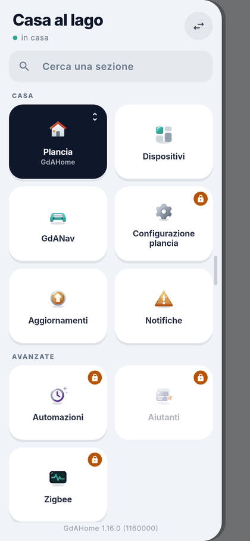
</p>

**Gruppo «Casa»**

| Voce | A cosa serve | Note |
| --- | --- | --- |
| «Plancia» | Torna alla plancia (o la ricarica se è già aperta). | |
| «Dispositivi» | Dispositivi stanza per stanza e integrazioni di Home Assistant. | Premium, solo amministratori |
| «GdANav» | Il navigatore. | Solo app |
| «Configurazione plancia» | Cambia la plancia dal telefono. | Premium |
| «Aggiornamenti» | Aggiornamenti di Home Assistant, add-on, firmware; riavvio. | Mostra un numero se ce ne sono |
| «Notifiche» | Cosa ricevere su questo telefono. | Solo app |
| «Salute» | Le misure dell'orologio verso la casa. | Solo app, Premium |

**Gruppo «Avanzate»**

| Voce | A cosa serve | Note |
| --- | --- | --- |
| «Automazioni» | Automazioni e Pianificatore. | Premium, solo amministratori |
| «Aiutanti» | Interruttori, numeri, timer, sensori calcolati. | Premium, solo amministratori |
| «Zigbee» | Abbinare dispositivi Zigbee dal telefono. | Solo app, Premium; c'è solo con ZHA o Zigbee2MQTT |
| «Gestione installatore» | Il cruscotto di chi installa. | Solo sugli impianti degli installatori |

**Gruppo «Aiuto»**

| Voce | A cosa serve |
| --- | --- |
| «Impostazioni app» | Plancia leggera e lucchetto con volto o impronta. |
| «Diagnostica app» | Come sta andando l'app nell'ultimo minuto. |
| «Segnalazioni» | Mandare un problema, un'idea o una domanda. |
| «Assistenza» | La chat privata con chi fa l'app. |
| «GdAHome Premium» | Abbonamento, prova gratuita, codice regalo. |

> **Il lucchetto.** Su una casa Base le voci Premium restano nel menu con un
> lucchetto. Toccandole si apre la pagina Premium, che spiega in cima che cosa
> sbloccheresti. Su una casa Premium le stesse voci portano il bollino
> **«✨ PREMIUM»**.

---

## 6. La plancia: usarla tutti i giorni

<p align="center">
  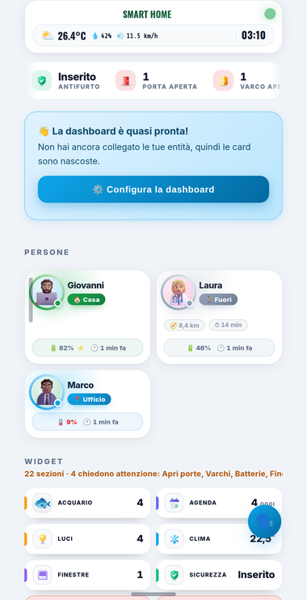
  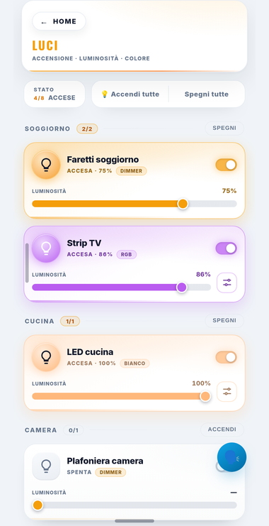
  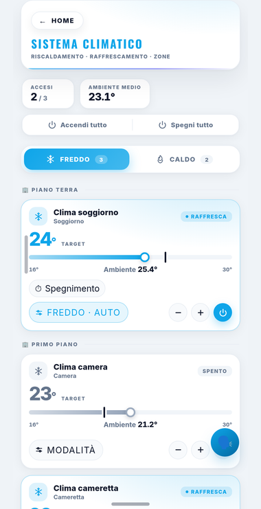
</p>

### 6.1 Come si usa

- **In alto** ci sono temperatura, antifurto e chi è in casa.
- **Sotto** ci sono i blocchi della Home e la barra con le **sezioni**.
  Toccandone una la apri; ogni sezione è divisa per stanza.
- **Un tocco** su una luce la accende o la spegne. **Trascinando il cursore**
  cambi luminosità o colore.
- **Un tocco** su una tapparella, un termostato o una telecamera apre i suoi
  comandi o il video dal vivo.
- Le **porte e i cancelli** si aprono dalla sezione «Porte e cancelli»: se è
  stato impostato, chiedono il **PIN dell'azione**.
- Le **Azioni rapide** della Home sono tasti che fanno più cose insieme (per
  esempio «Esco»: spegne tutto e chiude le tapparelle).

### 6.2 Le sezioni della plancia

Le sezioni si accendono e si spengono dalla Configurazione
([capitolo 7](#7-configurare-la-plancia)). Una sezione senza contenuto non
compare nella barra.

| Sezione | Cosa contiene |
| --- | --- |
| 🏠 Home | I blocchi della pagina iniziale, nel loro ordine, e i widget |
| ⚡ Energia | Contatori, fotovoltaico, accumulo, fasce, tariffe, flusso, bollette, report |
| 🚗 Auto elettrica | Auto, colonnina, evcc, ricarica di notte |
| 🧭 GdANav | Viaggi pianificati dal computer, che ritrovi nel navigatore |
| 🌞 Gestione termica (Solare) | Solare termico, scaldabagno, caldaia, stufa a pellet |
| 🛡️ Sicurezza | Telecamere, sensori, centrale d'allarme |
| 🖥️ Server e rete | Server, container, rete, Proxmox |
| 🌡️ Temperature | Le temperature delle stanze |
| 🌦️ Meteo | Condizioni attuali, stazione meteo di casa, previsioni, radar |
| ⚽ Sport | La tua squadra di calcio o hockey, Formula 1, MotoGP |
| ❤️ Salute | Le misure dall'orologio, Strava |
| ❄️ Clima | Termostati, VMC, deumidificatori |
| 🪟 Finestre | Tapparelle e finestre |
| 🏊 Piscina | |
| 💧 Irrigazione | |
| 🧺 Elettrodomestici | Lavatrice, lavastoviglie ecc., con cicli e programmi |
| 🤖 Aspirapolvere | I robot |
| 🐾 Animali | Anche acquari e terrari |
| 💡 Luci | |
| 🛋️ Stanze | Ogni stanza con quello che contiene |
| 📅 Agenda | Il calendario |
| 🔌 UPS | Gruppi di continuità |
| ⛈️ Allerte | Allerte meteo e della protezione civile |
| 🗑️ Rifiuti | Il calendario della raccolta |
| 🚪 Varchi | I contatti di porte e finestre |
| 🏃 Presenza | Sensori di movimento e di presenza |
| 🖨️ Stampanti | |
| 🔓 Porte e cancelli | Aperture, con PIN |
| 📮 Citofono e posta | Campanello, citofono, cassetta della posta |
| 🎵 Musica | Lettori, radio, Alexa |
| 🔋 Batterie | Livello delle batterie dei dispositivi |
| 🪴 Piante | |
| 💧 Acqua e gas | Contatori, pressione, portata, sale dell'addolcitore |
| ⭐ Le tue sezioni | Sezioni tue, con titolo e icona |

### 6.3 Alcune sezioni nel dettaglio

**Salute.** Le misure di ogni persona della famiglia che manda i dati
dall'orologio ([capitolo 12](#12-la-salute-dallorologio)): i **passi di oggi**
con l'anello dell'obiettivo (10.000 di serie, si cambia in Config, «Passi al
giorno») e gli ultimi 7 giorni; una scheda per ogni misura. La pressione ha
una fascia («Ottimale», «Normale-alta», «Alta», «Bassa»). **Toccando una
scheda** apri lo storico a **7, 30 o 90 giorni**, con media, minimo, massimo e
dettaglio giorno per giorno.

**UPS.** In Configurazione, scheda UPS: **«Aggiungi un UPS»** → scegli le
entità («Rete elettrica», «Carico», «Autonomia residua», «Potenza»,
«Tensione», «Temperatura») → **«Salva UPS»**. NUT e apcupsd vengono trovati
da soli. La tessera mostra «Rete presente», «Sotto protezione» o «L'UPS non
risponde».

**Sport.** In Configurazione → Casa → Sport, alla voce **«Cosa segui»**,
aggiungi fino a 8 elementi: «Squadra di calcio» (scegli il campionato e la
squadra), «Squadra di hockey» (NHL), Formula 1 e MotoGP con il «Pilota del
cuore». Li riordini con «Sposta su» / «Sposta giù» e li togli con «Togli».
Non serve nessun account.

**Auto elettrica: la ricarica notturna.** Se in casa c'è **evcc**, nella
pagina Auto compare la scheda **Ricarica notturna**. Accendila e imposta
**«Dalle» / «Alle»**, i **«Giorni»**, **«Parte se la batteria è sotto»**, la
**«Potenza della wallbox»**, cosa fare **«Poi»** («Spento» / «Come prima» /
«Intelligente») e il **«Prezzo in fascia»**. La casa avvia e ferma la ricarica
da sola, anche a pagine chiuse, e ti dice se l'auto **«Ci arriva?»**.

---

## 7. Configurare la plancia

### 7.1 Come si apre la Configurazione

- Dall'app: menu → **«Configurazione plancia»** **(Premium)**.
- Dalla plancia: l'**ingranaggio** in cima.
- Dal browser, in Home Assistant: è sempre disponibile per l'amministratore.

La Configurazione la apre solo l'utente indicato come **«Utente admin»**. Agli
altri utenti l'ingranaggio non compare.

### 7.2 Il primo passo: farla compilare in automatico

1. Apri la Configurazione.
2. Premi **🪄 «Rileva automaticamente le mie entità»**.
3. GdAHome trova luci, stanze (dalle aree di Home Assistant), clima e
   telecamere, e ti mostra un riepilogo.
4. Controlla il riepilogo e **accettalo**: finché non accetti non viene
   scritto niente.

### 7.3 Le schede della Configurazione

Le schede sono raggruppate per famiglia:

| Famiglia | Schede |
| --- | --- |
| ⚙️ Plancia | ⚙️ Impostazioni (lingua, Assist, elenco delle sezioni, modo chiosco, tema, tavolozza), 🏠 Home, 🧩 Widget della Home, ⚡ Azioni rapide, ⏰ Automazioni, 📟 A muro, 👁️ Colpo d'occhio, ⭐ Le tue entità, ⭐ Le tue sezioni, 💾 Backup e ripristino, 🩺 Diagnostica |
| ⚡ Energia | Energia, accumulo, Auto elettrica, GdANav, UPS |
| 🌡️ Clima e acqua | Clima, Temperature, Meteo, Gestione termica, Piscina, Piante, Irrigazione, Acqua e gas |
| 🛋️ Casa | Stanze, Luci, Finestre, Elettrodomestici, Musica, Radio, Sport, Aspirapolvere, Stampanti, Animali, Persone, Batterie |
| 🛡️ Sicurezza | Sicurezza, Varchi, Presenza, Porte e cancelli, Citofono e posta |
| 🔔 Avvisi | Avvisi, Allerte, Agenda, Rifiuti |
| 🔊 Alexa | Annunci sugli Echo, avvisi personalizzati, musica |
| 🖥️ Macchine e rete | Server e rete, dispositivi che non rispondono |

### 7.4 Operazioni di tutti i giorni

**Accendere o spegnere una sezione.** Vai in **⚙️ Impostazioni** → elenco
delle sezioni e usa l'interruttore della sezione. Lo stesso interruttore
(fascia verde) c'è anche in cima a ogni scheda.

**Mettere un'entità in una sezione.** Apri la scheda della sezione (per
esempio Luci), aggiungi l'entità, scegli la **stanza** dalla tendina sulla
riga e premi **«Salva»**. Se lasci la scheda senza salvare, compare
**«Ricordati di salvare»**, con la scelta fra salvare, andare senza salvare o
restare.

**Le stanze.** Puoi assegnare una stanza a qualunque entità. Il blocco
«stanze» compare nella Home quando hai scelto almeno una stanza; dalla sua
scheda puoi spegnere tutto ciò che è acceso in quella stanza (con conferma).

**Le tue entità.** Nella scheda **⭐ Le tue entità** aggiungi entità in fondo a
qualunque sezione, anche se GdAHome non ha una sezione apposita per loro.

**Le tue sezioni.** Nella scheda **⭐ Le tue sezioni** crei sezioni nuove con
titolo e icona; ognuna ha la sua voce nella barra.

**Azioni rapide.** Nella scheda **⚡ Azioni rapide** crei i tasti della Home.
Sono anche i comandi proposti in auto e al polso.

**Tema e aspetto.** In **⚙️ Impostazioni** scegli **tema** (chiaro, scuro,
automatico), **tavolozza** e **barra di navigazione**. Queste scelte valgono
solo per il dispositivo su cui le fai.

**Modo chiosco.** Nasconde i menu per un tablet sempre acceso. Si accende in
⚙️ Impostazioni (vale per quel dispositivo), oppure tenendo premuto il tasto
☰ della plancia, oppure aggiungendo `?kiosk=1` all'indirizzo. Sul telefono è
già acceso.

### 7.5 Backup e ripristino della plancia

1. Apri **💾 Backup e ripristino**.
2. **Scarica** (oppure copia) il file JSON con tutta la configurazione e
   conservalo.
3. Per ripristinare, carica il file o incolla il testo e conferma. Il
   ripristino **non cancella nulla** di quello che non è nel file.

Il **«Reset totale»** si trova nel menu della plancia, è riservato
all'amministratore e cancella tutta la configurazione: usalo solo se vuoi
davvero ricominciare da capo.

---

## 8. Più plance: a muro, Colpo d'occhio, Casa 3D

<p align="center">
  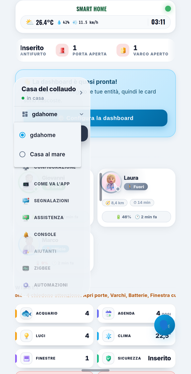
  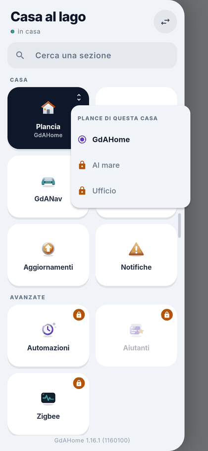
</p>

Con **Base** c'è una plancia, la **principale**. Con **Premium** puoi averne
**fino a 30 per casa**: una per la famiglia, una per il piano di sopra, una per
il tablet in cucina.

### 8.1 Creare una plancia nuova

Le plance si creano dalla scheda dell'add-on:

1. Apri **«Configura GdAHome»** → sezione **Plance**.
2. Premi **«Aggiungi una plancia»**.
3. Scrivi il **Nome** (fino a 40 caratteri, per esempio «Casa al mare»).
4. Scegli il **Tipo**:
   - **📟 A muro**: per tablet a muro e NSPanel. Comandi grandi, una schermata
     sola. Nasce già pronta, con le stanze e le scene della principale.
   - **👁️ Colpo d'occhio**: una pagina sola con il meteo e riquadri grandi
     (fotovoltaico, telecamere, antifurto, cancello). Scegli **«Parte da»**:
     **«Segue la principale»** oppure **«Da zero»**.
   - **🧊 Casa 3D**: la casa in tre dimensioni, dalla planimetria.
   - **🏠 Classica**: una plancia completa, da preparare da zero.
5. In **«Chi la vede»** spunta gli utenti che possono vederla. **Nessuna
   spunta = la vedono tutti.** Per un tablet a muro, spunta l'utente con cui è
   entrato il tablet.
6. Premi **«Aggiungi la plancia»**.

Nell'app la nuova plancia compare nel **selettore delle plance** del menu. In
Home Assistant compare fra le Dashboard della barra laterale.

### 8.2 Gestire le plance esistenti

Nell'elenco **«Le tue plance»** (contatore «N di 30»), per ogni plancia:

- **Apri** la apre in Home Assistant;
- **Gestisci** apre il pannello con:
  - **«Chi la vede»**: l'interruttore **«Solo gli amministratori della
    casa»** e le spunte **«e anche, solo questi utenti»**. Le modifiche si
    salvano subito, senza bisogno di premere niente;
  - **Rinomina**;
  - **«Togli la plancia»**. Si cancellano anche sezioni, tessere e stanze
    della plancia, e **non si torna indietro**. La prima plancia non si può
    togliere.

Se un utente non vede nessuna plancia, l'app gli mostra «Non hai plance
associate alla tua utenza».

### 8.3 La plancia a muro (Premium)

Trasforma un tablet fisso o un **Sonoff NSPanel** in un pannello con comandi
grandi, **fino a 8 pagine**.

**Prepararla**

1. Crea una plancia di tipo **📟 A muro** (oppure apri una plancia esistente).
2. In Configurazione apri la scheda **📟 A muro**.
3. Accendi **«Usa questa plancia a muro»**. Vale su ogni tablet che apre
   questa plancia.
4. In **«Prende le cose da»** scegli se usare stanze, luci, clima e antifurto
   di questa plancia o della **principale**.
5. In **«Le pagine di questo tablet»** premi **«Aggiungi una pagina»** e
   scegli il tipo:
   - «Stanza», «Scene», «Ingresso», «Personalizzata»;
   - «Tutte le luci», «Clima», «Tutte le tapparelle»;
   - «Ambienti», «Telecamere», «Energia», «Musica», «Meteo»;
   - «Mixer audio», «Telecamera con comandi», «Comandi di regia».
6. Per ogni pagina scegli la **griglia**: 4, 6 (di serie), 8, 9, 12, 16, 20 o
   24 posti.
7. Premi **«Salva»**. Finché non salvi, il tablet non vede le modifiche.

**«Altre impostazioni»**

| Impostazione | Cosa fa |
| --- | --- |
| Orientamento | Automatico, Orizzontale o Verticale; anche «Menu di lato» e «Card del clima» |
| Tema | Come la plancia, Scuro, Chiaro, oppure con l'orario |
| Temperatura mostrata | Dal meteo oppure da un sensore |
| Riposo | Dopo qualche minuto senza tocchi resta l'orologio; «Al riposo torna alla prima pagina» |
| Notte | «Di notte schermo nero» |
| Avvisi | «Avvisi sul riposo»; «Avvisi a tutto schermo», che si chiudono con «Ho visto» |
| Luminosità dello schermo | Solo con l'app GdAHome sul tablet: luminosità di giorno e di notte, «Abbassa dopo», e «Giorno e notte da» (sole, luce della stanza oppure orario) |
| Chi c'è vicino | Sveglia lo schermo col sensore di presenza di casa (consigliato), col sensore di prossimità del tablet (Android) o al tocco |
| Blocca il tablet | Per uscire dal pannello serve un PIN da 4 a 8 cifre |
| Antifurto e serrature chiedono il codice | Chiede il codice prima di comandarli |

**Sul tablet** si passa da una pagina all'altra con le linguette o facendo
scorrere il dito; un tocco apre la finestra grande. Con l'app GdAHome sul
tablet, le barre di Android spariscono e lo schermo si riaccende quando suona
il campanello.

### 8.4 Colpo d'occhio (Premium)

Una pagina sola: in cima il nome della casa, il collegamento e l'ora; poi il
meteo (a 7 giorni e ora per ora) e i riquadri grandi **Fotovoltaico**,
**Telecamere** (video dal vivo), **Antifurto** (tasti dei modi, PIN
facoltativo) e **Cancello o porta** (chiede conferma prima di aprire). Si
attiva in Configurazione → **👁️ Colpo d'occhio** → **«Accesa: questa plancia
si apre a colpo d'occhio»**. Ogni riquadro, toccato, apre i suoi dettagli.

### 8.5 Casa 3D (Premium)

La tua casa in tre dimensioni, con luci e sensori dal vivo.

**Crearla** (solo l'amministratore della plancia)

1. Apri la scheda **Casa 3D** e premi **«Crea la tua casa»**.
2. Segui gli **8 passi** guidati:
   1. **Planimetria**: una foto (anche storta), un PDF, un DWG, le misure a
      mano oppure le foto delle stanze; scegli il piano.
   2. **Scala**: segna due punti di cui conosci la distanza.
   3. **Muri**: vengono riconosciuti da soli; li ritocchi con muro, gomma,
      porta e finestra.
   4. **Stanze**: i nomi vengono dalle aree di Home Assistant oppure li scrivi.
   5. **Foto delle stanze**: arredi e dispositivi riconosciuti, ognuno legato
      alla sua entità.
   6. **Dispositivi**.
   7. **Esterno**: villa o palazzo, piani, tetto, colore della facciata.
   8. **Casa 3D**: salvi e apri, oppure aggiungi un altro piano.
3. Per modificarla in seguito usa **«Crea / modifica la casa»**, **«Aggiungi
   o rifai un piano»**, **«Modifica la planimetria di questo piano»** oppure
   **«Elimina questo piano»**.

> Le foto restano sul dispositivo da cui le carichi: si salvano solo muri,
> stanze, arredi, colori e dispositivi.

**Usarla.** In alto scegli il piano; a sinistra vedi i piani con le luci
accese, al centro la casa, a destra i dispositivi del piano con i comandi
rapidi. Un tocco accende le luci, muove le tapparelle o apre il video delle
telecamere. Il tasto **«Arreda»** serve per mobili e collegamenti.

> Con Base la plancia a muro resta una plancia normale, e Colpo d'occhio e
> Casa 3D mostrano un avviso. **La configurazione resta salvata** e torna
> com'era appena Premium è di nuovo attivo.

---

## 9. Più case e il collegamento da fuori casa

### 9.1 «Le tue case»

Con **Premium** puoi avere **fino a 10 case** nella stessa app (casa, casa al
mare, ufficio) e passare dall'una all'altra senza riabbinare.

**Aprire l'elenco**: tocca il tondo in testa al menu, oppure l'icona della
casa in alto a destra nelle pagine con la barra del titolo.

Ogni casa mostra il nome, l'etichetta **«Premium»** se lo è, e da dove la
raggiungi: «in casa adesso», «da fuori adesso», «solo sotto il Wi-Fi di casa»
oppure «in casa e da fuori».

- **Passare a un'altra casa**: tocca il suo nome.
- **Aggiungere una casa**: premi **«Aggiungi»** e ripeti l'abbinamento
  ([capitolo 4](#4-abbinare-il-telefono-alla-casa)) sull'Home Assistant
  dell'altra casa. Il tasto ha un lucchetto se nessuna delle tue case è
  Premium, e sparisce quando arrivi a 10 case.
- **Togliere una casa dal telefono**:
  1. tocca il **cestino** accanto alla casa;
  2. conferma con **«Elimina»** nella finestra «Eliminare «…»?».

  La casa sparisce da questo telefono. Per eliminare del tutto il telefono
  anche **dalla parte della casa**, toglilo anche dalla scheda dell'add-on
  (**Telefoni → ⋯ → «Togli da questa casa»**).

### 9.2 Lo stato del collegamento

Un pallino colorato con una parola ti dice come sei collegato:

| Stato | Significato |
| --- | --- |
| 🟢 «in casa» | Sei sul Wi-Fi di casa e parli direttamente con l'add-on. |
| 🟠 «da fuori» | Passi dal centralino, cifrato (Premium). |
| «sto cercando la casa…» / «riconnessione…» | L'app sta riprovando da sola. |
| 🔴 «non raggiungibile» | La casa non risponde. |
| 🔴 «da riabbinare» | Il telefono va abbinato di nuovo. |

### 9.3 Da fuori casa (Premium)

Sul Wi-Fi di casa il telefono parla direttamente con l'add-on. **Con Premium**
la casa si raggiunge anche dall'ufficio, in vacanza o con i dati mobili,
**senza fare niente**:

- **nessuna porta da aprire sul router**, nessun indirizzo pubblico, nessuna
  VPN: è la casa che tiene aperto il collegamento verso l'esterno;
- **cifrato da un capo all'altro** fra telefono e add-on: il centralino fa
  passare i messaggi ma non può leggerli;
- **il passaggio è automatico**: appena esci di casa l'app passa alla strada
  da fuori, senza che tu te ne accorga.

Perché funzioni, l'opzione dell'add-on **«Da fuori casa»** deve essere accesa
(lo è di serie). Con **Base**, fuori dal Wi-Fi di casa l'app mostra **«Fuori
casa serve GdAHome Premium»**, e la casa torna raggiungibile appena rientri.

<p align="center">
  
</p>

### 9.4 L'app dal browser (Premium)

Apri [webapp.gdahome.org](https://webapp.gdahome.org) da qualunque computer e
abbinala con il **codice a mano** (passo 4.4). L'indirizzo si salva fra i
preferiti e funziona da casa e da fuori. Nel browser non ci sono Notifiche,
Salute, Zigbee e il navigatore, che sono solo nell'app.

> In ufficio o a scuola il sito potrebbe risultare bloccato come «Newly
> Registered Domain»: dipende dall'età del dominio e non indica un problema.

---

## 10. Le notifiche

La casa ti avvisa **anche ad app chiusa**: l'antifurto che scatta, il
campanello, la lavatrice che ha finito. **Le regole stanno nell'add-on**, che
guarda i sensori e decide quando scriverti; sul telefono scegli **quali**
ricevere. Le notifiche partono **già cifrate** con la chiave del tuo telefono:
né il centralino, né Google, né Apple le possono leggere.

> **Con Base** arrivano solo gli **avvisi di sicurezza**: fumo, gas,
> allagamento, antifurto scattato e campanello. **Tutto il resto è
> Premium.**

### 10.1 Attivarle

1. La prima volta che entri in una casa compare il foglio **«Le notifiche di
   casa»**: premi **«Attiva»** e consenti le notifiche al telefono. Se avevi
   scelto «Non ora», puoi attivarle in qualsiasi momento dalla pagina
   Notifiche.
2. Apri menu → **«Notifiche»**.
3. Se hai più case, scegli dalle schede in alto **per quale casa** stai
   decidendo: ogni casa ha le sue notifiche.
4. Accendi l'interruttore principale **«Notifiche di GdAHome»**. Le pillole
   devono mostrare **«Attive su questo telefono»** e **«Cifrate»**.
5. Premi **«Manda una notifica di prova»** in fondo alla pagina. Il messaggio
   «Partita: arriva fra qualche secondo» conferma che la notifica è partita.

**Requisiti:** l'opzione «Da fuori casa» dell'add-on deve essere accesa (le
notifiche passano dal centralino), e il telefono deve essere abbinato a un
utente di Home Assistant attivo. Se qualcosa manca, la pagina lo dice con una
scheda gialla e spiega cosa fare.

> Su iPhone il banner mostra solo «GdAHome: nuova notifica»: il contenuto si
> vede toccandolo, perché arriva cifrato.

Su Android trovi tre **canali** nelle impostazioni di sistema: **«Urgenti»**
(suonano sempre), **«Casa»** e **«Manutenzione»** (silenziose).

### 10.2 Semplici o elaborate

Nella scheda **«Come le vuoi»**:

- **«Semplici»** (di serie): solo testo;
- **«Elaborate»** **(Premium)**: con la scheda col grafico e le foto delle
  telecamere. La foto passa dal centralino cifrata e viene cancellata appena
  consegnata (o dopo dieci minuti).

### 10.3 Cosa puoi ricevere

Ogni voce ha un interruttore, e sono tutte accese di serie.

| Categoria | Voce | Quando arriva |
| --- | --- | --- |
| **Urgenti** (suonano anche in silenzioso) | Antifurto scattato | Subito, con la zona |
| | Allagamento, fumo, gas | Dal primo sensore (anche il monossido) |
| | Campanello | Con la foto della porta e «Apri cancello» |
| | Manca la corrente | Dagli UPS: autonomia, e quando torna |
| **Sicurezza** | Antifurto inserito o disinserito | Totale, notte, parziale, vacanza |
| | Uscito senza antifurto | L'ultimo esce e l'antifurto è spento |
| | Porta o garage aperti | Di notte, o con la casa vuota (dopo 10 min) |
| | Movimento davanti alle telecamere | Con la foto, a casa vuota o di notte |
| **Casa** | Elettrodomestico finito | Durata, kWh e costo, col sole |
| | Freezer e frigo | Troppo caldi, o porta rimasta aperta |
| | Pioggia con finestre aperte | Mezz'ora prima |
| | La pappa degli animali | Quando è ora di darla |
| **Persone** | Arrivi e uscite | Solo per le persone che scegli (tocca i loro nomi) |
| **Assistente di casa** | Suggerimenti | Luci o clima accesi con la casa vuota, ecc. Scegli «Solo gli importanti» o «Tutti» |
| **Manutenzione** | Riepilogo serale | Ogni sera all'ora che scegli (di serie 20:30) |
| **Viaggi** | Quando partire | I viaggi pianificati in GdANav, col traffico |

### 10.4 Regolare una singola notifica

Tocca il nome di una voce: si apre il foglio con le sue scelte, che valgono
**solo per quella notifica, su questo telefono**, e si salvano subito.

| Scelta | Cosa fa |
| --- | --- |
| **Stile** | Come tutte, Semplice oppure Elaborata |
| **Quali** | Quali elettrodomestici, UPS o telecamere seguire (con «Cerca», «Tutti», «Fatto») |
| **Quando** (Movimento) | «Casa vuota o notte» (di serie), «Casa vuota», «Di notte», «Sempre» |
| **Video** (Movimento, Premium) | «Mini video del movimento»: 5 secondi prima e 5 dopo |
| **Solo se** | Per esempio «Solo se il ciclo costa più di … €» oppure «Solo se manca da più di … min» |
| **Suono** | «Muta», «Normale», «Il suo suono» |
| **Orari** | «Sempre» oppure «Solo in queste ore» (per esempio dalle 08:00 alle 22:00) |
| **Come** | «Subito» oppure «Nel riepilogo della sera» (Premium) |
| **Dentro** (Elettrodomestico) | Cosa mostrare: Durata, kWh, Costo, ☀️ Sole, Consiglio |

Con **«Prova: mandamela adesso»** ricevi subito un esempio.

> Le notifiche **urgenti** non si possono silenziare né rimandare: arrivano
> sempre e subito.

### 10.5 Ore di silenzio e «solo quando sono fuori»

Nella scheda **«Quando»**:

- **«Ore di silenzio»** (accese di serie, dalle 23:00 alle 07:00): tocca gli
  orari per cambiarli. **Le urgenti passano comunque.**
- **«Solo quando sono fuori casa»**: quando sei in casa, le notifiche di
  «Casa» e «Assistente» restano zitte.

### 10.6 Notifiche personalizzate (Premium)

Sono regole tue del tipo «quando il freezer va sopra i -10 °C per 10 minuti,
avvisami».

1. Notifiche → **«Notifiche personalizzate»** → **«Aggiungi»**.
2. **Quando**: componi la frase
   **«[entità] è [sopra/sotto/uguale a/diverso da] [valore] per [durata]»**.
   - Tocca **«Scegli l'entità»** e cercala.
   - Scegli la condizione e scrivi il valore (l'unità di misura si aggiunge
     da sola).
   - Scegli la durata: subito, 1, 5, 10, 15 o 30 minuti, oppure 1 ora.
   - Sotto vedi il **valore di adesso** («scatterebbe» / «tutto a posto») e
     un **grafico delle ultime 24 ore** con la soglia, che ti dice quante
     volte sarebbe scattata.
3. **Messaggio**: scrivi il **«Titolo»** (obbligatorio, fino a 80 caratteri)
   e, se vuoi, il testo **«Sotto il titolo»**. Con **«Con il valore e da
   quanto»** il messaggio aggiunge per esempio «-10 °C da 10 min».
4. **Urgenza**: «Bassa», «Normale» oppure «Urgente» (passa anche in
   silenzioso).
5. **Chi la riceve**: di serie solo tu. Solo un amministratore può mandarla
   ad altri utenti.
6. **«Non ripetere per»**: al massimo una volta ogni 15 min, 30 min, 1 h (di
   serie), 3 h, 12 h o 24 h.
7. Premi **«Prova adesso»** per riceverla subito, poi **«Salva»**.

Ogni casa può avere fino a **40** notifiche personalizzate. Per toglierne una,
aprila e premi **«Togli questa notifica»**. L'interruttore sulla riga la
spegne senza cancellarla.

### 10.7 Le notifiche che già mandi con Home Assistant (Premium)

Se hai automazioni che mandano notifiche all'app di Home Assistant, GdAHome le
trova e le elenca nella scheda **«Da Home Assistant»** («Ho trovato N
automazioni che ti mandano notifiche»).

1. Premi **«Accendi quelle di questo telefono»**, oppure tocca una singola
   automazione.
2. Nella sua pagina scegli **«Chi la riceve»** e se deve **«Rispetta le ore di
   silenzio»**.
3. Premi **«Ricevila anche in GdAHome»**.

Arrivano nello stesso momento e con lo stesso testo, ma cifrate. L'app di
Home Assistant continua a riceverle: se non le vuoi doppie, spegnile lì. Con
**«Proponimi le nuove»** GdAHome ti segnala le automazioni nuove (che
arrivano spente).

### 10.8 I tasti nelle notifiche e cosa succede toccandole

Molte notifiche hanno dei tasti, che valgono **per 2 ore**:

| Notifica | Tasti |
| --- | --- |
| Antifurto scattato | «Spegni sirena», «Disinserisci», «Guarda» |
| Campanello | «Apri cancello», «Ignora» |
| Uscito senza antifurto | «Inserisci», «Più tardi» |
| Porta o garage aperti | «Chiudi», «Va bene così» / «Va bene stanotte», «Più tardi» |
| Movimento | «Guarda», «Inserisci antifurto» |
| Luci con casa vuota | «Spegni», «Restano così», «Più tardi» |
| Riepilogo serale | «Apri la giornata», «OK» |

«Va bene così» zittisce quel suggerimento per 12 ore; «Più tardi» lo rimanda
di un'ora. Con il lucchetto dell'app acceso, i tasti chiedono prima volto o
impronta.

**Toccando la notifica** si apre la pagina giusta: Sicurezza, Varchi,
Elettrodomestici, Energia, Persone, Meteo, Animali, la telecamera,
«La tua giornata» o GdANav.

**Il campanello** si presenta a tutto schermo, come una telefonata, con la
foto dal vivo della porta e i tasti **«Ignora»** e **«Apri»** (che chiede
prima di sbloccare il telefono). Resta valido per 60 secondi.

**Le telecamere.** Dalla notifica di movimento vedi prima la **foto del
momento**, poi puoi premere **«Guarda dal vivo»** (un'immagine ogni 2
secondi) oppure **«Rivedi il video»**. Il **mini video** (Premium) dura 10
secondi e la casa lo conserva per tre giorni.

---

## 11. Il riepilogo della sera e «La tua giornata»

### 11.1 Il riepilogo serale (Premium)

Ogni sera, all'ora che scegli (di serie **20:30**), arriva **una notifica
sola** con la giornata della casa:

- quanta energia è arrivata dal sole, quanta ne hai usata in casa e quanto
  hai risparmiato;
- la rete: kWh, euro e quanto hai ceduto;
- il picco di potenza e il confronto con ieri;
- i record («La giornata più solare di novembre»);
- chi ha consumato di più e la carica della batteria di casa per la notte;
- un **consiglio per domani** («Domani sole fino alle 15:00: lavatrice in
  mattinata»);
- le notifiche che hai scelto di ricevere «nel riepilogo della sera»;
- cosa va sistemato (batterie scariche, dispositivi non connessi,
  aggiornamenti).

**Per regolarlo:** Notifiche → Manutenzione → **«Riepilogo serale»** → tocca
l'orario **«Ogni sera alle»** per cambiarlo.

### 11.2 La pagina «La tua giornata» (Premium)

Si apre toccando il riepilogo serale (o **«Apri la giornata»**), oppure da
Notifiche → Manutenzione → **«La tua giornata»**. Tira la pagina verso il
basso per aggiornarla.

Le sezioni compaiono solo se la casa ha i dati corrispondenti:

| Sezione | Cosa racconta |
| --- | --- |
| In breve | Tre o quattro fatti della giornata |
| Energia | «Ora per ora» (sole, usato in casa, consumo), «Chi ha consumato di più», «Soldi» (rete, ceduti, risparmiati, il mese finora, la rete per fascia), «Batteria di casa» |
| Clima di casa | Temperature e umidità per stanza; quanto è stato acceso il riscaldamento; finestre aperte col clima acceso |
| Acqua calda | Solare termico, quanto calore ha preso e quanta corrente ha fatto risparmiare |
| Auto e consumi | Ricariche, chilometri, quanto dal sole; acqua, gas e irrigazione |
| La casa | Porte aperte, automazioni eseguite, avvisi (senza nomi di persone) |
| Rispetto a | Ieri, la settimana, il mese |
| Domani | Meteo e ore di sole |
| Da sistemare | Le cose che chiedono attenzione |

---

## 12. La Salute dall'orologio

**(Premium, solo app sul telefono.)** Passi, battito, pressione, peso, sonno e
altre misure dall'orologio arrivano nella tua casa e diventano sensori di Home
Assistant. Funziona con **Apple Salute** (iPhone e Apple Watch) e con
**Health Connect** su Android (Galaxy Watch, Pixel Watch, Fitbit, Amazfit e
gli altri che ci scrivono; serve Android 8 o successivo).

### 12.1 Attivarla

1. Menu → **«Salute»**.
2. Su Android, se manca Health Connect, premi **«Installa Health Connect»**.
3. Accendi **«Manda le misure alla casa»** e concedi il permesso di lettura
   della salute.
4. Lascia acceso **«Manda anche ad app chiusa»** (di serie):
   - su iPhone, quando Salute ha un dato nuovo, l'iPhone sveglia GdAHome (a
     telefono bloccato aspetta lo sblocco);
   - su Android l'invio avviene circa ogni mezz'ora, quando c'è la rete.
5. In **«Come ti chiama la casa»** scrivi il tuo nome (fino a 30 caratteri):
   con quel nome le tue misure compaiono nella pagina Salute della plancia.
6. In **«Cosa mandare»** spunta le misure: Passi, Distanza a piedi, Piani
   saliti, Battito, Battito a riposo, Peso, Massa grassa, Pressione massima e
   minima, Ossigeno, Sonno, Calorie attive e a riposo; su iPhone anche Minuti
   di esercizio e Ore in piedi. Di serie sono tutte accese, tranne Massa
   grassa e Ossigeno.
7. Premi **«Manda adesso»** per un primo invio («Mandate N misure alla
   casa.»).

Ogni membro della famiglia fa lo stesso **sul proprio telefono**: nella
pagina Salute della plancia compare una persona per telefono, con il selettore
in alto.

### 12.2 Se una misura non arriva

- **Android**: premi **«Dai i permessi che mancano»**. Se la richiesta non
  compare, vai in **Impostazioni → Health Connect → Autorizzazioni app →
  GdAHome**.
- **iPhone**: vai in **Impostazioni → Salute → Accesso ai dati e dispositivi →
  GdAHome** e controlla che la misura sia permessa.
- Se compare «La casa non accetta le misure», la casa non è Premium oppure il
  telefono non è intestato a un utente: riabbinalo entrando con il tuo utente.

### 12.3 Privacy

Le misure vanno **solo alla tua casa**, cifrate, senza passare da server di
GdAHome. GdAHome legge da Salute e **non ci scrive mai**. Spegnendo
l'interruttore, **la casa cancella le tue misure**.

> Le misure sono visibili a chiunque possa aprire la plancia che contiene la
> sezione Salute. Se vuoi tenerle riservate, metti la sezione in una plancia
> visibile solo a te (**«Chi la vede»**, [capitolo 8](#8-più-plance-a-muro-colpo-docchio-casa-3d)).

---

## 13. Dispositivi, integrazioni, aiutanti e Zigbee

Queste pagine **cambiano Home Assistant**. Per questo sono **Premium** e
riservate a **chi amministra Home Assistant**. Gli altri utenti non le vedono
nel menu; se ci arrivano, leggono «Solo per chi amministra».

### 13.1 Dispositivi

Menu → **«Dispositivi»**. La pagina ha due schede.

**Scheda «Dispositivi»**

- Raggruppa **«Per stanza»** oppure **«Per integrazione»**, e usa **«Cerca
  un dispositivo…»**.
- Ogni riga mostra marca, modello e il valore principale o l'interruttore.
  «Non risponde» indica un dispositivo scollegato; «Senza stanza», uno non
  assegnato.
- Toccando un dispositivo vedi **tutte le sue entità**, con i loro comandi, e
  il tasto **«↻ Ricarica l'integrazione»**.

**Scheda «Integrazioni»**

- In cima ci sono tre riquadri: **«Installate»**, **«Dispositivi»** e **«Da
  guardare»** (da sistemare, non rispondono, nuove).
- **«Trovata in rete: …»** segnala un'integrazione scoperta da Home
  Assistant: premi **«Aggiungi ›»**.
- Nel gruppo **«Da guardare»** ci sono le integrazioni con **«L'accesso va
  rifatto»**: premi **«Ripara»**.
- Toccando un'integrazione trovi **«Ricarica»**, **«⚙️ Opzioni»**,
  **«Disattiva»** / **«Riattiva»**, **«Elimina»** e **«＋ Aggiungi
  un'altra»**.

**Aggiungere un'integrazione**

1. Premi **«＋ Aggiungi»**.
2. Cerca il nome (per esempio «Shelly», «Hue», «Sonos»).
3. Rispondi alle domande della procedura guidata di Home Assistant, una alla
   volta.

> **Elimina** toglie l'integrazione con tutti i suoi dispositivi ed entità, e
> le automazioni che li usano smettono di funzionare. Non si torna indietro.

### 13.2 Aiutanti

Menu → **«Aiutanti»**: le variabili e i sensori «fatti in casa».

**Creare un aiutante**

1. Premi **«＋ Nuovo»** e scegli il tipo:
   - **Semplici**: «Interruttori», «Numeri», «Elenchi», «Testi», «Date e
     ore», «Pulsanti», «Timer», «Contatori», «Programmi». Un Programma è
     acceso nelle fasce orarie che scrivi, per esempio `7-9, 18:30-23`.
   - **Calcolati**: gruppi, soglie, modelli, contatori di consumo, minimo e
     massimo. Questi passano dalla procedura guidata di Home Assistant.
2. Compila il modulo (Nome, Icona, Minimo, Massimo, Passo, Unità di misura,
   Voci, Durata…).
3. Premi **«Salva in Home Assistant»**.

Toccando un aiutante puoi cambiarne subito il valore (**«Avvia»**,
**«Pausa»**, **«Azzera»**, **«Imposta»**, **«Premi»**), oppure usare
**«Modifica»** ed **«Elimina»**.

### 13.3 Zigbee: aggiungere un dispositivo dal telefono

**(Premium, solo app.)** La voce **«Zigbee»** compare se in casa c'è **ZHA**
o **Zigbee2MQTT**; GdAHome riconosce da solo quale dei due usi.

1. Menu → **«Zigbee»**.
2. Leggi **«Prima di cominciare»**: porta il dispositivo **vicino a una presa
   o a una lampadina già in casa** e **tienilo spento**.
3. Premi **«Apri la rete»**. Parte un conto alla rovescia di circa 4 minuti,
   poi la rete si richiude da sola.
4. **«Adesso tocca a te»**:
   1. accendi il dispositivo;
   2. mettilo in abbinamento: quasi sempre si tiene premuto il tasto per
      cinque secondi, finché la spia non lampeggia;
   3. aspetta sulla pagina («Sto ascoltando la casa»).
5. Quando compare **«È entrato»**, vedi marca e modello. Nel campo **«Come lo
   chiami»** dagli un nome chiaro (per esempio «Luce comodino») e premi
   **«Chiamalo così»**. È il momento migliore per dargli un nome, perché
   ancora non lo usa nessuno.
6. **«È a posto»**: premi **«Adesso mettilo nella plancia»** per aprire
   **«Dove lo metto?»**, oppure **«Aggiungine un altro»**.

Se hai finito prima del tempo, puoi chiudere la rete con **«Richiudi la rete
adesso»**.

**«Dove lo metto?»**

La plancia ti propone la sezione giusta e ti dice perché («è una lampadina»,
«è una presa», «è un sensore di porta», «misura la temperatura»…).

1. Controlla la proposta (**«Te la propongo io»**) oppure scegli un'altra
   sezione sotto **«Oppure»**.
2. Scegli la **«Stanza»**.
3. Premi **«Mettilo in Luci»** (o nella sezione scelta). Se preferisci farlo
   dopo, premi **«Più tardi»**.

Niente è definitivo: nome, stanza e icona si cambiano quando vuoi dalla
Configurazione.

**La rete e i dispositivi già presenti**

- In **«Ce ne sono N»** tocca un dispositivo. Vedi il suo ruolo («È l'antenna
  della rete», «Fa da ponte per gli altri», «Sta in fondo a un ramo», «va a
  batteria») e trovi i tasti:
  - **«Salva il nome»**, per rinominarlo (Home Assistant ricrea le entità:
    le sezioni che lo usano vanno sistemate);
  - **«Mettilo nella plancia»**;
  - **«Togli dalla rete»**. Un dispositivo a batteria va prima svegliato
    premendo il suo tasto.
- Premi **«Guarda la rete»** → **«Rifai il giro»** per disegnare la **mappa
  della rete**. Ci può volere un minuto, e nel frattempo i comandi sono più
  lenti.

---

## 14. Automazioni e Pianificatore

**(Premium, riservate agli amministratori.)** Sono **vere automazioni di Home
Assistant**: le esegue Home Assistant anche ad app chiusa, e le ritrovi in
**Impostazioni → Automazioni** con il segno «gdahome».

Menu → **«Automazioni»**. La pagina ha due schede: **«Automazioni»** e
**«Pianificatore»**.

### 14.1 L'elenco

- In cima ci sono i riquadri **«Attive»**, **«Spente»** e **«Prossima»**.
- Raggruppa **«Per categoria»**, **«Per tipo»** o **«Per stanza»**, e usa
  **«Cerca un'automazione…»**.
- I riquadri **«Prossimo»** e **«Ultime eseguite»** dicono cosa sta per
  succedere e cosa è appena successo.
- **«N proposte per la tua casa»** apre i suggerimenti pensati sui tuoi
  dispositivi: per ognuno premi **«Crea»** oppure **«No, grazie»**.
- Toccando un'automazione trovi l'interruttore, **«Esegui ora»**,
  **«✏️ Modifica»**, **«Duplica»**, **«Stanza e nome»** ed **«Elimina»**.

Le automazioni molto complesse (con modelli o blueprint) mostrano un
riassunto leggibile e il tasto **«Apri in Home Assistant ↗»**.

### 14.2 Creare un'automazione

1. Premi **«＋ Nuova»**.
2. Parti da un modello pronto oppure **«Da zero»**. I modelli sono: «Luce col
   movimento», «Tapparelle a orario», «Clima spento con finestra aperta»,
   «Avvisami quando la lavatrice ha finito», «Tutti fuori: spegni tutto»,
   «Bentornato a casa» e «Cronotermostato».
3. Compila i tre blocchi:

**QUANDO** (cosa la fa partire)

- ⏰ a un orario (anche all'alba e al tramonto)
- 🚪 una porta o finestra si apre o si chiude
- 🏃 c'è movimento, oppure non ce n'è da X minuti
- 🌡️ un valore sale o scende
- 🏠 qualcuno arriva o esce, oppure tutti fuori
- 🛡️ l'antifurto si inserisce o suona
- 🔌 un elettrodomestico finisce
- sotto **«Altro…»**: un'entità cambia stato, un attributo cambia, un evento
  di Home Assistant (tasti Zigbee, tag…), ogni tot minuti

**SOLO SE** (facoltativo; scegli se devono valere «tutte insieme» o se
«basta una»)

- 🌙 è notte
- 🕐 fra due orari
- 📅 certi giorni
- 🏠 chi è in casa
- 💡 un'entità è… / 🌡️ un valore è…
- ☀️ il sole è…

Aggiungi con **«＋ Una condizione»**.

**ALLORA** (cosa fare)

- 💡 accendi, ⏻ spegni
- 🪟 tapparella, 🌡️ clima
- ⚡ azione della plancia
- 📱 notifica (scrivi cosa ti dice l'app)
- ⏱ aspetta
- sotto **«Altro…»**: imposta un valore, lettore multimediale, aspetta
  finché…, chiama un servizio

Aggiungi con **«＋ Aggiungi un'azione»**.

4. Se ti servono, apri le opzioni avanzate: **«Non più di una volta ogni»**,
   **«Se riscatta mentre è in corso»**, **«Attiva fino al»**.
5. Controlla la frase **«Si legge così:»**, che racconta l'automazione in
   italiano.
6. Premi **«SALVA IN HOME ASSISTANT»**.

### 14.3 Il Pianificatore: routine a orari e calendari a fasce

Scheda **«Pianificatore»** → **«＋ Crea la prima»** (oppure **«＋ Nuova»**).
Scegli uno dei due tipi.

**«Routine a orari»**: a ogni orario le sue azioni («alle 6:30 caldaia, alle
7 tapparelle su»).

1. Scegli i **«Giorni»**.
2. In **«Orari»** premi **«＋ Aggiungi un orario»** e, per ogni orario,
   aggiungi le azioni.
3. In **«Quando vale»** scegli **«Tutto l'anno»** oppure **«Dal… al…»** (si
   ripete ogni anno).
4. Se vuoi, aggiungi un **«Solo se»**, poi salva.

**«Calendario a fasce»**: tiene acceso qualcosa nelle fasce che disegni.

1. In **«Cosa accende»** scegli l'entità.
2. In **«Le fasce»** **trascina il dito** sulle barre dei giorni per segnare
   quando è acceso. Le scorciatoie **«Copia Lun su Mar–Ven»** e **«Copia Sab su
   Dom»** evitano di ridisegnare; **«Svuota»** cancella tutto.
3. In **«Fuori dalle fasce»** scegli **«Spegni»** oppure **«Lascia com'è»**.
4. Salva.

**Cronotermostato** (dal modello omonimo):

1. Imposta le due temperature, **«IN CASA»** e **«NOTTE / FUORI»**.
2. Trascina il dito per indicare **«Quando serve il caldo»**.
3. Con **«Finestra aperta, si spegne»** il riscaldamento si spegne quando apri
   una finestra e riparte quando la chiudi.

---

## 15. In auto e al polso: GdANav, Android Auto, CarPlay, orologi

### 15.1 GdANav, il navigatore

Nell'app c'è **GdANav**, un navigatore pensato per l'auto elettrica che va
bene anche a benzina o a gasolio: percorso, distributori con i prezzi del
giorno, traffico, autovelox, meteo lungo la strada, segnalazioni (incidenti,
lavori, strade chiuse) e lo svincolo ingrandito agli incroci.

<p align="center">
  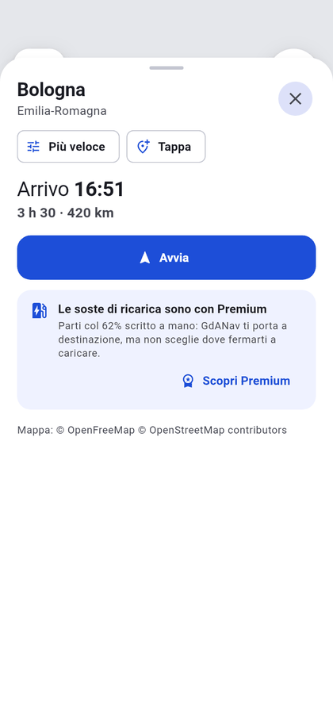
  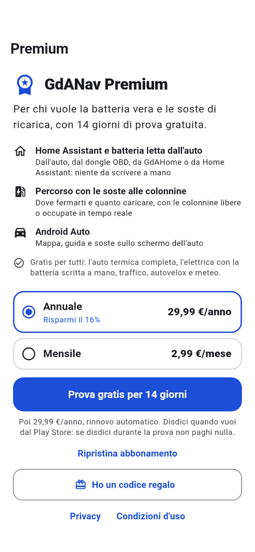
</p>

**Aprirlo**: menu → **«GdANav»**, oppure tocca la tessera GdANav in cima al
menu. Le scorciatoie **«A casa»** e **«Al lavoro»** partono subito se hai
impostato quei luoghi nel navigatore; altrimenti il navigatore si apre per
farteli impostare. GdANav si accende anche da solo quando colleghi il telefono
all'auto.

**L'auto elettrica.** GdANav usa l'auto attiva nella sezione **Auto
elettrica** della plancia e ne legge dal vivo batteria, autonomia e ricarica.
Non serve nessun codice, perché la casa è già collegata.

| | GdANav (gratis, con Base) | GdANav Premium (compreso in GdAHome Premium) |
| --- | :-: | :-: |
| Auto a benzina o gasolio | completa | completa |
| Auto elettrica | batteria scritta a mano, percorso senza soste | batteria **letta dall'auto**, **soste alle colonnine** in tempo reale |
| Traffico, autovelox, meteo | ✅ | ✅ |
| Home Assistant, Android Auto, CarPlay | — | ✅ |

**Le persone sulla mappa.** Le persone della sezione Persone che hanno il GPS
compaiono sulla mappa. Toccando il loro segnaposto ottieni le indicazioni per
raggiungerle.

**Con Siri** (iPhone, anche in CarPlay) puoi dire: «Portami a casa con
GdAHome», «Portami al lavoro con GdAHome», «Naviga con GdAHome», «Aggiungi una
tappa con GdAHome».

### 15.2 Pianificare un viaggio (GdANav Premium)

I viaggi si pianificano dall'app (tessera GdANav → **«Pianifica i viaggi»**)
oppure dal computer, nella pagina **🧭 GdANav** della plancia. Li ritrovi nel
navigatore sul telefono, su CarPlay e su Android Auto.

1. Premi **«＋ Nuovo viaggio»**.
2. Scegli il tipo: **«Una volta»**, **«Ogni settimana»** oppure **«A tappe»**.
3. Se vuoi, dai un **nome** (per esempio «Giro clienti»).
4. Scrivi **«Da dove parti?»** e **«Dove vai?»**, e scegli il suggerimento
   📍. Nei viaggi a tappe aggiungi le soste con **«Aggiungi una tappa…»** e i
   minuti di sosta di ciascuna.
5. Scegli il **giorno** (o i giorni della settimana) e **«Arrivo entro»**
   oppure **«Parto alle»**.
6. A destra leggi **«Parti alle …»**, l'arrivo, la strada e le eventuali soste
   di ricarica.
7. Con un'auto elettrica, nella scheda **«L'auto»** scegli:
   - **«Alla partenza»**: la carica di adesso, l'obiettivo di stanotte oppure
     100%;
   - **«Carica minima all'arrivo»**: 10, 15 (di serie), 20 o 30%;
   - la **potenza minima delle colonnine**: da 50, 100 (di serie) o 150 kW.

   Sotto vedi le **«⚡ Soste di ricarica»** proposte.
8. In **«Avvisi»** accendi **«Avvisami prima»** e scegli quanti minuti prima
   di partire (5–30).
9. In **«Prepara l'auto e la casa»** puoi:
   - accendere il **clima dell'auto** 10 minuti prima di partire;
   - mettere nell'avviso un tasto per aprire **il garage**. Il garage non si
     apre mai da solo.
10. Premi **«Salva il viaggio»**.

Ognuno vede solo i propri viaggi: fino a 50 viaggi, con un massimo di 10
tappe ciascuno.

### 15.3 La casa in Android Auto e CarPlay (Premium)

Sullo schermo dell'auto si apre la mappa di GdANav. Il tasto con la
**casetta** apre i **«Comandi rapidi»**: una griglia di tasti di casa (6 su
ogni auto, fino a 12 sugli schermi grandi). Da lì trovi anche:

- **«Dispositivi»**: i dispositivi di casa con il loro stato, comandabili con
  un tocco;
- **«Azioni rapide»** (su CarPlay «Azioni»): le azioni rapide della plancia;
- su Android Auto, **«Come sta la casa»**: energia e chi è in casa.

**Scegliere i tasti per l'auto (cancello, portone…)**

1. Sul telefono apri **GdANav** → menu ☰ → **«Comandi rapidi in auto»**.
2. La prima volta la pagina è già compilata con le azioni rapide della
   plancia, il cancello e il garage.
3. In **«I TUOI COMANDI»** (fino a 12):
   - **tocca** un comando per cambiare **«Nome sul tasto in auto»**,
     **«Icona in auto»** e **«Chiedi conferma in auto»**, poi premi
     **«Salva»**;
   - **tieni premuto** per spostarlo (i primi 6 si vedono su ogni auto);
   - il tasto **meno** lo toglie.
4. Per aggiungere altri comandi:
   - da **«AZIONI RAPIDE DELLA PLANCIA»** premi **«Aggiungi»** oppure
     **«Aggiungi tutte»**;
   - da **«DALLA CASA»** cerca cancello, luci, scene… e toccali;
   - oppure premi **«Crea un comando»**:
     1. scegli il dispositivo;
     2. scegli cosa fa («Apri», «Chiudi», «Accendi o spegni», «Attiva»,
        «Premi»…);
     3. scrivi il nome sul tasto;
     4. premi **«Aggiungi in auto»**.
5. Le modifiche si salvano da sole.

Le serrature chiedono sempre conferma in auto («Sei sicuro?», «Sì» / «No»).

**«Quasi a casa»: il comando che ti viene proposto arrivando**

1. Nella stessa pagina, scheda **«Quasi a casa»**, scegli il comando da
   proporre (per esempio «Apri cancello») oppure «Non proporre niente».
2. Scegli **«Quanto prima di arrivare»**: da 100 m a 2 km (di serie 500 m).
3. Imposta **«Casa»** nel navigatore: la distanza si misura da lì.

Arrivando, lo schermo dell'auto chiede **«Quasi a casa»** con i tasti
**«Fallo»** / **«Non ora»**. La domanda arriva una volta per arrivo, dopo che
ti sei allontanato abbastanza da casa.

I comandi partono anche con l'app chiusa sul telefono. Dopo aver premuto un
tasto, l'auto risponde «fatto», «in coda» o «serve GdAHome Premium».

### 15.4 Al polso: Apple Watch e Wear OS (Premium)

L'orologio **non ha impostazioni sue**: mostra la casa del telefono, e i suoi
tasti sono gli stessi **«Comandi rapidi in auto»** del paragrafo 15.3.

1. Installa GdAHome sul telefono e aprila **una volta** con l'orologio
   collegato.
2. Sull'orologio trovi:
   - **i comandi rapidi**;
   - **«Dispositivi»** (fino a 24, con lo stato, comandabili con un tocco);
   - **«Azioni rapide»**;
   - **«Come sta la casa»** (chi è in casa, energia);
   - il **«Navigatore»**: durante la guida mostra la freccia, la distanza e
     il limite di velocità; altrimenti offre **«Portami a casa»** e **«Al
     lavoro»**.

Se l'orologio dice «Il telefono non risponde», tieni il telefono vicino con
GdAHome installata. Su Wear OS, controlla anche il Bluetooth.

---

## 16. GdAHome Premium e licenze

### 16.1 Base e Premium a confronto

| | **Base**<br>gratis, per sempre | **Premium**<br>4,99 € al mese · 49,99 € all'anno |
| --- | :-: | :-: |
| L'add-on e la plancia in Home Assistant | ✅ | ✅ |
| Plance | una, la principale | fino a **30** per casa |
| Telefoni abbinati alla casa | fino a 2 | **senza limite** |
| Case nell'app | una | fino a **10** |
| Dove funziona | sulla rete di casa | **anche da fuori**, cifrato |
| L'app dal browser | — | ✅ |
| Configurare la plancia dal telefono | — | ✅ |
| Dispositivi, integrazioni, aiutanti, automazioni dall'app | — | ✅ |
| Zigbee dall'app con «Dove lo metto?» | — | ✅ |
| Notifiche | solo sicurezza | tutte, elaborate, mini video, riepilogo serale |
| La tua giornata | — | ✅ |
| Plancia a muro, Colpo d'occhio, Casa 3D | — | ✅ |
| La Salute dall'orologio | — | ✅ |
| Al polso e in auto | — | ✅ |
| GdANav | gratis | **GdANav Premium compreso** |
| Segnalazioni e assistenza, aggiornamenti, lucchetto | ✅ | ✅ |
| Account da creare | nessuno | nessuno |

> **I primi 14 giorni di Premium sono gratis**, la prima volta. Se non ti
> serve, disdici dal Play Store o dall'App Store prima che finiscano.

### 16.2 Premium è della casa, non del telefono

Si attiva **una volta per la casa**: tutti i telefoni abbinati a quella casa,
e anche l'app dal browser, diventano Premium insieme a lei. Chi abita con te
**non paga un'altra volta**.

### 16.3 Attivare Premium dall'app

1. Menu → **«GdAHome Premium»**.
2. Scegli **«Annuale»** o **«Mensile»**.
3. Premi **«Prova gratis per 14 giorni»** (oppure «Abbonati a …»).
4. Conferma il pagamento con Google Play o con l'App Store.
5. Compare **«Fatto: ora la casa è Premium.»**

<p align="center">
  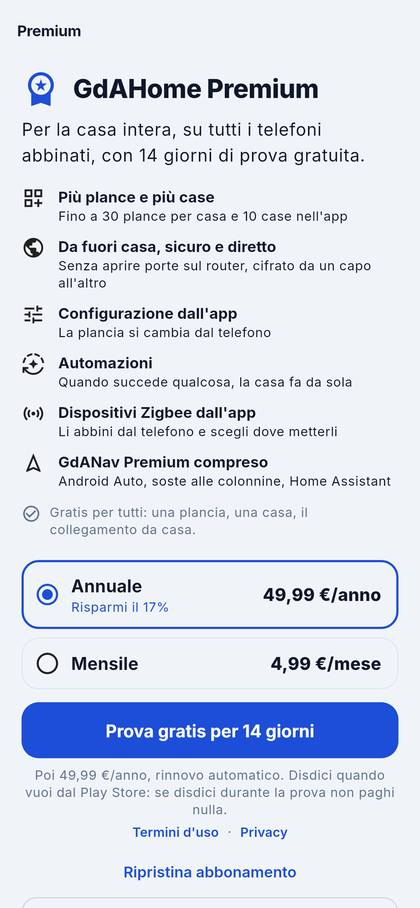
  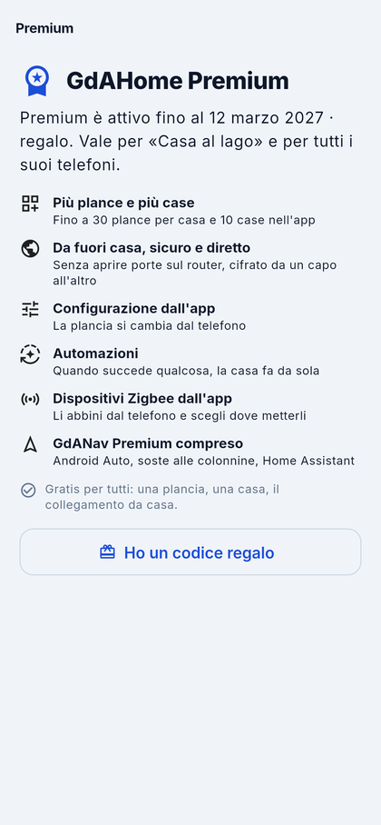
</p>

- **Dal browser non si compra**: compri dal telefono, e vale anche nel
  browser.
- **«Gestisci abbonamento»** apre l'abbonamento nel negozio, per cambiarlo o
  disdirlo.
- **«Ripristina abbonamento»** serve dopo un cambio di telefono o se hai già
  pagato. Un abbonamento vale per **una casa alla volta**: ripristinandolo su
  un'altra casa, quella di prima torna Base.
- Se dopo il pagamento la casa non risponde, non ricomprare: l'abbonamento si
  attiva da solo appena la casa torna raggiungibile.

### 16.4 Con un codice regalo

I codici regalo sono fatti così: `GDA-XXXX-XXXX-XXXX` e **valgono una volta
sola**.

**Dall'app (anche dal browser)**

1. Menu → **«GdAHome Premium»** → **«Ho un codice regalo»**.
2. Scrivi il codice.
3. Premi **«Riscatta»**. Il messaggio di conferma è «Codice riscattato: la
   casa è Premium.»

**Dalla scheda dell'add-on**

1. Apri **«Configura GdAHome»** → **Licenza**.
2. Scrivi il codice nella casella di **«Come si attiva» → «Con un codice»**.
   Puoi scriverlo anche in minuscolo o senza trattini.
3. Premi **Attiva**.

<p align="center">
  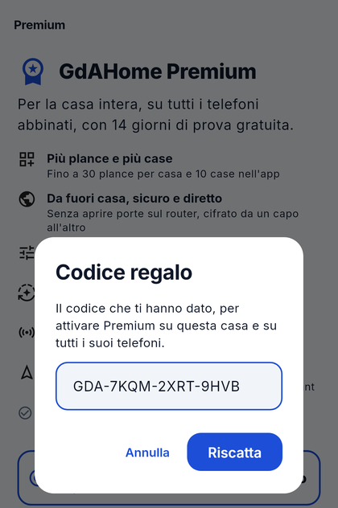
</p>

### 16.5 Dal tuo installatore

Se l'impianto te l'ha fatto un installatore, può:

- **assegnare Premium direttamente alla tua casa**: non devi fare niente,
  perché l'app lo sa già;
- **mandarti un codice regalo**, che riscatti come al paragrafo 16.4. La
  durata parte da quando lo riscatti.

Se qualcuno ti vuole regalare Premium, ti chiederà la **«Matricola della
casa»**: la trovi in **«Configura GdAHome» → Licenza → «Matricola della
casa»**, con il tasto **Copia**.

### 16.6 Quando Premium finisce

**Non si perde niente.** La casa torna Base:

- la plancia principale resta, e le altre **restano salvate** e tornano
  appena Premium torna;
- dei telefoni ne restano abbinati due, **i due usati più di recente**. Gli
  altri si staccano e mostrano «Con Base si abbinano al massimo 2 telefoni»;
  con Premium si riabbinano con un QR nuovo;
- una casa senza internet resta Premium per **fino a 8 giorni** con l'ultima
  licenza nota.

### 16.7 GdANav da solo

GdANav Premium esiste anche da solo (**2,99 € al mese · 29,99 € all'anno**,
con 14 giorni gratis), per chi vuole solo il navigatore. **Con GdAHome
Premium è già compreso.**

---

## 17. Impostazioni dell'app, lucchetto e diagnostica

### 17.1 Impostazioni app

Menu → **«Impostazioni app»** (solo nell'app). La pagina ha due capitoli.

**«La plancia»**

- **«Plancia leggera»** (spenta di serie): ferma le animazioni continue e
  toglie le sfocature. Accendila solo se il telefono fa fatica.
- **«Composizione ibrida»** (Android): prova a spegnerla solo se, con lei
  accesa, l'app va peggio.

Cambiare uno di questi interruttori ricarica la plancia.

### 17.2 Il lucchetto: volto o impronta

Nel capitolo **«Sicurezza»** (spento di serie):

1. Accendi **«Chiedilo quando apro l'app»**. Vale per tutte le case.
2. Se vuoi, accendi **«Anche quando ci torno»**: lo richiede se hai lasciato
   l'app per più di un minuto.
3. In **«Con che cosa»** scegli **«Volto»** e/o **«Impronta»**. Puoi
   accendere solo quelli che il telefono sa fare.
4. In **«E una seconda volta prima di»** scegli quando chiederlo di nuovo:
   - «Aprire le pagine di gestione»;
   - «Comandare dalla scheda Dispositivi»;
   - «Togliere una casa dall'app».

Volto e impronta **non escono dal telefono**: GdAHome riceve solo un «sì».
Porte e cancelli della plancia sono protetti dal **PIN dell'azione**.

> Se il telefono non ha nessun blocco (né volto, né impronta, né codice),
> compare «Questo telefono non ha una guardia»: prima imposta un blocco nelle
> impostazioni del telefono.

### 17.3 Diagnostica app

Menu → **«Diagnostica app»**. È una pagina di sola lettura che racconta
**l'ultimo minuto** dell'app:

- **«Questa app»**: versione, pacchetto, centralino;
- **«Fotogrammi»**: fotogrammi disegnati e lenti;
- **«Il filo con la casa»**: stato, da dove sei collegato, traffico;
- **«Le ultime cadute»** del collegamento;
- **«Quanto ci mettono i dati»**: sotto i 2 secondi sei collegato
  direttamente; qualche secondo vuol dire che passi dal centralino.

**Se l'app va a scatti**, fai una foto di questa pagina e allegala a una
segnalazione ([capitolo 19](#19-segnalazioni-e-assistenza)).

---

## 18. Aggiornamenti e riavvio della casa

Menu → **«Aggiornamenti»**. Il numero sulla voce del menu dice quanti
aggiornamenti sono in attesa.

### 18.1 Installare un aggiornamento

1. In cima leggi **«Tutto aggiornato»** oppure **«N aggiornamenti da fare»**:
   Home Assistant, gli add-on, GdAHome e i firmware.
2. Nel gruppo **«Da fare»**, tocca **«Cosa cambia»** per leggere le novità
   della versione.
3. Premi **«Installa»**.
4. Conferma con **«Aggiorna»**. Gli aggiornamenti segnati **«riavvia la
   casa»** riavviano Home Assistant: per qualche minuto l'app resta senza
   collegamento, poi si ricollega da sola.
5. Durante l'installazione leggi **«In corso · N%»**.

Alcuni firmware si aggiornano solo dal loro apparecchio («Questo si aggiorna
dal suo apparecchio»).

### 18.2 Riavviare Home Assistant

Serve quando qualcosa non risponde più e non si capisce perché.

1. Nel gruppo **«La casa»**, scheda **«Riavvia Home Assistant»**, premi
   **«Riavvia»**.
2. Conferma. Per qualche minuto non funzionano luci, tapparelle e
   automazioni.
3. L'app si ricollega da sola; con **«Guarda adesso»** controlli se la casa è
   tornata.

### 18.3 Aggiornare l'app

L'app si aggiorna dal Play Store o dall'App Store. Se è troppo vecchia, compare
la pagina **«C'è una versione nuova di GdAHome»**: aggiorna e ritrovi tutto
com'era.

---

## 19. Segnalazioni e assistenza

### 19.1 Segnalazioni

Servono per un **problema**, un'**idea** o una **domanda**. Arrivano a chi fa
l'app con le versioni e le informazioni tecniche già allegate, e la risposta
torna nell'app.

> **Le segnalazioni sono pubbliche**: diventano pagine su GitHub che chiunque
> può leggere. Non scriverci password, dati personali, nomi delle entità o
> indirizzi.

**Mandare una segnalazione**

1. Menu → **«Segnalazioni»** → **«Nuova segnalazione»**.
2. Scegli il tipo: **«Problema»**, **«Idea»** oppure **«Domanda»**.
3. Scrivi **«In due parole»** il titolo (per esempio «La luce del salotto non
   risponde»).
4. In **«Racconta»** spiega cosa stavi facendo, cosa ti aspettavi e cosa è
   successo.
5. Se serve, allega **foto e video** con **«Foto»**, **«Scatta»** o
   **«Video»** (al massimo 10 MB). Non inquadrare persone, documenti, codici
   QR o l'esterno di casa. GdAHome toglie da sola la posizione GPS da foto e
   video, quando il formato lo permette.
6. Premi **«Manda»**.

**Seguirla.** In **«Le tue segnalazioni»** filtra per **«Da lavorare»**,
**«In lavorazione»**, **«Chiuse»** o **«Tutte»**. Apri una segnalazione per
leggere le risposte (firmate «chi fa l'app») e per aggiungere messaggi o
allegati.

Le segnalazioni richiedono che l'opzione **«Da fuori casa»** dell'add-on sia
accesa.

### 19.2 Assistenza

Menu → **«Assistenza»**: è una **chat privata** con chi fa l'app e non finisce
su nessuna pagina pubblica. Scrivi nella casella **«Scrivi a chi fa
l'app…»**: con il messaggio partono da sole le versioni di plancia, add-on e
app, così non te le chiediamo. La chat accetta solo testo; per una foto apri
una segnalazione.

È la strada più veloce per chiedere aiuto.

---

## 20. La scheda dell'add-on in Home Assistant

Nella barra laterale di Home Assistant trovi **«Configura GdAHome»** (icona
ingranaggio). È la pagina dove si gestiscono i telefoni, le plance e la
licenza della casa, e la vede solo un amministratore.

<p align="center">
  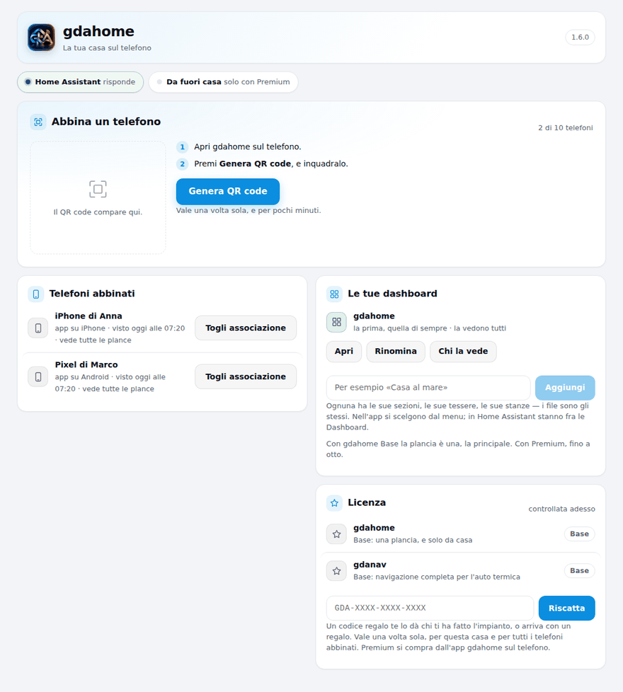
</p>

Su un computer le sezioni sono schede in alto: **Casa · Telefoni · Plance ·
Licenza · Installatore · Avanzate**. Su un telefono parti da Casa e torni
indietro con **«‹»**. Le azioni che non si possono annullare chiedono sempre
conferma.

### 20.1 Casa

In cima c'è la frase di stato:

- **«Tutto a posto»**, con una riga sul collegamento («La casa risponde, ed è
  raggiungibile anche da fuori.» oppure «La casa risponde dal Wi-Fi di casa.
  Da fuori si entra con Premium.»);
- **«C'è una cosa da sistemare»**: sotto trovi le righe dei controlli, ognuna
  con un **«Perché: …»** e il rimedio:
  - **Home Assistant**: «risponde» oppure «non risponde» (se dura, riavvia
    l'add-on);
  - **Serve riavviare Home Assistant una volta**: vedi il paragrafo 3.3;
  - **Da fuori casa**: «si entra», «spento», «solo con Premium», «non entra»
    (con il motivo; la casa riprova da sola), oppure «cade di continuo»;
  - **La plancia**: «modificata» o «di provenienza sconosciuta» (se non l'hai
    toccata tu, reinstalla l'add-on).

Poi ci sono le **quattro tessere**: **«Collega l'app»**, **«I tuoi
telefoni»**, **«Le plance»** e **«Licenza»**, e le righe **«GdAHome nel
browser»**, **«Installatore»** e **«Avanzate»**.

### 20.2 Telefoni

**«I tuoi telefoni»**: i telefoni e i tablet che entrano nella casa, con il
contatore («N di 10»). Ogni riga mostra:

- il nome e il proprietario («di Mario»);
- **«Collegato adesso»** oppure quando è stato visto l'ultima volta;
- il modello e la versione dell'app.

Il menu **«⋯»** della riga offre:

- **«Rinomina»**: scrivi il nuovo nome e premi **Salva**;
- **«Togli da questa casa»**: il telefono **esce subito**. Per rientrare dovrà
  abbinarsi di nuovo con un QR nuovo.

> **Hai perso il telefono?** Toglilo da qui: da quel momento non entra più.

Un telefono con l'etichetta gialla **«vede tutte le plance»** è stato abbinato
prima che esistessero gli intestatari. Per legarlo a una persona, toglilo e
riabbinalo.

### 20.3 Plance

La gestione delle plance è spiegata nel [capitolo 8](#8-più-plance-a-muro-colpo-docchio-casa-3d).
In breve: **«Aggiungi una plancia»**, poi per ognuna **Apri** e **Gestisci**
(«Chi la vede», Rinomina, «Togli la plancia»).

**Le regole di «Chi la vede»:**

- nessuna spunta = la vedono tutti;
- «Solo gli amministratori» e le spunte valgono insieme;
- per riaprirla a tutti, spegni l'interruttore e togli tutte le spunte;
- vale anche per la plancia principale.

### 20.4 Licenza

- La scheda grande dice **«Premium attivo»** (con la scadenza e la
  provenienza: abbonamento, regalo o installatore) oppure **«Base»**.
- **«Ricontrolla adesso»** chiede subito la licenza; la casa la ricontrolla
  comunque da sola ogni 6 ore. Usalo dopo un acquisto appena fatto.
- La tabella **«Base e Premium»** segna con «il tuo» la colonna della tua
  casa.
- **«Come si attiva»**: qui puoi scrivere un **codice regalo** (paragrafo
  16.4). Premium non si compra da questa pagina, ma dall'app.
- **«Matricola della casa»**: il codice da mandare a chi ti regala Premium.

<p align="center">
  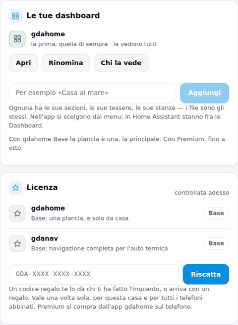
  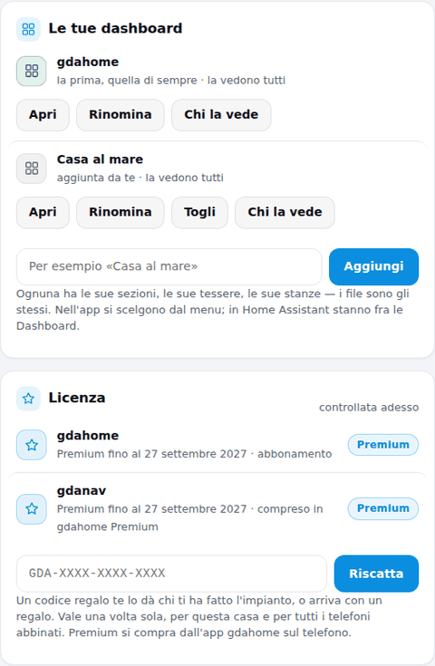
</p>

### 20.5 Installatore

Questa sezione compare solo se la casa manda un rapporto a un installatore. È
spiegata nel [capitolo 22](#22-se-la-casa-te-lha-montata-un-installatore).

### 20.6 Avanzate

- **«Versione e aggiornamenti»**: la versione dell'add-on. Gli aggiornamenti
  arrivano da Home Assistant.
- **«GdAHome nel browser»**: l'indirizzo dell'app dal browser con **«Apri nel
  browser»** (con Premium funziona da casa e da fuori).
- **«Casa di prova»**: riservata a chi deve far provare l'app (per esempio ai
  revisori dei negozi); in una casa normale non serve.

---

## 21. Le opzioni dell'add-on

In Home Assistant: **Impostazioni → Add-on → GdAHome → Configurazione**. Dopo
ogni cambio premi **Salva**: l'add-on si riavvia da solo.

### 21.1 «La casa»: le opzioni che contano

| Opzione | Di serie | Cosa fa |
| --- | --- | --- |
| **Da fuori casa** | acceso | L'app entra anche da fuori passando dal centralino, senza aprire porte. Serve anche per notifiche e segnalazioni. Spento, la casa si raggiunge solo dalla sua rete. |
| **Il codice di chi ti ha fatto l'impianto** | vuoto | Lascialo vuoto, a meno che un installatore non ti abbia dato un codice ([capitolo 22](#22-se-la-casa-te-lha-montata-un-installatore)). |
| **Ogni quanto parte un rapporto** | 1 minuto | Conta solo se il codice sopra è scritto. |
| **Lascia che chi ti ha fatto l'impianto aggiorni da lontano** | spento | Gli permette due sole cose: installare un aggiornamento già in attesa e riavviare Home Assistant. |
| **Lascia che chi ti ha fatto l'impianto configuri la plancia da lontano** | spento | Gli permette di vedere e cambiare com'è fatta la plancia (sezioni, stanze, entità). |
| **Lascia che la plancia porti il marchio di chi ti ha fatto l'impianto** | acceso | Il nome e il logo dell'installatore compaiono sulla plancia. |
| **Quanto vive un QR di abbinamento** | 5 minuti | Da 1 a 60. |
| **Dopo quanto un telefono va riabbinato** | 90 giorni | 0 = mai. |
| **Quanti telefoni insieme** | 10 | Con Base al massimo 2; con Premium senza limite. |

### 21.2 Le altre sezioni

- **«Chi installa»**: solo per chi monta GdAHome nelle case degli altri
  ([capitolo 23](#23-per-chi-installa-il-cruscotto)). In casa tua lascia
  tutto com'è.
- **«Chi gestisce il cruscotto»** e **«L'assistenza»**: servono a una sola
  casa al mondo. **Lasciale vuote.**
- **«Avanzate»**:
  - **«La porta su cui bussa l'app»** (8098): cambiala solo se un altro
    programma usa già quella porta;
  - **«Quanto scrive il registro»**: lascia «info»; scegli «debug» solo se ti
    viene chiesto per capire un problema.

---

## 22. Se la casa te l'ha montata un installatore

Il tuo installatore può tenere d'occhio l'impianto **senza entrare in casa
tua**. Sei tu a deciderlo, con interruttori che puoi spegnere quando vuoi.

### 22.1 Collegare la casa all'installatore

1. L'installatore ti dà un **codice di abbinamento**: 16 caratteri, valido un
   giorno.
2. In Home Assistant apri **Impostazioni → Add-on → GdAHome →
   Configurazione**.
3. Incolla il codice in **«Il codice di chi ti ha fatto l'impianto»** e premi
   **Salva**.
4. Entro un minuto la tua casa compare nel suo cruscotto, e in nessun altro.

### 22.2 Cosa vede e cosa non vede

**Cosa vede** (un rapporto con pochi numeri, ogni minuto):

- come sta la macchina: processore, memoria, disco, temperatura;
- la rete: internet, indirizzo di casa, segnale Wi-Fi;
- versioni, add-on e aggiornamenti in attesa;
- i titoli delle plance e quanti telefoni sono abbinati;
- i nomi dei dispositivi che non rispondono, le batterie scariche, da quanto
  non si fa un backup.

**Cosa non vede**:

- se le luci sono accese, se le porte sono aperte, quanto fa caldo;
- chi è in casa e dove sono le persone;
- cosa riprendono le telecamere;
- il nome del tuo Wi-Fi.

Il rapporto lo leggi parola per parola in **«Configura GdAHome» →
Installatore → «Leggi l'ultimo rapporto, parola per parola»**.

### 22.3 I permessi in più (spenti di serie)

Nelle opzioni dell'add-on puoi accendere:

- **«…aggiorni da lontano»**: l'installatore può installare gli aggiornamenti
  già pronti e riavviare Home Assistant. Il backup viene sempre prima.
  Nient'altro;
- **«…configuri la plancia da lontano»**: può sistemare la plancia (per
  esempio mettere nella stanza giusta una presa nuova) senza venire. In
  questo caso escono verso di lui i nomi delle tue stanze, dei dispositivi e
  delle entità, ma **mai** le immagini delle telecamere né gli stati dei
  sensori;
- **«…porti il marchio»** (acceso di serie): la plancia mostra il suo nome e
  il suo logo, così il giorno che qualcosa non va sai chi chiamare.

### 22.4 Smettere

In **«Configura GdAHome» → Installatore** premi **«Smetti di mandarlo»** e
conferma con **Smetti**. Il rapporto si ferma e il codice viene cancellato
dalle opzioni. Se compare un avviso giallo, svuota a mano la casella «Il
codice di chi ti ha fatto l'impianto» nelle opzioni e premi Salva.

---

## 23. Per chi installa: il cruscotto

Se monti impianti Home Assistant per i tuoi clienti, GdAHome ti offre il
**cruscotto per installatori** (**«Gestione installatore»**): una pagina sola
con tutti gli impianti che segui e le licenze Premium da dare ai clienti.

<p align="center">
  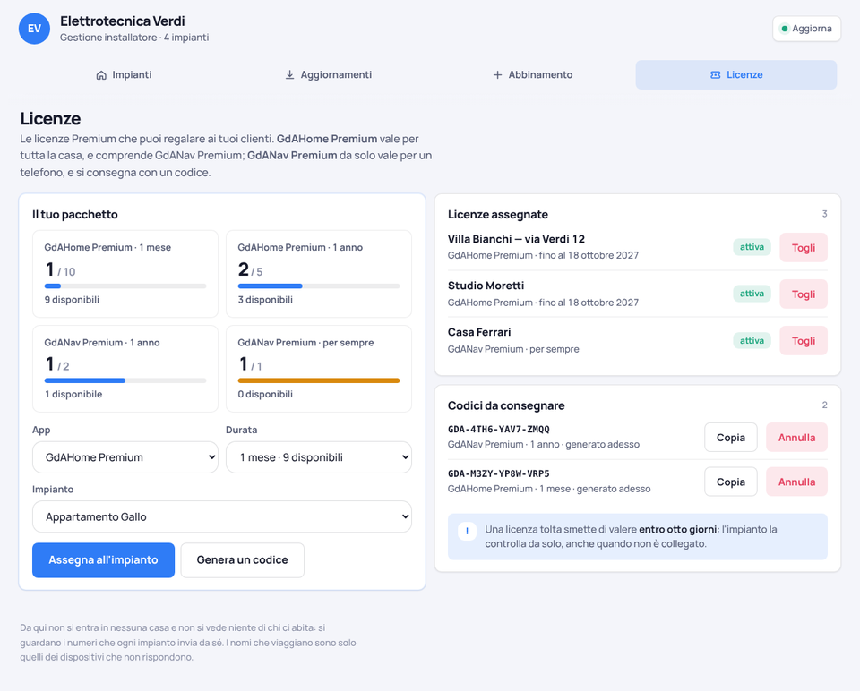
</p>

### 23.1 Come si comincia

1. **Chiedi l'accesso** dalla pagina dei contatti:
   [gdahome.org/#contatti](https://gdahome.org/#contatti). Ricevi il
   **codice del tuo cruscotto** e il tuo **pacchetto di licenze**.
2. Sul **tuo** Home Assistant (mai su quello di un cliente) apri le opzioni
   dell'add-on GdAHome, sezione **«Chi installa»**:
   - accendi **«Questo Home Assistant e' di chi installa»**;
   - scrivi il codice in **«Il codice che apre il tuo cruscotto»**;
   - premi **Salva**.
3. Compare la voce **«Gestione installatore»** nella barra laterale, nella
   scheda dell'add-on e nel menu dell'app.

Il cruscotto ha quattro schede: **Impianti · Aggiornamenti · Abbinamento ·
Licenze**.

### 23.2 Collegare un cliente (scheda «Abbinamento»)

1. Se vuoi, scrivi un **«Riferimento»** e premi **«Genera codice»**. Il
   codice vale **un giorno** e per **un solo impianto**, e si vede per intero
   solo adesso: **copialo**.
2. A casa del cliente: **Impostazioni → Add-on → GdAHome → Configurazione**,
   incolla il codice in **«Il codice di chi ti ha fatto l'impianto»** e premi
   **Salva**.
3. Entro un minuto l'impianto compare fra i **«Nuovi impianti»**: dagli un
   nome e premi **Salva** (il nome resta sul tuo cruscotto).

Puoi revocare i codici non usati da **«Codici attivi»** → **Revoca**. In
questa scheda carichi anche **«Il tuo logo»** (fino a 128 kB), che compare
sulla plancia dei tuoi clienti.

### 23.3 Tenere d'occhio gli impianti (scheda «Impianti»)

- Un **anello** colora gli impianti per stato: **in ordine**, **da
  verificare**, **offline**. I filtri sono ◎ tutti / ■ offline / ▲ da
  verificare / ● in ordine.
- **«Da verificare ora»** mette in cima gli impianti che chiedono qualcosa,
  ciascuno con **Apri →**.
- Ogni impianto ha **dieci controlli** al giorno: la plancia, i telefoni, il
  collegamento da fuori, i collegamenti dei dispositivi, gli aggiornamenti,
  gli add-on, la rete, la macchina (temperatura e disco), il backup, le
  batterie.
- Ricevi **un avviso quando una casa smette di farsi sentire** (dopo 2 ore) e
  uno quando riprende.

Nella scheda di un impianto trovi anche **Rinomina**, **Copia rapporto**,
**Rimuovi** e, se il cliente ha acceso la manutenzione, **«Riavvia Home
Assistant»**.

### 23.4 Aggiornare da lontano

Solo sugli impianti in cui il cliente ha acceso **«…aggiorni da lontano»**.
Nella scheda **Aggiornamenti** (o in quella dell'impianto) premi
**Installa**, poi premi di nuovo per confermare. Il backup viene sempre
prima, e si installa un aggiornamento alla volta.

### 23.5 Nomi, logo e configurazione della plancia

Nella scheda di un impianto, sezione **«Le plance»**:

- dai a ogni plancia il **«Nome della plancia»** e il **«Nome all'avvio»** e
  premi **Salva**: arrivano in casa con il rapporto successivo;
- con **«Una plancia in più»** ne crei una nuova;
- con **Configurazione** apri l'editor della plancia. Funziona solo se il
  cliente ha acceso **«…configuri la plancia da lontano»**, e le modifiche la
  casa le ritira al passaggio successivo.

### 23.6 Le licenze per i clienti (scheda «Licenze»)

Il tuo **pacchetto** è diviso per durata (per esempio 10 da un mese, 5 da un
anno, 2 per sempre) e può contenere licenze GdAHome Premium e GdANav Premium.

1. Scegli **App** e **Durata**.
2. Poi scegli una delle due strade:
   - **assegnarla a un impianto**: scegli l'impianto e premi **«Assegna
     all'impianto»**. La casa è Premium subito, e il cliente non deve fare
     niente;
   - **generare un codice regalo**: premi **«Genera un codice»** e mandalo al
     cliente, che lo scrive in **Premium → «Ho un codice regalo»**. La durata
     parte da quando lo riscatta.

Una licenza tolta (**Togli**) o un codice annullato prima dell'uso
(**Annulla**) **torna nel tuo pacchetto**.

### 23.7 Cosa non vedi

Non apri la plancia del cliente e non entri in casa sua: ricevi numeri, non
nomi. Stanze, persone e telecamere restano sue.

---

## 24. Se qualcosa non va

| Cosa succede | Cosa fare |
| --- | --- |
| Il QR non funziona | Vale 5 minuti e una sola volta: generane uno nuovo. Oppure usa il codice a mano (4.4). |
| «Fuori casa serve GdAHome Premium» | Con Base la casa si apre solo dal Wi-Fi di casa. Rientra in casa, oppure attiva Premium. |
| Da fuori non entro, ma ho Premium | In «Configura GdAHome» → Casa leggi il motivo sotto la riga «Da fuori casa». Controlla che l'opzione «Da fuori casa» sia accesa. Se compare «cade di continuo», c'è un'altra copia della casa accesa (per esempio un backup ripristinato su un'altra macchina): spegni GdAHome sulla copia in più. |
| «Riconnessione…» | Succede per qualche minuto mentre l'add-on si aggiorna o Home Assistant si riavvia: l'app riprova da sola. |
| «Questo telefono è stato staccato» | Riabbinalo con un QR nuovo. |
| «Con Base si abbinano al massimo 2 telefoni» | Sono rimasti abbinati i due telefoni usati più di recente. Con Premium riabbini anche questo. |
| «Non hai plance associate alla tua utenza» | L'amministratore deve abilitarti: «Configura GdAHome» → Plance → Gestisci → «Chi la vede». |
| Nell'app compare «Home Assistant va riavviato una volta» | Riavvia Home Assistant (paragrafo 3.3). |
| «La plancia vuole un indirizzo sicuro» | Nel browser serve https: apri la plancia da un indirizzo https, oppure usa l'app. |
| Le notifiche non arrivano | Controlla l'interruttore principale in Notifiche, il permesso del telefono, l'opzione «Da fuori casa» e che il telefono sia intestato a un utente. Poi premi «Manda una notifica di prova». |
| La Salute non arriva | Paragrafo 12.2. |
| L'app va a scatti | Accendi «Plancia leggera» (17.1). Se non basta, manda una segnalazione con la foto di «Diagnostica app». |
| La voce «Zigbee» non c'è nel menu | Serve ZHA o Zigbee2MQTT in casa, Premium e l'app sul telefono (non il browser). |
| Nella barra laterale c'è una voce in più che dà «Errore di configurazione» | È della vecchia integrazione DashboardModern: toglila da Impostazioni → Dashboard. |
| Ho perso il telefono | «Configura GdAHome» → Telefoni → ⋯ → «Togli da questa casa». |

Se il problema resta, scrivi in **Assistenza** oppure apri una
**Segnalazione** ([capitolo 19](#19-segnalazioni-e-assistenza)).

---

## 25. Domande frequenti

**Si installa su Home Assistant in Docker?**
No: su Container e Core non esistono add-on. Serve OS o Supervised (capitolo
2).

**L'add-on serve solo per usare l'app?**
No. La plancia compare anche in Home Assistant e si usa da qualunque browser
di casa. Con l'app diventa una casa in tasca.

**Devo installare anche l'integrazione DashboardModern?**
No: la plancia è già dentro l'add-on, e una configurazione esistente viene
ripresa alla prima apertura.

**Siamo in quattro in casa: paghiamo quattro volte?**
No. Premium è della casa: tutti i telefoni abbinati e l'app dal browser sono
Premium insieme, senza limite di telefoni.

**Il mio installatore mi ha dato un codice. Dove lo metto?**
Dipende dal codice:
- un **codice regalo** (`GDA-…`) va nell'app, in **Premium → «Ho un codice
  regalo»**, oppure in «Configura GdAHome» → Licenza;
- un **codice di abbinamento** (16 caratteri) va nelle opzioni dell'add-on,
  in **«Il codice di chi ti ha fatto l'impianto»**.

**Devo creare un account?**
No, nessun account.

**Qualcuno può vedere le mie telecamere o i miei dati?**
No. I dati restano in casa. Da fuori i messaggi viaggiano cifrati fra
telefono e add-on, e il segreto di Home Assistant non lascia mai l'add-on.

**Le automazioni create dall'app funzionano ad app chiusa?**
Sì: sono automazioni vere di Home Assistant e le esegue la casa.

**Cosa succede se disdico Premium?**
Non perdi niente: la casa torna Base e quello che hai preparato resta salvato
(paragrafo 16.6).

**Posso usare l'app in inglese?**
Sì. L'app parla italiano e inglese e sceglie la lingua del telefono.

**Dove finiscono le segnalazioni?**
Nelle [segnalazioni pubbliche del progetto](https://github.com/danigio15/gdahomeapp/issues),
senza bisogno di un account GitHub. Per una domanda privata usa
**Assistenza**.

---

## 26. Privacy, contatti e chi c'è dietro

**I tuoi dati.** I dati della casa restano in casa: nessun account, nessuna
pubblicità, nessun tracciamento. Per sapere se una casa è Premium, l'add-on
manda solo un identificativo anonimo della casa. I pagamenti li gestiscono
Google e Apple: a GdAHome non arrivano né il tuo nome né i dati della carta.
I dettagli sono nell'[informativa sulla privacy](https://gdahome.org/privacy.html)
([PRIVACY.md](PRIVACY.md)) e nei [termini d'uso](TERMINI.md).

**Contatti.**
- Dentro l'app: **Assistenza** (la via più veloce) e **Segnalazioni**.
- Sito: [gdahome.org](https://gdahome.org), con il modulo nella sezione
  contatti.
- Email: **domotica@crvgroup.it**.

**Chi c'è dietro.** GdAHome la fa **CRV Immobiliare S.r.l.**, impresa di
impianti elettrici e tecnologici di Aversa (CE), abilitata ai sensi del D.M.
37/2008. Premium, per GdAHome e per GdANav, lo vende CRV Immobiliare S.r.l.
attraverso l'App Store e Google Play.

---

<sub>Manuale aggiornato a GdAHome 1.19.1. Alcune schermate potrebbero
differire leggermente nelle versioni successive.</sub>
